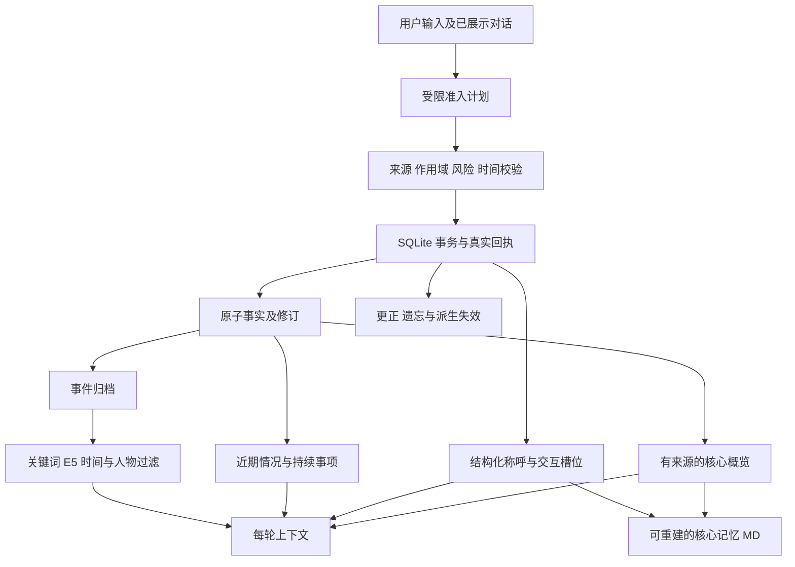

# 陪伴机器人记忆系统设计与实施方案

版本：3.0 设计稿。日期：2026-10-25，Asia/Shanghai。项目：companion-harness。

状态：待实施。本轮只新增设计与文档索引；不修改运行代码、数据库、聊天记录、模型配置或向量开关。本文中的接口、表、参数和测试编号均为实施合同，不代表已实现或已通过。

本方案将日常记忆改为自动形成，以小型常驻档案、滚动近期情况、按需长期召回支持陪伴连续性。称呼和明确相处边界使用结构化字段；用户能通过聊天纠正和要求忘记，无需逐条审批日常记忆。SQLite 继续保存权威记录，MD 是可重建的可读导出；保留现有 E5 混合检索、来源证据、修订与遗忘能力。

本文是下一阶段产品语义和工程实施入口。[v1.1 工程方案](memory-engineering-plan.md)保留历史：其中逐条确认、聊天仅登记候选、只有人工 confirmed 可读等规则，在启用本方案的隔离 v3 实例中被本文替代。未启用 v3 的正式实例继续采用原行为。执行安全、工具授权、用户与 bot 隔离、来源有效性和删除恢复规则仍须保留。

## 1 产品目标与范围

### 1.1 用户应该感受到的行为

用户正常分享生活，机器人自然回应并逐渐了解用户。明确介绍的称呼和日常偏好能在后续交流中使用；聊天不会连续出现“要记住这件事吗”“已经登记为待确认”等办理信息。

机器人应能区分用户、朋友和虚构人物；理解今天临时改变与长期更新；接续持续事项；在适当场景使用过去的信息。记忆为空或暂时读不到时表达当前依据不足，不编造经历或宣布全库没有记录。

“重要信息一定在场”的工程含义是：每轮请求携带当前有效称呼、禁用称呼与明确交互边界，并测试模型是否遵守。它不等于承诺模型永不出错、所有旧事必然召回或存储永久存在。

### 1.2 本阶段交付

1. 自动记忆准入与实际事务回执。
2. 结构化称呼、当前有效值与历史版本。
3. 有独立预算的核心档案及 MD 导出。
4. 近期情况、持续事项、事件记忆和来源回查。
5. 统一的结构化读取与关键词加 E5 召回。
6. 聊天内更正、撤回和遗忘，以及全部派生视图失效。
7. 用户可选的记忆管理界面，替换日常确认卡片。
8. 预算、故障恢复、观察指标、冻结评测与隔离发布流程。

本阶段继续使用现有数据库和模型提供方，不引入独立向量数据库、通用知识图谱服务或新的外部个人数据接收方。提醒、通知、外发消息和日程执行沿用各自授权，不能因记住一件事而自动执行。

## 2 已核对的基线与需要改变的行为

本项目没有 Git 元数据。本次源码基线另存于 [v3 设计源码基线](companion-memory-v3-source-baseline.json)，通过 SHA-256 标识文件状态，不编造 commit。

| 现有部分                                          | 已核对行为                                                                  | v3 的处理                                                                    |
| ------------------------------------------------- | --------------------------------------------------------------------------- | ---------------------------------------------------------------------------- |
| `src/domain.ts`                                   | Memory 含来源、状态、certainty、主体和时间字段，缺少专门称呼槽位            | 保留 Memory 主记录，增加准入元数据和有约束的槽位引用                         |
| `src/memory/reading.ts` 与 `Store.qualifiedFacts` | 普通事实要求 active/confirmed                                               | v3 接纳合法提交的 user_stated 记录；不能假装用户点过确认                     |
| `src/memory/capture.ts`                           | 自动提取形成 pending；显式保存也只登记提取                                  | 改成低风险事实自动准入；内部待处理不再成为用户工作队列                       |
| `src/memory/operations.ts`                        | 聊天写入能力为 interface_only，成功操作清单为空                             | 从实际准入事务生成受限能力和真实回执                                         |
| `src/context.ts`                                  | 置顶与普通事实共预算，极端情况下均可裁剪                                    | 核心字段单独保护，近期与召回内容按确定顺序收缩                               |
| `src/memory/retrieval.ts`                         | 小规模全量、大规模 E5 混合；有冷加载及降级状态                              | 保留，扩展统一资格函数和事件检索目标                                         |
| `src/harness.ts`                                  | 生成后执行 facts 与 operations 双检；最多六次模型调用；执行过工具不自动修复 | 保留语义严格度；增加受预算约束的准入阶段、评审故障恢复与只读结果后的文字修复 |
| `src/store.ts`                                    | 只接受 schema 1/2，`hasMemoryV2` 为版本等于 2                               | 明确增加 schema 3 能力检查；禁止简单改成降版本打开                           |
| `web/app.js`                                      | 候选卡片与维护页确认是主要入口                                              | 日常卡片退出默认聊天；管理页承担查看、更正、删除与撤销                       |
| `src/backup.ts`、证据和删除链路                   | 有来源修订、UTF-16 区间、删除台账和恢复过滤                                 | 扩展到档案、持续事项、回执、MD 与模型读取屏蔽区间                            |

最新隔离实测为：656 项自动化测试通过、浏览器回归 8/8；新增冻结题 8/8，原 40 题最终重跑 38/40。严格评审兼容集为 79/80。历史结果详见[保存承诺报告](../implementation/memory-commit-release.md)，这些数字不是 v3 验收成绩。

必须保留并解决的已知问题：

- u02：只读检索后生成越界的“没有记录”，被正确拦截，用户没有收到回答。
- u07：facts 评审输出截断，未完成校验，用户没有收到回答。
- `generated-q28-0`：把相关属性的有限列举误解为全部记忆清单，属于评审误拦。
- 自动提取会把提问、办理意愿写成候选，并可能与真正偏好重复。

## 3 调研依据与适配决定

调研日期为 2026-10-25。产品文档支持公开行为，不能据此推断其私有存储格式、Embedding 型号或真实成功率。

| 证据                                                                                                                         | 可采用的机制                                               | 本项目的决定                                                           |
| ---------------------------------------------------------------------------------------------------------------------------- | ---------------------------------------------------------- | ---------------------------------------------------------------------- |
| [Kindroid Memory](https://kindroid.ai/v2/docs/memory/)，更新于 2026-10-13                                                    | 常驻、中期与按需记忆；自动学习重要事实、关系发展和持续话题 | 采用分层及持续事项；容量参数自行验证，不复制订阅配置                   |
| [Nomi Mind Map](https://nomi.ai/updates/mind-map-2-0-bringing-nomi-memory-into-view/)                                        | 从详细记忆形成自动更新的概览，允许纠正                     | 增加短概览与实体标识，首版不引入图数据库                               |
| [Nomi Identity Core](https://nomi.ai/updates/introducing-the-nomi-identity-core-fostering-dynamic-and-authentic-identities/) | 对机器人身份及关系的连续理解                               | 用户档案、角色人格、相处约定分别表达；不允许记忆自动改写系统人格与权限 |
| [Replika Memory](https://help.replika.com/hc/en-us/articles/37208679176077-How-does-Replika-s-memory-work)                   | 自动形成记忆，用户可另外查看和添加                         | 日常自动写入，可选管理；不复制关于“更懂用户”的效果承诺                 |
| [Character.AI Memory](https://blog.character.ai/memory/)，2026-05-21                                                         | Facts 自动保存，区分人物；手动重要内容受保护               | 主体与作用域先于相关性；保护明确核心字段                               |
| [Letta 核心记忆块](https://docs.letta.com/v1-sdk/memory/memory-blocks)，V1 SDK 文档                                          | 重要信息常驻上下文，无需检索                               | 采用常驻块原则，不引入旧版 SDK 或整套 Agent 框架                       |
| [Zep Context Types](https://help.getzep.com/context-types)                                                                   | 区分概况、时间事实、事件原文与对话摘要                     | 采用对象区分与生效时间，继续使用本地 SQLite                            |
| [LongMemEval](https://arxiv.org/abs/2410.10813)                                                                              | 提取、跨会话、时间、更新与适当表示未知的评测               | 纳入外部基准和分能力统计，不用单一综合分替代                           |
| [LoCoMo-Plus](https://arxiv.org/abs/2602.10715)                                                                              | 未直接询问旧信息时，仍要应用相关限制                       | 增加自然对话与间接约束任务                                             |
| [ZifaMem](https://arxiv.org/abs/2607.17564)，预印本                                                                          | 结构化记忆承载关系与情感连续性                             | 只借鉴分层与评测维度；作者实验不作为本项目收益保证，不添加情绪状态机   |

结论是采用“自动形成、有来源、可纠正”的产品规则。MD、向量服务与特定框架均不是产品连续性的充分条件。

## 4 记忆层次与权威数据



### 4.1 核心档案

核心字段包括当前称呼、禁用称呼和明确交互边界；软性概览包括少量稳定偏好、重要背景和用户明确表达的相处方式。字段用于精确决策，概览保留有依据的背景。

“忙的时候先别连续追问”可以成为用户表达的相处偏好；频繁晚睡不能自动升级为“夜猫子”，一时难过不能成为永久心理标签。相处约定不能推导现实依赖、排他关系或提醒执行权限。

核心概览是可重建的派生视图，每条概括关联支撑事实和来源。机器人自己生成的赞美、猜测与角色设定不能成为用户事实的来源。

### 4.2 近期情况

包含有限近期原文、当前会话摘要、近况和持续事项。七天只是近期摘要候选的初始时间范围，不是删除线；仍在进行的事情可跨越这个范围。

区分用户计划、实际结果与机器人建议。例如“下周面试”形成 planned 事项；日期经过只能变成 awaiting_update，不能推断已完成、已通过或需要发通知。

### 4.3 长期归档

归档原子事实、用户报告的经历、已展示的共同聊天事件、偏好变化与阶段结果。现实经历、角色扮演与机器人背景分开保存。可通过结构化条件、关键词、向量和来源展开找回，不全量塞进上下文。

### 4.4 权威关系

- `memories` 和受事务保护的结构化指针是权威记录。
- 核心概览、摘要、向量、MD 均为派生内容，不能反向授予写权限。
- 源消息、证据和修订证明某人表达过什么，不证明现实事实已被独立核实。
- 原聊天的显示、模型可读取内容、可长期保存内容分别管理，不能用“没写长期记忆”暗示原文没有保留。

## 5 自动记忆规则

### 5.1 用户设置

新增每个 bot 独立的 `memoryFormationMode`：

| 值              | 自动形成                       | 用户明确保存 更正 遗忘                                       |
| --------------- | ------------------------------ | ------------------------------------------------------------ |
| `automatic`     | 允许符合本方案的日常低风险资料 | 执行真实命令，不再次征求相同意愿                             |
| `explicit_only` | 不从普通陈述自动形成长期事实   | 明确指令仍可执行；单轮临时信息仍可用于回答                   |
| `off`           | 不新增或更新一般记忆           | 明确保存时如实说明功能关闭；遗忘、删除和交互边界控制仍可使用 |

旧 `autoExtract=false` 映射到 `explicit_only`，不能因升级替用户重新开启自动学习。关闭形成不删除已存资料，也不等同于停用读取；界面分开说明。明确称呼、禁用称呼与停止类交互控制独立于一般画像学习，暂停新增时仍可显式变更，并在界面作为交互设置展示；它们不能因关闭自动学习而失效。

`memoryPolicy`和schema是程序能力选择，`memoryFormationMode`是用户选择，不能互相替代。schema3的安全回退保持v3读取能力，仅暂停新形成；不能切回旧资格过滤使已提交的user_stated资料无声消失。

新功能只在未来明确启用的隔离实例应用。是否跨 bot 共享资料不在此次设置中默认开启。

### 5.2 准入矩阵

| 输入类型                                      | 保存位置与状态                                       | 正文行为                               |
| --------------------------------------------- | ---------------------------------------------------- | -------------------------------------- |
| 明确的日常偏好 稳定习惯                       | 自动提交 user_stated 事实                            | 自然聊内容，无逐条确认或流程播报       |
| 长期称呼 明确禁用称呼                         | 原子记录加结构化槽位，提交即生效                     | 使用有效称呼，不要求点卡片             |
| 今天的尝试 临时称呼                           | 近期记录或有到期条件的覆盖槽位                       | 仅按当前范围使用，不替换长期值         |
| 用户明确要求记住的低风险信息                  | 前台提交并产生实际回执                               | 可自然简短确认已记住；不承诺永久召回   |
| 用户纠正自己的资料                            | 按谓词与时间处理新旧版本                             | 采用新值，成功后可如实说明更正         |
| 提问 假设 引用 办理意愿                       | 不生成对应现实事实                                   | 回答问题；“想保存”不能再成为一条事实   |
| 助手猜测或对用户的推断                        | 不进入核心或确定事实                                 | 必要时保持不确定，不固化人格标签       |
| 多义主体或不清楚的目标                        | 内部暂缓，不默选覆盖对象                             | 为理解内容澄清，不问“要不要记住”       |
| 明确不长期保存                                | 对对应内容设置写入排除                               | 可在本轮理解，不进入后续摘要和长期记忆 |
| 密码 Token 密钥 身份证或支付凭证              | 禁止进入记忆、概览、MD、向量                         | 如实说明无法作为记忆保存，不复述敏感值 |
| 诊断 财务状况 精确住址 私人联系方式等敏感资料 | 默认不自动形成长期记忆；主动保存请求按专门白名单判定 | 日常聊天不弹敏感信息确认卡片           |

低风险、敏感和禁止项由版本化策略与明确字段分类共同决定。模型风险标签不能覆盖程序禁存规则；未知类别保守暂缓。首版只自动接纳明确用户陈述，不从行为统计自动构建性格、健康或亲密程度画像。

拒绝与允许按原子断言及其证据区间处理。例如同一消息中“不保存住址，但记住我喜欢爵士”，不能因为全句出现拒绝词而丢掉全部内容，也不能把住址写进概览。

### 5.3 表达语义

真实提交成功后允许“好，小岚，记住了”这类自然回应。普通分享不要求主动宣布记忆行为；没有成功回执不得宣称已保存、已替换或已删除。

显式保存失败或只完成一部分时应简短如实说明，不用“永远记住”“下次一定知道”遮盖失败。用户没有询问流程的普通聊天，不播报事务、索引或内部队列。

这替代 v2 一律禁止回应保存动作的规则，但不降低真实性要求。

## 6 数据模型与结构化称呼

### 6.1 作用域

所有新表、缓存键、回执与后台任务包含 `ownerUserId`、`relationshipId`。首版用户档案仍在当前 bot 的关系作用域内保存，不读取其他 bot 的私有资料。

再包含 `subjectId`、`realityScope` 和必要的 `worldId`。现实与虚构数据不能只靠提示词隔离；同名人物不因相似度而自动合并。用户实体使用当前 owner 的稳定标识；朋友、家人和角色使用独立实体 ID。无法确定两个名称是否同一个人时，保留分离。

### 6.2 扩展现有 Memory

继续使用 `memories` 主记录。新增 v3 `admission` 元数据，不把自动写入伪装成手动 confirmed。

```ts
type AdmissionV3 = {
  policyVersion: "companion-memory-v3";
  state: "committed" | "quarantined";
  origin:
    "explicit_user" | "automatic_user_statement" | "legacy_user_confirmed";
  verification: "user_reported" | "externally_verified" | "not_applicable";
  mutationId: string;
  learnedAt: number;
  observedThroughSeq: number;
  subjectId: string;
  scopeKind: "relationship" | "segment" | "until";
  scopeId?: string;
  validUntil?: number;
  riskClass: "ordinary" | "sensitive_explicit";
};
```

新自动事实可以是 `active/stated + admission.committed`。长期已提交记录没有默认7天到期；`validFrom/validTo`表达事实的有效时间，临时作用域的`validUntil`限制使用范围，内部计划正文清理期限不参与事实真值。`certainty` 继续表达原陈述的性质，`admission` 表达是否被程序接纳；两者不能混用。首版不自动生成 externally_verified。

通用 `predicate` 不能完全依赖自由文本。维护小型谓词注册表，明确单值或多值、比较规则、允许对象、时间与风险。首批结构化键覆盖称呼、禁用称呼和明确交互偏好；音乐等一般偏好可用多值事实，暂不为每种生活主题造独立表。

v3 统一资格函数同时检查作用域、准入、来源、有效期、排除区间、删除台账和读取截止。SQL 预筛、内存缓存、全量模式、FTS、向量 delta、来源展开和评审投影必须使用相同资格语义，不能只修改 `eligibleFact` 而遗漏 `qualifiedFacts` 的 SQL。

### 6.3 新增表

物理 schema 升到 3，未来迁移脚本明确执行；本轮不运行迁移。

| 表                    | 权威内容与约束                                                           |
| --------------------- | ------------------------------------------------------------------------ |
| `memory_entities`     | 作用域内实体 ID、别名和证据；别名不直接证明同一身份                      |
| `profile_slots`       | 结构化键到当前 Memory 修订的指针，按主体 范围 场景唯一；与事实同事务更新 |
| `profile_views`       | 核心概览的派生快照，含支撑 ID、版本、最早失效时间和预算统计              |
| `ongoing_threads`     | 计划 状态 结果和时间条件，记录来源及可见版本；不创建 Delivery            |
| `memory_mutations`    | 幂等命令、申请与实际结果、受影响 ID 和版本；不无限复制正文               |
| `memory_suppressions` | 不保存与遗忘所需的对象指纹、来源区间、适用范围和重新学习条件             |

沿用 `memory_dependencies`、`memory_state`、`memory_embeddings`、`memory_index_state` 与会话摘要表。不得创建另一个无同步合同的事实主库。

事务外生成自然语言概览、向量和 MD。SQLite 事务只包含检查与记录更新，不能跨网络或模型等待。

### 6.4 称呼槽位

| 键                        | 值的含义                           | 基本更新规则                                   |
| ------------------------- | ---------------------------------- | ---------------------------------------------- |
| `self_reported_name`      | 用户自我介绍的姓名，仅表示用户说过 | 不当作法定身份核实，不覆盖已有偏好称呼         |
| `preferred_address`       | 当前关系中长期希望被叫的名字       | 新的明确长期称呼替换指针，历史事实保留         |
| `address_override`        | 当前交流段或到指定时间的临时称呼   | 到期后恢复长期值，不写回长期槽位               |
| `forbidden_addresses`     | 明确拒绝的叫法集合                 | 添加与撤销分开，有独立证据；不被新昵称顺手清空 |
| `interaction_preferences` | 用户明确要求的交流方式             | 使用有限、可解释的字段，不变成系统人格任意改写 |

解析顺序为：当前用户明确要求和禁用约束 → 有效临时覆盖 → 长期偏好称呼 → 用户自我介绍姓名 → 已发布人格默认称呼。用户当轮明确撤销某个禁用值时，先按本轮新的明确指令更新，避免旧禁用永久压过用户的新选择。

“叫我小岚”作为明确称呼指令，默认作用于当前关系；“今天叫我小桥”只设临时值；“他叫小岚”不改用户槽位；“戏里叫我阿棠”只进对应 world。昵称不能被当作法定姓名。“我叫林然，不过叫我小林就好”可分别记录用户报告姓名和偏好称呼，两者不会互相替换。

“今天”到期点按用户时区的下一个当地午夜计算，处理 DST，不能用 now 加 24 小时。“这段聊天”绑定内部交流段，不因页面刷新结束；“这轮”绑定当前 Run。范围不明时不自作永久更新。

每轮生成前和发布前检查 `validUntil`；跨午夜或换段造成的失效即使没有后台版本递增，也不能继续使用缓存临时称呼。

### 6.5 更新与冲突

单值谓词按明确更新顺序、来源语义和生效时间更替，不以后台任务完成时间或向量相似度决定最新值。旧任务的 `observedThroughSeq` 低于现行槽位时不能覆盖。

“我现在改喜欢银色”是偏好变化，旧值的历史有效期结束；“之前记错了，我一直喜欢银色”是纠错，不能伪造一段真实偏好变化史。“两个我都喜欢”不应按单值替换。问“我以前喜欢什么”使用历史查询，不把旧值当现在有效值。

普通冲突保留来源并暂缓有歧义的覆盖。当前输入仍可用于本次回答，暂缓不能变成继续坚持旧值。

### 6.6 核心选择与概览更新

关键字段由槽位白名单决定，不能由模型给一条普通记录打高分就获得系统指令优先级。软性概览只从已接纳、有效、当前作用域匹配的原子资料选择。

选择按固定优先级排序：用户明确表达的重要性（须有证据）→ 当前持续事项相关的重要背景 → 多个独立用户来源支持的稳定资料 → 近期相关资料 → 稳定ID。重复提取同一来源和助手自己重复的话不增加支持次数；重要性只影响选择，不证明内容更真实。具体主题不写入排序特例。

超过500 token的软性部分按此顺序收缩，未选内容仍保留归档。用户要求“这很重要”提高选择优先级，但不能把无限信息都变成硬常驻；回应保存成功也不能暗含每轮全部载入的保证。明确的行为边界进入受限交互槽位，而非混在自由文本背景里。

提交新事实只标记概览dirty并记录wantedVersion，不每轮生成长概览。初始维护合并等待60秒，最早dirty后最多5分钟安排一次；同一关系最多一个维护任务。生成期间又发生变化，只允许匹配版本提交或重排一次，不并发写多个相互覆盖的概览。

当前概览过期、依赖无效或尚未形成时，按同一选择规则直接投影有效原子事实作为后备，不等待后台模型，也不用陈旧MD代替。自然语言概览的每条陈述必须能回到来源集合；模型新推断不因写入概览而获得事实资格。

## 7 写入事务与运行流程

### 7.1 准入计划

新增 `src/memory/intake.ts`。每条普通用户输入先经过一次小型结构化准入调用，复用当前用户已授权的模型提供方。输入只含当前用户消息、必要的已展示上一条助手内容、实体/槽位候选和时间；不发送整库或完整聊天。

计划表达主体、谓词、值、时间范围、肯否定、意图、风险和逐条证据。助手上轮问“你周末通常做什么”，用户回答“爬山”时，上轮内容可解释语境；事实必须仍由用户回答支持，助手建议本身不能变成事实。

准入本身先做输入预算预检；过长消息不能截半条去存，再把后半条丢掉。必要时返回明确的分段输入错误，原消息保留，未执行项如实记录。

这次调用代替依赖保存关键词的总路由。有限语法可作优化，但不能决定全部保存、更正或遗忘资格。引用、假设、指代、否定及多主体均属于结构化解析与回归范围。

一次最多申请 8 个原子变更。超出部分登记为有明确范围的后续工作，回执标记 partial；不能声称全部保存。首版对歧义计划宁可不写，直接继续当前对话或澄清对象。内部quarantined计划不自动升级，也不等待用户逐条审批；7天后清掉临时计划正文，保留非内容状态与原始来源引用。新澄清输入走新的准入，不能通过后台重试猜出一个结论。

准入调用的语义判断仍可能出错。来源切片校验只能证明原文存在，不能独自证明解释正确；因此使用受限谓词、保守准入、毒化输入测试、可撤销历史和真实对话评估共同控制风险，不能把“有来源”宣传成“自动判断必然正确”。

### 7.2 命令接口

以下是新增内部接口合同，模型不直接调用数据库或指定任意表。新表必须有作用域复合索引及唯一约束，指针引用在事务内校验目标所属关系，禁止只凭全局ID跨关系读取。

```ts
type MemoryCommand = {
  type: "add" | "replace" | "set_override" | "retract" | "forget";
  subjectId: string;
  predicate: string;
  value?: unknown;
  targetId?: string;
  expectedRevision?: number;
  scope: {
    kind: "relationship" | "segment" | "until";
    id?: string;
    until?: number;
  };
  primaryEvidence: EvidenceRef[];
  contextEvidence?: EvidenceRef[];
};
type MemoryReceipt = {
  mutationId: string;
  inputId: string;
  inputRevision: number;
  status: "committed" | "noop" | "partial" | "quarantined" | "failed";
  operations: { action: string; id: string; revision: number }[];
  memoryVersion: number;
  contextVersion: number;
  reason?: string;
};
```

`owner`、`relationship`、当前输入顺序、来源资格、策略版本、mutationId 和实际回执由服务端填入。客户端或模型粘贴的回执 JSON 不能成为执行权限。`replace` 必须有旧目标与预期修订；自由文本“全部删掉”在对象不明时不能自动扩大为整库删除。

### 7.3 原子提交

1. 收到用户输入时按现有入口持久化消息与顺序，检查取消和显式停止类控制。
2. 事务外生成准入计划。一次计划同时解析允许与不允许保存的各个区间。
3. 服务端校验字段白名单、当前作用域、主要用户证据、UTF-16 边界、来源修订、风险、时间与排除规则。
4. 使用 `intake:{inputId}:{inputRevision}:{policyVersion}` 作为父幂等键，保存计划指纹。相同键不同申请返回 conflict，不额外生成第二条事实。
5. 短事务内重查 epoch、generation、来源和预期修订；写事实/指针/屏蔽/依赖/索引 dirty 状态，并同步更新版本和回执。
6. 更新模型内存快照，登记后台概览、摘要、向量与 MD 工作。新事实在向量未完成时即可被结构化读取和 delta 路径看到。
7. 生成回复并执行发布检查；回执只来自步骤 5。

可在明确、互不依赖的操作之间给出逐项结果；同一槽位替换、旧值失效、新值提交和指针变更必须原子完成。批内存在互相矛盾的命令时不按数组顺序随意选最后一项，先解析成一个有明确语义的最终计划。

CAS 冲突最多重新读取一次。旧输入的迟到结果不能覆盖较新用户更新。事务失败不得发布成功回执，也不得留下只改指针、未改事实的半成品。

### 7.4 提交与回复的关系

记忆提交成功后，即使回复生成失败或用户随后取消，已经被授权且提交成功的记忆仍保留；停止回复不自动等于撤销用户已说过的信息。取消发生在事务提交前时，不执行该批写入。删除来源和明确撤回会使相关记录失效，优先级高于迟到的模型结果。

回复修复、重试或重启不能重放准入事务。重启先读取父幂等记录和回执；提交已成功但回执尚未展示时，恢复到事实状态，不重建一条相同记忆，也不自动继续被中断的聊天。

### 7.5 调用与截止预算

采用清楚可计量的上限，不把准入请求挪到“后台”来逃避前台费用统计。

| 阶段                     | 正常调用数        | 上限说明                                         |
| ------------------------ | ----------------- | ------------------------------------------------ |
| 输入准入                 | 1                 | off 模式也只解析允许的控制命令；普通画像写入关闭 |
| 回复生成                 | 1 至 2            | 最多一次只读工具往返；预检索优先由程序执行       |
| facts 与 operations 检查 | 2                 | 同一快照下可并行，均须通过                       |
| 一次完整文字修复与双检   | 最多 3            | 不重新准入、不执行工具、不重复副作用             |
| 评审格式或截断恢复       | 全 Run 最多额外 1 | 必须在总额中有剩余空间；不得替代语义判定         |

v3 前台模型调用硬上限暂定 **8 次**，正常无工具回合为 4 次；端到端硬截止沿用 60 秒。预算使用“已花费加下阶段所需预留”判断，不能在没有剩余三次额度时启动完整修复。一次恢复和一次修复不保证能同时执行，达到上限即如实失败。

这明确改变 v2 的六次上限，以容纳真实准入和有界恢复；它不是评分标准放宽。延迟与费用须和 v2 在相同模型、同一设备及同一组题上对照。若准入显著破坏陪伴体验，先优化小型计划输入与并行读取，再单独评估合并调用；不能偷偷跳过来源或发布检查。

后台维护沿用独立 Job、25 秒单调用截止、总费用与重试限制。后台不发送聊天或通知，不享有新执行权限。每轮和每任务均记录实际模型身份、用量与未知用量，未知不能计为零。

## 8 回复真实性与评审恢复

### 8.1 实际状态输入

`memoryOperations` 改为由当前 Run 的回执构造：允许的动作、已提交操作、失败/部分状态及适用范围。已有记忆状态与本轮写入分开交付；历史确认事实仍可自然回忆。成功操作ID必须解析为该事务实际变更的主体、谓词、修订、有效期和受限内容摘要，以独立的 committedFacts 提供给检查器；不能让一个不透明ID证明任意“我存了什么”的陈述，也不能因普通召回裁剪而丢掉本轮回执所需依据。

operations 检查只允许成功回执支持“本轮已保存、更正、删除”。失败、登记和排队不能冒充提交；真实保存也不能支持“以后每个窗口必然记得”。用户当前明确更正可以用于本次选择，只有相应事务成功才能宣称旧记录已经更新。

facts 检查使用本轮实际读取覆盖范围、当前用户输入和有效核心字段。structured exact 读取成功不等于查遍全部历史；空结果、部分结果和不可用均不得转成存储不存在。

### 8.2 修复路径

保留两个独立检查和精确引句校验，不合并成长提示词来凑一次调用。无关风格不进入记忆违规评分。

只读搜索或来源展开后，若事实检查失败，允许在保留完整工具结果的前提下进行一次文字修复。修复请求 `tools=[]`，不重新运行搜索，不重放准入和其他写入；有未处理的副作用工具或不完整工具组时不启动这一路径。

已有整句移除机制只用于事实检查已通过、且问题只在操作或流程句时；位置必须唯一，结果非空，并再次通过双检。移除正确答案主体、半句否定、歧义引句时不能算修复。

### 8.3 评审故障

网络超时、非法 JSON、输出截断和引句无效记为 evaluator/runtime error，与语义拒绝分开。若剩余截止和调用预算允许，最多重新执行一次故障检查；沿用同一草稿、证据和严格规则。截断内容不能靠补括号猜成“无违规”，空结果不能当作通过。

恢复仍失败时不发布未经验证的草稿，界面显示可理解的失败状态，保留用户输入。数据库事务结果独立存在，不能显示成“没有保存过”。不得用固定安慰句假装回答已经完成，也不能要求用户反复改问法以替代修复。

u02、u07 与 q28 的旧输入、原始模型输出和旧评分全部保留。修复必须在新的完整运行中证明；不能挑选历史最好一次替换整组失败。

## 9 近期情况与持续事项

### 9.1 记录结构

`ongoing_threads` 包括 title、subjectId、reality/world、status、occurredAt/expectedAt、lastEvidenceSeq、lastUpdatedAt、reviewAfter、supportingMemoryIds、sources、revision。状态为 `planned | active | awaiting_update | resolved | dormant | cancelled`。

日期经过只推进到 awaiting_update。用户给出结果才进入 resolved；很久未提及可以成为 dormant，但仍可检索，不能写成“已经放弃”。用户取消和完成是不同状态。

### 9.2 形成与更新

前台准入提取明确计划及结果的原子事实，并按受限计划谓词在同一事务更新相应事项状态；后台只整理近况叙述和关联，不让明确完成状态等待长摘要才能生效。模型不能因某句话“情绪强烈”就永久固化用户状态。情绪记录保留事件、时间和用户表述，后续情况更新可结束适用性。

长期项目是否仍进行，优先用明确状态、预计时间及最近相关证据判断。七天内摘要只是候选来源；持续事项不被七天窗口清空。

核心概览和近况不重复存同一条事实。两者都引用原始断言或事件，避免摘要反复摘要造成范围丢失。概览的更新不能只追加，需要移除已失效或已经结束的内容。

### 9.3 与主动关心的边界

“下周面试”能帮助用户回来时接续话题，不自动创建提醒或 Outbox。用户希望被提醒时，仍进入 FollowUp 的授权与执行流程。

当前话题无关时，不强行每轮问进展。敏感事件不因检索命中就必须提起；亲近感不能依赖持续挖掘私人信息。

## 10 上下文组装与预算

### 10.1 独立分区

继续采用 24000 token 的 requestInputBudget，包含工具 Schema、包装及本次所有输入消息。输出和推理 token 另受模型能力与请求上限约束；调用前检查 input 加 output 加 reasoning 不超过该模型可用窗口。不得把 24000 当作包含输出的模型总窗口。

以下是初始工程配额，均包括分区自身序列化开销，不是实验得出的最佳值。

| 分区                     | 初始软配额 token | 保护规则                                   |
| ------------------------ | ---------------: | ------------------------------------------ |
| 系统 人格 执行与记忆规则 |             7000 | 不靠裁剪安全规则挪预算；规则本身必须控长   |
| 关键称呼与明确交互边界   |             1600 | 每轮固定包含当前有效值，不参与普通事实淘汰 |
| 核心软性概览             |              500 | 可去掉低优先级背景，保留来源引用           |
| 近期情况与持续事项       |              800 | 当前话题优先；不将未展示新输入带入旧 Run   |
| 分段与近期摘要           |              800 | 按范围与相关性选择，避免同时重复日摘要     |
| 长期召回事实与事件       |             1500 | 已包含在核心/近期的记录不重复注入          |
| 近期原文                 |             3500 | 以完整交流组裁剪，助手只读 displayed 前缀  |
| 当前输入                 |             2000 | 软配额，可借其他分区；不静默截断用户输入   |
| 工具 Schema              |             1000 | 只提供当前允许的工具，不截坏 JSON Schema   |
| 工具结果交流组           |             2000 | 完整配对，当前交流组不半截删除             |
| 统一包装与状态           |             1000 | 计入实际版本 回执及引用开销                |
| 修复与额外状态预留       |             2300 | 日常组装不预先吃满；不足时继续裁剪可选分区 |
| **合计**                 |        **24000** | 日常分区总软上限 21700，另留 2300          |

软配额允许借用，最终以整个请求序列化后的估计为准。估算误差记录到指标；供应商提供真实 token 时记录估计与实际偏差，不能宣称中文估算精确。

### 10.2 确定的收缩顺序

当完整请求超过总预算时，按以下顺序执行；每一步删除原因、记录 ID 和最终分区大小写入 Trace。

1. 去重：相同事实、概览与原文的重复注入先去掉。
2. 旧工具组：2000 → 1000 → 0，当前所需完整工具组保留。
3. 较早原文：3500 → 2000 → 1000 → 0，按完整 Run 交流组淘汰。
4. 可选摘要：800 → 400 → 0，不误报已经覆盖全部原文。
5. 归档召回：1500 → 800 → 0，关键字段已在核心，相关建议证据丢失后必须重建读取范围。
6. 非当前事项：近期情况 800 → 400 → 0；当前明确未解决事项先保留，其余归档仍可检索。
7. 软性概览：500 → 250 → 0。
8. 若关键字段、当前输入、当前完整工具组、Schema 和必要规则仍放不下，返回明确预算错误，不丢禁用称呼、不截用户原文、不伪称全量。

关键字段可借用被释放配额，因此 1600 不是“第 1601 个 token 开始忽略用户边界”的存储截断线。字段持续膨胀时做有来源的等价去重；不能压缩成语义更宽或更窄的规则。极端情况下无法装入全部关键约束，停止生成并记录 `critical_context_over_budget`，不以沉默忽略换取正常回复。

### 10.3 快照与时间

上下文包含 coreRevision、memoryVersion、contextVersion、indexVersion、epoch、enqueueSeq、策略版本和 validUntil。准入后构建快照，异步检索后与发布前复核。

内容发生变化最多重建一次；必须保留已有回执并受同一个 Run 预算约束。仅索引 ready 或 MD 写完不触发内容重建。临时槽位到期通过 validUntil 额外检查，不能只看版本号。

## 11 读取与长期召回

### 11.1 根据对象选择读取路径

| 目标                       | 首选路径                                    | 后备与原文展开                           |
| -------------------------- | ------------------------------------------- | ---------------------------------------- |
| 当前称呼 禁用称呼 明确边界 | profile_slots 精确读取，固定注入            | 不靠 E5 命中；字段缺失才使用人格默认值   |
| 当前近况与持续事项         | 状态 时间和主体过滤                         | 关键词定位事项，再展开对应证据           |
| 一般稳定事实               | 小规模全量，否则关键词加 E5                 | 未建索引事实走即时 delta                 |
| 较早会话决定               | 分段摘要 FTS 和范围查询                     | read_memory_source 展开已展示原文        |
| 某次经历 事件              | 时间和人物筛选后，事件 FTS；逐步加入事件 E5 | 回查事件来源，不靠摘要推断计划已发生     |
| 旧昵称 旧偏好              | 带 asOf 或历史模式的修订查询                | 历史结果带有效区间，不进入当前值         |
| 精确编号 型号 名字         | 关键词和结构化字面匹配优先                  | 向量只补语义相关项，不改编号或补缺失数字 |

首期继续使用本地 `intfloat/multilingual-e5-small`、384维及原固定模型版本。事件向量在事实资格和删除链路完成后单独接入；不能把“有 E5”写成所有摘要和事件已经向量化。

### 11.2 混合排序

先做 owner/relationship、主体、现实范围、修订、时间、来源和排除规则过滤，再在合格集合内合并关键词与向量。保留真实读状态、候选覆盖与降级原因。

结构化当前值永远先于归档相关性。精确实体或编号的完整字面命中不能被语义近似覆盖；具体测试同时包含同名不同人、旧版本、数字相近和无答案的干扰项。语义相似不证明同一人物，也不证明事实成立。

一般事实的 all/hybrid 模式只统计未在核心块重复提供的合格事实投影，v3 使用进入1500、退出1250 token的滞后起点，与本方案归档配额对齐；v2仍保留2000/1700。总预算二次裁剪或未读到完整合格集合时必须标记 partial 或 budget_limited，不能把模式名当覆盖证明。不得在小规模路径重复注入一份核心档案。

### 11.3 热加载与后台索引

沿用 query 编码与快照加载并行、250ms 本地读取截止及大冷快照快速回退。E5 在服务预热阶段加载；未准备好时回退关键词并标记 unavailable/partial，不能等待模型冷启动阻塞整个前台。

向量矩阵常驻扫描 worker，仅传查询向量和资格掩码，增量更新矩阵。向量仍是用户资料的派生数据，继续采用私有权限和遗忘规则，不视为匿名指标。后台编码按时间片调度，预计单批不超过 50ms；长文本单独处理，每批之间检查前台查询。该 50ms 是待校准起点，不能承诺 CPU 推理可中断。

需要分别测量冷启动、热查询、索引回填期间前台排队与端到端回答。保持归档数量增长时上下文规模有界。召回失败只影响这次可用依据，不抹掉核心称呼或变成“你从没说过”。

## 12 更正 遗忘与版本一致性

### 12.1 版本递增清单

| 写入                             | memoryVersion            | contextVersion                        | indexVersion         |
| -------------------------------- | ------------------------ | ------------------------------------- | -------------------- |
| 新提交事实 替换 撤回 槽位变更    | 增加                     | 槽位或上下文投影受影响时增加          | 索引资格变化时增加   |
| 近况 持续事项 会话摘要生效或失效 | 仅同时改变事实资格时增加 | 增加                                  | 索引条目变化时增加   |
| 来源遗忘 屏蔽区间 删除台账       | 增加                     | 增加                                  | 增加                 |
| quarantined 计划 内部待处理候选  | 不增加                   | 不增加                                | 不增加               |
| 向量 dirty→ready 重建批进度      | 不增加                   | 不增加                                | 增加                 |
| MD 导出成功 观察指标 运维日志    | 不增加                   | 不增加                                | 不增加               |
| 临时槽位自然到期                 | 按读取时点计算资格       | validUntil 检查，不依赖后台及时写版本 | 资格掩码在使用时复核 |

同一事务内同一种版本至多递增一次。索引变化可以使索引快照重建，但不能使一个内容未变的 Run 反复重答。

### 12.2 遗忘语义

用户说“忘掉这条偏好”，默认移除它的记忆与派生内容，并阻止原聊天在模型读取、摘要重建或再提取时把它带回来；原聊天在界面仍可保留。用户明确要求“原话也删除”，进入现有原文遗忘命令，移除原始内容及派生记录。回应只能描述实际完成的范围，不能把移除记忆说成抹掉所有聊天与备份。

`memory_suppressions` 记录来源修订与 UTF-16 区间、规范化对象/谓词指纹、适用范围及触发输入顺序。模型历史投影、全文搜索、摘要、来源展开、再提取均检查屏蔽区间，不只过滤 memories 表。

新 v3 事实必须具有原子证据范围。遗忘同一原话中的一个事实不能顺手删除另一条独立称呼或边界。旧记录没有可靠区间时保守屏蔽整条来源的模型读取，界面聊天可保留；通过其他独立有效来源重建不受影响的信息，并记录降级原因，不能伪造精确切片。

用户明确忘掉某类信息后，相同来源的重放和后台重提取不能恢复它。基于新的输入重新学习，要求用户明确重新提供/允许保存且符合风险策略；不能仅因字符串相似度低而绕过遗忘。

### 12.3 失效闭包

遗忘命令在返回成功前完成逻辑失效：事实和槽位不可读、来源区间被屏蔽、缓存失效、epoch/版本推进、未展示文本停止发布。物理删除大索引可分批，但每次读取必须先做资格过滤。

固定处理顺序为：

1. 写删除或屏蔽台账，标记受影响源与事实。
2. 失效槽位、概览、会话摘要、事件和持续事项，并保存完整依赖集合。
3. 失效向量、索引队列、内存矩阵资格和检索缓存。
4. 清理回执中重复正文、Trace、导出、MD 及临时文件的相应内容。
5. 所有迟到 worker、摘要和模型结果按来源修订、epoch 和观察截止拒绝提交。

依赖使用现有表并保持直接原始来源引用。首版不实现任意深度递归记忆图；派生视图展开依赖时同步存平坦来源集合，防止概览引用概览造成无界循环。异常依赖保守使整个派生视图失效，不能保留疑似过期片段。

忘记一个记录不意味着物理磁盘不可恢复擦除。恢复备份时先应用最新台账与屏蔽规则，再允许模型读、再启动后台任务。

## 13 核心记忆 MD

拟生成路径为每个 bot 私有目录下 `memory/core-memory.md`，目录 0700、文件 0600，继续排除 Git 与静态 Web 资源。文件包含作用域、策略版本、快照版本、生成时间、有效至、当前称呼、简短背景与相处偏好；不默认导出敏感值、秘密或全部原始消息。

MD 来自数据库已提交快照。写到同目录临时文件后原子替换，禁止跟随用户构造的符号链接。异步导出前后核对版本；旧任务不能覆盖较新的文件。失败只影响查看或导出，模型直接读数据库投影，不读取可能陈旧的磁盘 MD。

用户不能手工改 MD 就绕过资料准入。管理界面的修改进入同一领域命令；未来若支持 MD 导入，要单独做差异预览、来源标识和规则检查，首版不实现任意文件自动反向同步。

删除与恢复必须覆盖 MD 和临时文件。发现已遗忘数据残留且无法清理导出时，不提供该导出下载，并记录修复任务，不能宣称遗忘闭包完成。

## 14 用户界面与 API

### 14.1 聊天体验

日常自动形成的条目不显示“要记住吗”卡片，也不触发语音播报。明确保存成功时允许自然回应；后台索引与概览维护保持安静。

聊天输入状态只显示界面状态，不假冒角色消息：初期等待用“正在回复”，超过初始 8 秒阈值用“回复有点慢”。取消后及时清理状态。它们不写进聊天、不进入摘要、不触发自动朗读。

新功能在设置中使用“自动记住日常信息”“只按我的明确要求记住”“暂停新增记忆”等产品语言，避免展示 schema、embedding、policyVersion。开发 Trace 面板保留技术诊断。

### 14.2 可选管理界面

管理页提供当前档案、近期事情和过往记忆，可看来源、修改、撤销错误自动更新或要求忘记。展示“你说过”“你要求保存”“从旧确认记忆保留”等来源说明，不把自动资料标成用户亲自确认。

撤销一次错误更新不等于遗忘：可以恢复旧当前值，并保留纠错轨迹。遗忘则同时排除派生读取和再提取。管理界面不承担维持系统正常记忆的必要工作。

旧 pending 条目保留在兼容/历史区域，不能升级后一次性自动确认，也不再占满默认聊天视图。

### 14.3 拟新增接口

所有新接口复用当前鉴权、bot 选择和作用域绑定，不接受客户端任意 owner。新增前检查现有动态 `:id` 路由，避免静态 profile 路径被当作记录 ID。

| 接口                                 | 合同                                                            |
| ------------------------------------ | --------------------------------------------------------------- |
| `GET /v1/memory/profile`             | 返回当前可读档案、修订、来源和有效时间，隐藏内部秘密            |
| `PATCH /v1/memory/profile`           | typed changes、expectedRevision、idempotencyKey；走同一准入事务 |
| `GET /v1/memory/threads`             | 按状态/时间分页读取当前 bot 的持续事项                          |
| `GET /v1/memory/mutations/:id`       | 仅当前 bot 的实际结果，不信任用户粘贴 JSON                      |
| `POST /v1/memory/mutations/:id/undo` | CAS 与幂等撤销，拒绝覆盖后来的明确更新                          |
| `GET /v1/memory/profile/export`      | 按当前快照生成或取匹配版本 MD；不提供过期导出                   |

沿用 `/v1/memory/search`、`/v1/memory/corrections`、`/v1/memory/forget` 与来源展开，扩展目标和资格函数。旧客户端仍可按旧语义操作旧记录；不能用老 confirm 接口绕过新敏感策略。

## 15 故障与降级合同

| 情况                        | 必须保留的行为                                                     | 不允许的替代                                   |
| --------------------------- | ------------------------------------------------------------------ | ---------------------------------------------- |
| 准入模型不可用 或 JSON 截断 | 本轮内容仍可用于对话；没有提交则不给成功回执；显式请求失败简短说明 | 假装已记住，或把用户长期称呼从磁盘清空         |
| SQLite 只读 满盘 事务失败   | 原子回滚，无半槽位；记忆修改有明确 failed 状态                     | 回复“保存好了”或只改内存却说落盘               |
| 核心视图过期                | 直接用有效槽位和原子事实重建；软性概览可暂缺                       | 用旧昵称继续回答，或把 MD 当备用权威库         |
| E5 冷启动/超时              | 核心照常，归档走关键词并标覆盖                                     | 把部分召回说成没有记录，或无限等待模型加载     |
| 索引回填中                  | 旧矩阵/资格掩码配合 delta，前台有界                                | 复制全矩阵到每次查询，或阻塞全部聊天           |
| 源消息被删或屏蔽            | 拒绝迟到写入与发布，级联失效                                       | 从摘要、回执或 MD 恢复刚忘掉的内容             |
| 准入已提交 后续回复失败     | 保留真实记忆结果；回复失败独立计分                                 | 重试时再加一条记录，或显示成未保存             |
| 自然语言目标有歧义          | 澄清人物或对象，当前对话保持可用                                   | 默选同名人物，或跨 bot 批量删除                |
| 评审失败/截断               | 有界恢复；仍失败则不发布草稿，明确计失败                           | 空 JSON 当通过，补造 verdict，固定安慰句算答对 |
| 内容版本在异步期间变化      | 最多一次重建，保留已有回执；预算不足则停止                         | 因 index ready 反复重答，或重放日程工具        |
| 核心硬约束放不下            | 停止生成并暴露明确工程错误                                         | 静默丢边界，继续声明核心始终在场               |

## 16 模块改动与实施顺序

所有阶段以独立可检查的交付物结束。先完成语义、事务与测试，再启用自动写入；不能只隐藏确认卡片就宣称新记忆上线。

| 阶段                     | 改动与交付物                                                         | 主要文件                                                                                | 进入下一阶段的条件                                                         |
| ------------------------ | -------------------------------------------------------------------- | --------------------------------------------------------------------------------------- | -------------------------------------------------------------------------- |
| CM3 0 基线和合同         | 固定源码、保护快照方法、测试矩阵、未运行题与评分合同；登记旧三项失败 | `tests/fixtures/`、新评估脚本、工程文档                                                 | 问题/预期/模型与资源配置均冻结；正式环境无写入                             |
| CM3 1 模型和迁移工具     | schema3、admission、实体/槽位/回执/屏蔽/持续事项表；仅临时库升级     | `domain.ts`、`store.ts`、`memory/schema.ts`、`scripts/memory-migrate.ts`                | v1/v2/v3兼容、旧二进制拒绝、事务与恢复故障注入通过                         |
| CM3 2 准入与称呼纵向切片 | 当前输入→计划→真实事务→槽位→下一轮读取；关闭自动模式下显式指令仍有效 | 新 `memory/intake.ts`、`mutations.ts`、`profile.ts`，调整 `capture.ts`、`operations.ts` | 正常/否定/引用/临时/撤销/取消/重启全部通过，真实回执不能伪造               |
| CM3 3 上下文与回复边界   | 核心固定块、预算、版本快照；v3回执双检；只读结果后文字修复与评审恢复 | `context.ts`、`harness.ts`、`read-scope.ts`、`reply-contract.ts`、`model.ts`            | 预算测试、取消、工具不重放、u02/u07/q28及跨题变体回归通过                  |
| CM3 4 自动事实和近期事项 | 普通低风险事实自动准入，概览、持续事项与原子去重                     | `capture.ts`、新 `working-memory.ts`、`entities.ts`、`conversations.ts`                 | 提问/办理意愿不进事实，类别差异不制造重复；计划不变结果                    |
| CM3 5 长期召回和遗忘     | 统一资格、事实与事件路径、向量 delta、全部派生失效、MD导出           | `reading.ts`、`retrieval.ts`、`evidence.ts`、新 `profile-export.ts`、`backup.ts`        | 冷热/回填规模测试、无答案、跨范围与删除恢复测试通过                        |
| CM3 6 界面               | 默认退出候选确认，资料/事项/历史管理、撤销和形成设置                 | `server.ts`、`web/app.js`及样式、浏览器测试                                             | 正常聊天无卡片干扰；管理修改同一事务；刷新/切 bot 不串数据                 |
| CM3 7 完整验收           | 基线对照、冻结集、外部基准、人工逐条复核、自然试聊清单               | 新 `scripts/memory-evaluate-companion-v3.ts`、报告                                      | 17.4节第1至8项门槛通过；第9项在CM3 8发布后观察；失败完整保留，没有题目特判 |
| CM3 8 独立试聊发布       | 备份当前4321、升级其隔离数据、预热索引、浏览器演示、观察与回退包     | `scripts/memory-trial.ts`、运维文档                                                     | 原聊天/确认事实保留，正式库/进程/配置未变，用户可继续试聊                  |

CM3 1 至 7 先在全新临时库和从隔离库取得的副本执行，不提前升级当前4321。CM3 8 必须有后续实施请求授权；本次文档任务不包含运行或部署。

每阶段报告包含已实现、通过、失败、未执行和待人工观察。预计工作量以完成阶段计，不按一个未经实测的天数承诺；发现阻断先记录原因与最小修复，不跳过门槛去迁移数据。

## 17 测试矩阵与验收方法

### 17.1 确定性测试矩阵

下表是最低场景集合，每行可展开多个参数化用例，不等于已经编写或通过的48项测试。现有656项和8项浏览器回归作为基线继续保留；v2特有行为在legacy模式下测，v3另测新准入规则，不通过删除旧失败来涨分。

| ID      | 场景                              | 核心验收                                           |
| ------- | --------------------------------- | -------------------------------------------------- |
| CM3 T01 | 无任何记忆的新关系                | 正常聊天，未知不编造，不生成虚假回执               |
| CM3 T02 | 普通稳定偏好                      | 无确认卡片，合法提交，可在后续读取                 |
| CM3 T03 | 明确保存的多种自然表达            | 自动形成关闭时仍正确提交；无重复同意要求           |
| CM3 T04 | 拒绝与允许写入混合在一句          | 按原子内容处理，不全收或全丢                       |
| CM3 T05 | 问句 假设 引用 旧话复述           | 不被当成当前本人事实或保存授权                     |
| CM3 T06 | 上轮助手提问加简短用户回答        | 利用已展示语境，主体正确，助手猜测不作事实来源     |
| CM3 T07 | 办理意愿与事实同句                | 只保留实际事实，不重复写“用户想保存”               |
| CM3 T08 | 同事实多种改述/不同category       | 幂等合并且不跨主体或时间强合并                     |
| CM3 T09 | 长期称呼                          | 同轮采用，下一轮核心必带，刷新重启后保留           |
| CM3 T10 | 临时称呼覆盖与到期                | 恢复长期值，长期记录未被临时值覆盖                 |
| CM3 T11 | 当地午夜 DST与时区切换            | 到期判断使用用户时区，缓存不漏失效                 |
| CM3 T12 | 禁用称呼与后续撤销                | 普通预算裁剪不能忽略，用户新明确指令可撤销         |
| CM3 T13 | 同名朋友 家人 用户                | 实体与归属不混写，不因向量相近合并                 |
| CM3 T14 | 现实与角色扮演                    | 同名字段不跨world，不写成现实履历                  |
| CM3 T15 | 单轮状态与长期偏好                | 今天尝试不污染长期值，不固化情绪或性格             |
| CM3 T16 | 现在变化与以前记错                | 生效时间与纠错历史分别正确                         |
| CM3 T17 | 单值与多值偏好                    | 替换与追加语义明确，非最后字符串一律覆盖           |
| CM3 T18 | 计划 经过日期 得知结果            | 只到 awaiting_update，不推断完成/成功              |
| CM3 T19 | 超过七天的持续事项                | 仍可接续，结束后正确归档                           |
| CM3 T20 | 未展示助手尾段                    | 不进入提取、摘要、事件或近况                       |
| CM3 T21 | 准入模型超时/非法JSON             | 无实际写入则无成功回执，原记录不损坏               |
| CM3 T22 | 满盘/只读/提交中断                | 无半槽位，恢复后提交状态唯一                       |
| CM3 T23 | 重复请求/相同幂等键不同内容       | 不重复写；不同申请返回冲突                         |
| CM3 T24 | 取消在提交前与提交后              | 两种状态准确，停止回复不重放或伪造撤销             |
| CM3 T25 | 来源修改/删除与迟到任务           | 旧修订不能落盘或重新展示                           |
| CM3 T26 | 旧任务晚于新纠正完成              | 按观察顺序和CAS保护新值                            |
| CM3 T27 | 读取期间索引ready                 | 不重建整轮内容，不误标 memoryVersion变化           |
| CM3 T28 | 内容版本变化和临时到期            | 有界重建，发布前不使用失效昵称                     |
| CM3 T29 | 固定核心加极端工具/长输入         | 核心约束完整；总预算包含Schema/当前输入/包装       |
| CM3 T30 | 全部可选内容被裁剪                | 输出明确覆盖；必要输入仍放不下则可诊断失败         |
| CM3 T31 | 无历史/无摘要的长期记忆测试       | 真正靠已提交记忆；不把题目答案偷偷放进额外提示     |
| CM3 T32 | 200条后问早期决定                 | 能通过摘要或归档及来源找回                         |
| CM3 T33 | 自然改述 精确编号 干扰项          | 语义召回与字面精度分别达标，不推断缺失值           |
| CM3 T34 | E5不可用/检索空/部分召回          | 三种状态分别表达，不断言存储不存在                 |
| CM3 T35 | 25000条 冷 热 回填并发            | 前台有界、矩阵不每次复制、真实命中和降级可观察     |
| CM3 T36 | 虚假保存/更正/删除回执            | 用户/助手文本不能冒充事务成功                      |
| CM3 T37 | 有实际保存回执                    | 自然确认不误拦，仍不允许永久召回保证               |
| CM3 T38 | 只读工具后回答出错                | 保留完整结果文字修复；工具/准入不重放              |
| CM3 T39 | 评审截断 非法引句 网络错误        | 有界恢复，仍失败不放行，错误单独计分               |
| CM3 T40 | 旧q28与其他属性限定列举           | 不把相关范围当全部记忆；复合句仍逐项检查           |
| CM3 T41 | 忘记同消息中的一个事实            | 独立事实保留，目标在各模型读取路径不可复活         |
| CM3 T42 | 删除/恢复/旧快照与迟到MD          | 最新台账先应用，旧文件/向量/摘要不复活             |
| CM3 T43 | schema1/2/3与旧二进制             | 可显式升级副本；旧程序拒绝新库，不降user_version   |
| CM3 T44 | 暂停形成 explicit_only与旧设置    | 旧选择受尊重；遗忘/交互控制可用；模式无暗改        |
| CM3 T45 | bot切换 归档 恢复与并行查询       | 全路径隔离，不串资料、回执或导出                   |
| CM3 T46 | 中文 emoji 生僻字 Unicode切片     | UTF-16合法边界和切片hash一致，删除与证据不串位     |
| CM3 T47 | 敏感内容 注入 模型自改权限        | 禁存项不进派生视图；资料中的指令不改人格或工具权限 |
| CM3 T48 | 浏览器刷新 分条回复 语音 管理撤销 | 原聊天不丢、不重播卡片、不把内部状态当角色消息     |

### 17.2 真实模型与自然对话

实施前固定24个多轮使用过程，每个过程3个探测点，共72个回答位置。覆盖核心称呼、主体归属、自动保存、临时/长期变化、持续事项、历史事件、间接约束和遗忘八类，每类3个过程。至少一个过程经过200条交流后回问早期决定，规模实验另种25000条干扰记录。

其中16个过程/48个位置作为开发回归；8个过程/24个位置在最终实现冻结后首次运行，保持题目、预期、模型配置和资源预算不变。由同一作者设计时只能叫预冻结未运行集，不能称为独立盲评。新题运行后若继续修复，则它转为回归，下一次泛化声明必须使用另一个事先冻结集合。

增加来源允许范围明确的自然使用片段；脱敏与改写必须重新标注预期，不能把个人聊天直接上传新第三方评审服务。公开 LongMemEval 使用固定版本、固定子集和原评分口径；中文自编过程另报，不混成一个行业准确率。

每个位置保存输入、交付快照、实际模型请求、读取与事务回执、完整发布答案、数据库前后状态、阶段耗时、费用和错误。评分预期不发给生成、提取或运行评审模型。

### 17.3 对照与分项指标

基线为当前 v2；实验为 v3 使用同一个回复模型、同一个 E5 版本和相同数据范围。额外做关键词关闭向量、核心不注入、近期投影清空等隔离消融，不能改用户原聊天来制造效果。

小数据可使用完整读取作为参照。超过模型窗口的全量条件标记不可运行，不能截断后仍叫全量，也不能因此从总数中隐藏困难题。

分开报告：

- 准入准确率与误写率：是否应该存、内容/主体/范围/时效是否正确。
- 槽位更新与真实持久化：读当前值、重启、CAS与回执是否一致。
- CandidateRecall 与最终交付证据召回：正确证据进候选，不代表最终上下文仍含足够证据。
- 阅读与运用正确率：已读到后是否答对、是否遵守建议中的限制。
- 记忆与关系连续性：没有直接问旧事实时是否仍恰当应用，并避免强行提起。
- 完整任务成功率：未发布、超时、预算错误、评审错误均算失败。
- 评审本身：漏拦与误拦分开，不能靠放宽引句或模糊真值提高分数。
- 资源：准入、读取、排队、生成、检查、维护、最终可见回复和总token分别测量。

人工复核必须逐条阅读发布正文及关键证据。模型评审只是诊断工具；评分问题可新增严格版本，但原版本与结果必须保留，不能原地改标签抹掉失败。零泄漏只描述本次观察，不承诺未来零错误。

### 17.4 发布门槛

以下是本项目的初始工程门槛，不来自厂商承诺或已经取得的实验结果。

1. 确定性合同全过；跨用户/bot串读、秘密入库、遗忘复活、半事务和未授权副作用为零容忍阻断。
2. 预定义关键称呼、禁用、主体、临时覆盖和更正场景全部正确。自动保存必须在不点确认卡片的条件下生效。
3. 冻结72个位置完整成功率至少98%；最终未运行24个位置独立统计，关键场景全过。不得让平均分掩盖关键错误。
4. 正确回答引用的最小充分证据完整；无法回答的问题不猜值，不作全库否定。虚假写入/删除回执、永久保证与错误核心写入在验收中不得出现。
5. u02、u07、q28及跨主题变体固定复现集连续三次完整运行均通过；不能从三次中逐题挑最好结果。已有80题严格评审集保持严格诊断，v3只有提供真实回执的条件才允许新增成功陈述。
6. 本机热态本地读取P95不超过250ms；冷态与回填时前台同样有250ms截止并真实标记降级。热态非人为故障的向量降级率目标低于5%，单独报告召回正确率。
7. 真实模型普通回合的可见回复P50目标不超过12秒、P95目标不超过25秒；硬截止60秒。与v2同条件比较，受控普通回合至少100个，初始化和探测回合都计资源但分开统计；72个探测位置之外的固定负载同样登记。采样不足时不报告稳定P95。费用/延迟不达标要先优化并复测，不删除检查凑速度。
8. 浏览器演示包含自动学习、无近期历史的召回、昵称更新/临时覆盖、自然纠正、遗忘与一次故障恢复；管理页不是成功必要步骤。
9. 独立试聊发布后观察至少7天真实使用，单独记录连续性、错误纠正、打扰频率与记忆失误；合成测试不能替代这项观察。本方案不自动创建定时任务或通知。

任何资源目标调整均记录旧值、原因和所需重跑项；不得在看见某道题失败后把语义要求改成它已经符合的版本。

## 18 迁移 独立发布与回退

### 18.1 数据库兼容

schema3 只通过显式迁移命令创建。普通启动不能顺手升级正式库。新二进制分别识别1、2、3；基础能力检查改为明确的版本集合，不能让现有 `hasMemoryV2 === 2` 在新库上误判成“没有基础表”。

迁移过程先输出 dry-run：输入路径、数据库schema、当前作用域、表计数、待转换记录数、冲突、缺失来源和预计索引变化。用 SQLite backup 获取一致备份，校验完整性、scope与非符号链接路径后才在获授权的副本执行短事务。旧二进制对schema3继续拒绝，不调低user_version。

旧 active/confirmed 记录保留原ID、来源、修订、时间和确认属性；增加兼容准入来源时不把人工确认解释成外部核实。普通 pending、过期候选、争议记录不自动全量升级。它们可保留历史；重新准入必须回到有效用户证据并通过v3规则，无法证明的继续隔离。

旧摘要能保留原文和覆盖范围，不能直接拆成无原始证据的新确定事实。旧主体unspecified不被偷偷归到用户本人；核心称呼提升只接纳主体明确且无冲突的记录。建立旧记录到新槽位的映射报告，不重写原聊天内容。

### 18.2 独立试聊发布步骤

后续实施获准且CM3 0至7完成后，按以下顺序更新4321：

1. 验证目标进程、端口、数据目录与实例锁，拒绝命中正式4317或正式数据路径。
2. 等待前台空闲，暂停后台写入，创建一致快照，保存原消息/记忆/来源/摘要逐行指纹、设置及删除台账；备份私有权限保持不变。
3. 在另一路径执行dry-run与迁移演练，证明聊天、来源ID和原确认事实语义保留。
4. 停止4321，先备份再对其独立库执行已验证迁移；写入v3策略与形成设置，尊重旧explicit_only选择。
5. 新程序先应用删除和屏蔽台账、校验schema，再加载档案；预热E5和现有矩阵。索引未就绪时仍能读核心与即时事实。
6. 就绪检查通过后开放试聊，浏览器验证当前聊天、原记忆、称呼与无卡片自动形成。没有点击确认不能被当成缺少授权。
7. 比较保护快照：原聊天与已确认记忆完整保留，新增记录可解释；正式各库、schema、配置、向量开关和进程不变。
8. 输出发布版本、备份位置、实际开关、失败项和回退方法；开始用户自然试聊观察。

此流程保留独立测试bot原有E5设置，不因策略升级切换正式向量，也不拿正式库回填测试数据。

### 18.3 回退

常规回退使用支持schema3的新二进制，将形成模式切为explicit_only或off，保留v3读取兼容、已有槽位、已提交资料和遗忘台账。关闭后台自动维护不能让已生效的用户称呼或纠正重新消失。不能通过关闭基础schema读取能力来实现回退；不兼容的schema/策略组合启动时明确拒绝，不能自动创建空库顶替原库。

若必须回旧二进制，先停止写入并保全当前v3库、删除/屏蔽台账和新增聊天。将迁移前备份恢复到独立恢复路径，先应用最新台账，再验证旧版本。该路径不自动把升级后新增聊天转换进旧库，不能承诺无损降级；需要另行设计转换或继续使用v3兼容读取。禁止直接用旧二进制打开新库或覆盖当前唯一副本。

正式发布另行安排，不属于当前设计交付或隔离试聊实施默认权限。

## 19 配置与初始参数

下列新配置名为拟定合同，实施时集中放入 `config.ts` 与版本化策略模块，不能在多个提示词中复制独立默认值。所有工程起点都要用验收证据校准。

| 配置或挂接点                           | 初始值                                                                            | 来源                            | 调整时重跑                        |
| -------------------------------------- | --------------------------------------------------------------------------------- | ------------------------------- | --------------------------------- |
| `memoryPolicy`                         | 正式沿用现状，隔离显式开启 `companion-v3`                                         | 发布边界                        | T43至45、隔离保护检查             |
| `memoryFormationMode`                  | 新v3按启用决定，旧autoExtract=false映射explicit_only                              | 用户设置与产品规则              | T02至05、T44、浏览器              |
| `memoryVectors`                        | 保持目标实例原设置                                                                | 当前授权范围                    | T31至35、正式开关检查             |
| `memoryMaxMutationsPerInput`           | 8                                                                                 | 有界执行起点                    | T03、T04、T22至26、partial回执    |
| `memoryIntakeMaxOutputTokens`          | 2000                                                                              | 小型结构化计划起点              | T03至08、T21、长输入及调用费用    |
| `memoryRunMaxCalls`                    | 8                                                                                 | 准入与有界恢复的预算推导        | T21、T29、T38、T39、延迟费用      |
| `memoryRunDeadlineMs`                  | 60000                                                                             | 沿用现有Run截止                 | 取消、网络故障、真实模型负载      |
| `memoryReviewRecoveryLimit`            | 整个Run 1次                                                                       | 故障恢复上限                    | T39、漏拦/误拦校准                |
| `memoryTextRepairLimit`                | 1次                                                                               | 沿用有界修复原则                | T36至40、工具不重放               |
| `memoryCasRetryLimit`                  | 1次                                                                               | 冲突恢复起点                    | T23至28                           |
| `memoryQuarantinePayloadRetentionDays` | 7                                                                                 | 内部暂缓计划清理起点，非记忆TTL | T05至08、T25、再提取与数据保留    |
| `memoryMaintenanceDebounceMs`          | 60000                                                                             | 概览维护合并起点                | T08、T25至28、成本及并发          |
| `memoryMaintenanceMaxDelayMs`          | 300000                                                                            | 持续聊天时的维护调度起点        | 同上，后台准入与可见性            |
| `requestInputBudget`                   | 24000 token                                                                       | 既有上限                        | T29、T30、真实token偏差           |
| 各上下文分区                           | 10.1节合计24000                                                                   | 工程分配，非实验最优            | T29至34、回答质量、费用           |
| `recentSummaryLookbackDays`            | 7                                                                                 | 近期候选起点，不是遗忘期限      | T18、T19、T31、T32                |
| `memoryV3AllEnterTokens`               | 1500                                                                              | 与归档配额对齐                  | T29至35、滞后边界                 |
| `memoryV3AllReturnTokens`              | 1250                                                                              | 模式滞后起点                    | 同上，中文估计边界                |
| `memoryV3WarmRatio`                    | 0.75，即1125 token                                                                | 沿用提前预热思路                | 冷加载、空闲预热、占用            |
| `memoryLocalReadDeadlineMs`            | 250                                                                               | 沿用本地读取截止                | T34、T35，包含排队                |
| `embeddingBackgroundSliceMs`           | 预计50                                                                            | 待校准时间片                    | 回填期间前台P95与降级率           |
| E5模型                                 | multilingual-e5-small，384维，revision `614241f622f53c4eeff9890bdc4f31cfecc418b3` | 已有实验与模型锁定              | 召回、缓存/索引一致性、删除与规模 |
| 临时称呼有效期                         | 当前Run 当前段 或用户指定时间                                                     | 用户语义，无统一24小时TTL       | T09至12、DST及换段                |
| `memorySlowStatusMs`                   | 8000                                                                              | 沿用界面两档等待思路            | T48、取消/语音/刷新               |
| 普通回复延迟目标                       | P50 12秒，P95 25秒                                                                | 陪伴体验工程目标                | 固定负载及自然观察，不由单题推断  |

2000/1700是v2旧事实模式阈值，不与v3的1500/1250混用。前台220ms内部余量、大冷快照25ms等待等现有实现参数先保持并单独记录，必要修改须运行原规模回归，不能只看单条短查询。

## 20 可观察性与诊断

每个Run记录准入计划状态、写入操作ID与结果、各内容版本、核心字段是否交付、预算裁剪、读取目标与覆盖、索引/编码/排队/生成/评审耗时、是否修复以及最终发布状态。

指标不依赖用户是否点击确认卡片。改为统计：可接纳事实数、实际提交数、错写/撤销数、当前槽位正确率、核心遗漏率、检索漏召回率、已读后答错率、评审误拦/失败率、对话打扰频率与实际资源消耗。原候选确认漏斗保留历史，不继续作为新产品成功前提。

正式诊断默认记录ID、状态、计数和必要指纹；完整模型正文只在明确启用的本地私有诊断中保存，并接受遗忘清理。测试产物放到被Git忽略的 `test-results/companion-memory-v3/`，原始请求不能放公开文档或共享链接。

最终验收报告至少含：源码/fixture/配置hash、完整样本分母、所有失败与未执行项、开发集与未运行集分栏、评分版本、真实模型身份、费用上限及实际用量。多个临时数据库不能各自重置用量来绕过整个评估批次预算。

模型实测先用小批估计总调用量和成本，再按用户已有额度及任务约束登记全批预算。资源不足则暂停该批并记录未执行，不将未执行当通过，也不把更便宜的模型结果混入同一条件。

## 21 风险与暂缓项

| 风险                       | 控制与停止条件                                                        |
| -------------------------- | --------------------------------------------------------------------- |
| 自动提取理解错了用户意图   | 保守准入、主体/区间证据、有限核心谓词、撤销与更正；关键错写阻止发布   |
| 核心档案越积越大           | 有界概览、去重、归档、关键与软性信息分开；不静默裁掉边界              |
| 角色关系概览固化成心理画像 | 只保留用户明确表达及事件背景，不推断人格/依赖度/健康结论              |
| 新准入调用增大等待和费用   | 前台独立计量、并行程序读取、固定资源目标；不以少检查掩盖              |
| 旧格式与新资格不一致       | 统一资格合同，覆盖SQL/缓存/检索/摘要/索引/原文；逐路径测试            |
| 忘记后从原文或MD复活       | 读取区间屏蔽、平坦来源依赖、恢复前台账过滤、迟到结果拒绝              |
| 评测过拟合                 | 固定语义要求和未运行集、外部基准、原失败保留；不放实体/题号进生产规则 |
| 迁移影响正在试聊的数据     | 临时库优先、唯一副本禁止覆盖、阶段保护快照与回退演练                  |

暂缓：跨bot自动共享用户画像、自动人格改写、亲密度数值系统、情绪动力学状态机、通用知识图谱、全聊天逐句向量化、用户手改MD自动回灌、多Agent维护编排、云记忆供应商替换。需要这些能力时另立需求与验证，不在本次核心改造顺手加入。

## 22 Agent执行边界参考

采用 `engineer-agents-with-kimi`，只比较执行边界，不从代码Agent推导陪伴产品交互。

目标身份与生命周期：关系拥有记忆事实和槽位；Run拥有当前输入、准入回执及上下文快照；Job拥有固定来源修订；worker拥有可丢弃索引缓存；MD拥有某一投影版本。

参考快照：`MoonshotAI/kimi-code`，`9e1248416faa22d9f0b777b91ad092bbf1e19182`，2026-07-19；由本机 `/Users/kuanyu/Projects/story-creation-agent/README.md` 声明。只读查看 requester 的请求解析实现、context projector实现及工具交换测试，未修改或运行上游测试。

| 不变量                                   | 决定  | 最小适配与验证                                             |
| ---------------------------------------- | ----- | ---------------------------------------------------------- |
| 模型请求依据确定上下文和显式工具集合构建 | Adapt | 准入后使用版本快照，发布前复核；取消与版本测试             |
| 裁剪与修复不能破坏工具交换或伪造工具成功 | Adapt | 完整交流组、文字修复tools为空、保留原回执；T29/T38         |
| 预算与取消属于执行边界                   | Adopt | 准入、生成、评审、恢复统一计费与截止；T21/T24/T39          |
| 作用域内状态与可重建投影分开             | Adapt | 数据库事实、只读核心投影、Job修订和worker代际；T25至28/T42 |
| 通用DI 多Agent权限服务 完整重放体系      | Defer | 当前单用户多bot、每bot单前台Run不需要新增框架              |

陪伴产品的自动记忆、称呼规则和确认卡片退出，是用户目标与产品调研驱动的决定，不宣称来自Kimi。

## 23 接下来首先执行的工作

后续进入实施时，按CM3 0开始：固定当前保护基线、定义24个过程与评分合同、在临时库创建schema3并完成称呼/事务纵向切片。此时即可用最小链路验证“正常聊→实际自动记住→清掉模型近期上下文→仍正确称呼和使用事实”，不需要先全量重建向量。

纵向切片通过后接入新的核心上下文与真实回执检查，先消除已知拒答和评审故障，再扩展近况/事件、全部遗忘闭包和界面。最后完成冻结验收、隔离迁移演练和独立试聊更新。

完成定义是：用户可以自然分享、纠正和要求忘记；日常聊天无需维护候选；重要字段稳定交付；长期信息可按话题找回；系统能如实报告失败；原聊天、旧确认事实和正式环境得到保护。单独隐藏卡片、增加MD文件或接上向量，均不能替代这些交付。
