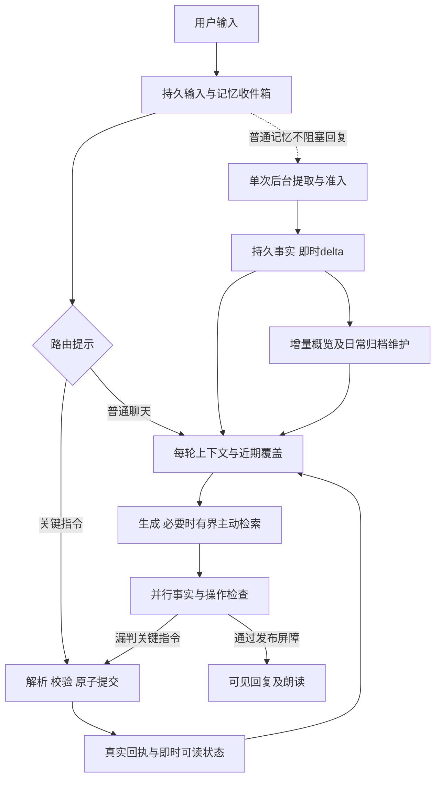

# 陪伴机器人记忆系统设计与实施方案

版本：3.1 设计稿。日期：2026-10-25，Asia/Shanghai。项目：companion-harness。

状态：待实施。本轮只修订设计与文档索引；不修改运行代码、数据库、聊天记录、模型配置或向量开关。本文中的接口、表、参数和测试编号均为实施合同，不代表已实现或已通过。表中的队列、时限与百分位数是初始工程目标，不能作为当前bot实测值。

本方案将日常记忆改为自动形成，以小型常驻档案、滚动近期情况、按需长期召回支持陪伴连续性。称呼和明确相处边界使用结构化字段；用户能通过聊天纠正和要求忘记，无需逐条审批日常记忆。SQLite 继续保存权威记录，MD 是可重建的可读导出；保留现有 E5 混合检索、来源证据、修订与遗忘能力。

本文是下一阶段产品语义和工程实施入口。[v1.1 工程方案](memory-engineering-plan.md)保留历史：其中逐条确认、聊天仅登记候选、只有人工 confirmed 可读等规则，在启用本方案的隔离 v3 实例中被本文替代。未启用 v3 的正式实例继续采用原行为。执行安全、工具授权、用户与 bot 隔离、来源有效性和删除恢复规则仍须保留。

本次3.1修订结合[Tolan案例](https://openai.com/index/tolan/)，补充有界主动检索、普通聊天快速路径、关键命令同步提交、普通记忆异步形成与带时间的交流背景。取消3.0对所有回合强制前置模型准入的要求；保留语义发布检查和真实回执要求。[3.0原稿](companion-memory-v3.0-plan.md)仅作历史对照，后续实施以本文为准。已有源码基线不因文档修订更新成虚构实现。

本版关键合同：普通聊天默认3次前台调用，后台普通提取不阻塞回复；关键指令在发布前取得真实事务结果；主动检索复用主调用且有查询/耗时上限；交流背景按时间和事件结束。快路仍有发布检查，不承诺亚秒语音。运行细节见7至11节，测试与参数见17及19节。

## 1 产品目标与范围

### 1.1 用户应该感受到的行为

用户正常分享生活，机器人自然回应并逐渐了解用户。明确介绍的称呼和日常偏好能在后续交流中使用；聊天不会连续出现“要记住这件事吗”“已经登记为待确认”等办理信息。

机器人应能区分用户、朋友和虚构人物；理解今天临时改变与长期更新；接续持续事项；在适当场景使用过去的信息。记忆为空或暂时读不到时表达当前依据不足，不编造经历或宣布全库没有记录。

“重要信息一定在场”的工程含义是：每轮请求携带当前有效称呼、禁用称呼与明确交互边界，并测试模型是否遵守。它不等于承诺模型永不出错、所有旧事必然召回或存储永久存在。

### 1.2 本阶段交付

1. 自动记忆准入与实际事务回执。
2. 结构化称呼、当前有效值与历史版本。
3. 有独立预算、每轮重建的核心档案及 MD 导出。
4. 近期情况、持续事项、带时间的交流背景和来源回查。
5. 统一的结构化读取、主动检索问题及关键词加 E5 召回。
6. 聊天内更正、撤回和遗忘，以及全部派生视图失效。
7. 用户可选的记忆管理界面，替换日常确认卡片。
8. 分路径调用预算、记忆提交时效、故障恢复、冻结评测与隔离发布流程。

本阶段继续使用现有数据库和模型提供方，不引入独立向量数据库、通用知识图谱服务或新的外部个人数据接收方。提醒、通知、外发消息和日程执行沿用各自授权，不能因记住一件事而自动执行。

## 2 已核对的基线与需要改变的行为

本项目没有 Git 元数据。本次源码基线另存于 [v3 设计源码基线](companion-memory-v3-source-baseline.json)，通过 SHA-256 标识文件状态，不编造 commit。

| 现有部分                                          | 已核对行为                                                                  | v3 的处理                                                                    |
| ------------------------------------------------- | --------------------------------------------------------------------------- | ---------------------------------------------------------------------------- |
| `src/domain.ts`                                   | Memory 含来源、状态、certainty、主体和时间字段，缺少专门称呼槽位            | 保留 Memory 主记录，增加准入元数据和有约束的槽位引用                         |
| `src/memory/reading.ts` 与 `Store.qualifiedFacts` | 普通事实要求 active/confirmed                                               | v3 接纳合法提交的 user_stated 记录；不能假装用户点过确认                     |
| `src/memory/capture.ts`                           | 自动提取形成 pending；显式保存也只登记提取                                  | 改成低风险事实自动准入；内部待处理不再成为用户工作队列                       |
| `src/memory/operations.ts`                        | 聊天写入能力为 interface_only，成功操作清单为空                             | 从实际准入事务生成受限能力和真实回执                                         |
| `src/context.ts`                                  | 置顶与普通事实共预算，极端情况下均可裁剪                                    | 核心字段单独保护，近期与召回内容按确定顺序收缩                               |
| `src/memory/retrieval.ts`                         | 小规模全量、大规模 E5 混合；有冷加载及降级状态                              | 保留，扩展统一资格函数和事件检索目标                                         |
| `src/harness.ts`                                  | 生成后执行 facts 与 operations 双检；最多六次模型调用；执行过工具不自动修复 | 保留语义严格度；增加受预算约束的准入阶段、评审故障恢复与只读结果后的文字修复 |
| `src/store.ts`                                    | 只接受 schema 1/2，`hasMemoryV2` 为版本等于 2                               | 明确增加 schema 3 能力检查；禁止简单改成降版本打开                           |
| `web/app.js`                                      | 候选卡片与维护页确认是主要入口                                              | 日常卡片退出默认聊天；管理页承担查看、更正、删除与撤销                       |
| `src/backup.ts`、证据和删除链路                   | 有来源修订、UTF-16 区间、删除台账和恢复过滤                                 | 扩展到档案、持续事项、回执、MD 与模型读取屏蔽区间                            |

最新隔离实测为：656 项自动化测试通过、浏览器回归 8/8；新增冻结题 8/8，原 40 题最终重跑 38/40。严格评审兼容集为 79/80。历史结果详见[保存承诺报告](../implementation/memory-commit-release.md)，这些数字不是 v3 验收成绩。

必须保留并解决的已知问题：

- u02：只读检索后生成越界的“没有记录”，被正确拦截，用户没有收到回答。
- u07：facts 评审输出截断，未完成校验，用户没有收到回答。
- `generated-q28-0`：把相关属性的有限列举误解为全部记忆清单，属于评审误拦。
- 自动提取会把提问、办理意愿写成候选，并可能与真正偏好重复。

## 3 调研依据与适配决定

调研日期为 2026-10-25。产品文档支持公开行为，不能据此推断其私有存储格式、Embedding 型号或真实成功率。

| 证据                                                                                                                         | 可采用的机制                                               | 本项目的决定                                                                                 |
| ---------------------------------------------------------------------------------------------------------------------------- | ---------------------------------------------------------- | -------------------------------------------------------------------------------------------- |
| [Kindroid Memory](https://kindroid.ai/v2/docs/memory/)，更新于 2026-10-13                                                    | 常驻、中期与按需记忆；自动学习重要事实、关系发展和持续话题 | 采用分层及持续事项；容量参数自行验证，不复制订阅配置                                         |
| [Nomi Mind Map](https://nomi.ai/updates/mind-map-2-0-bringing-nomi-memory-into-view/)                                        | 从详细记忆形成自动更新的概览，允许纠正                     | 增加短概览与实体标识，首版不引入图数据库                                                     |
| [Nomi Identity Core](https://nomi.ai/updates/introducing-the-nomi-identity-core-fostering-dynamic-and-authentic-identities/) | 对机器人身份及关系的连续理解                               | 用户档案、角色人格、相处约定分别表达；不允许记忆自动改写系统人格与权限                       |
| [Replika Memory](https://help.replika.com/hc/en-us/articles/37208679176077-How-does-Replika-s-memory-work)                   | 自动形成记忆，用户可另外查看和添加                         | 日常自动写入，可选管理；不复制关于“更懂用户”的效果承诺                                       |
| [Character.AI Memory](https://blog.character.ai/memory/)，2026-05-21                                                         | Facts 自动保存，区分人物；手动重要内容受保护               | 主体与作用域先于相关性；保护明确核心字段                                                     |
| [Letta 核心记忆块](https://docs.letta.com/v1-sdk/memory/memory-blocks)，V1 SDK 文档                                          | 重要信息常驻上下文，无需检索                               | 采用常驻块原则，不引入旧版 SDK 或整套 Agent 框架                                             |
| [Zep Context Types](https://help.getzep.com/context-types)                                                                   | 区分概况、时间事实、事件原文与对话摘要                     | 采用对象区分与生效时间，继续使用本地 SQLite                                                  |
| [LongMemEval](https://arxiv.org/abs/2410.10813)                                                                              | 提取、跨会话、时间、更新与适当表示未知的评测               | 纳入外部基准和分能力统计，不用单一综合分替代                                                 |
| [LoCoMo-Plus](https://arxiv.org/abs/2602.10715)                                                                              | 未直接询问旧信息时，仍要应用相关限制                       | 增加自然对话与间接约束任务                                                                   |
| [ZifaMem](https://arxiv.org/abs/2607.17564)，预印本                                                                          | 结构化记忆承载关系与情感连续性                             | 只借鉴分层与评测维度；作者实验不作为本项目收益保证，不添加情绪状态机                         |
| [Tolan案例](https://openai.com/index/tolan/)，2026-01-07                                                                     | 每轮重建上下文、合成检索问题、后台记忆维护及并行语气调整   | 普通聊天避开无关串行调用，关键写入有事务屏障，交流背景有时效；不照搬其模型、数据库或效果数字 |

结论是采用“自动形成、有来源、可纠正”的产品规则，并把响应速度和记忆生效时限同时纳入架构约束。MD、向量服务与特定框架均不是产品连续性的充分条件。

### 3.1 Tolan适配边界

案例明确描述了每轮重组摘要、人格、召回内容、语气和应用信号；用当前发言及合成问题召回，夜间整理记忆，并行调整表达。其向量查询低于50ms是案例中的组件指标；漏召回变化基于产品挫败信号，不是本项目的准确率或完整回复延迟。本文保留本地E5与SQLite，用相同模型条件实验验证改动。

每轮重建指重新选择有效动态资料，不是清空原聊天、重写人格或禁止所有缓存。静态规则可复用；动态内容按来源、版本、作用域与到期时间重建。当前文本加语音朗读不等同于连续实时语音，不能把少一次串行调用宣传成已经达到语音即时响应。

## 4 记忆层次与权威数据



图中回路只表示有预算的路径升级，不允许无限循环。路径升级次数、模型调用与副作用在7节限定；收件箱持久化不等于长期记忆提交。

### 4.1 核心档案

核心字段包括当前称呼、禁用称呼和明确交互边界；软性概览包括少量稳定偏好、重要背景和用户明确表达的相处方式。字段用于精确决策，概览保留有依据的背景。

“忙的时候先别连续追问”可以成为用户表达的相处偏好；频繁晚睡不能自动升级为“夜猫子”，一时难过不能成为永久心理标签。相处约定不能推导现实依赖、排他关系或提醒执行权限。

核心概览是可重建的派生视图，每条概括关联支撑事实和来源。机器人自己生成的赞美、猜测与角色设定不能成为用户事实的来源。

### 4.2 近期情况

包含有限近期原文、尚在处理输入的有来源覆盖、当前会话摘要、近况、持续事项和带时间的交流背景。七天只是近期摘要候选的初始时间范围，不是删除线；仍在进行的事情可跨越这个范围。

区分用户计划、实际结果与机器人建议。例如“下周面试”形成 planned 事项；日期经过只能变成 awaiting_update，不能推断已完成、已通过或需要发通知。

### 4.3 长期归档

归档原子事实、用户报告的经历、已展示的共同聊天事件、偏好变化与阶段结果。现实经历、角色扮演与机器人背景分开保存。可通过结构化条件、关键词、向量和来源展开找回，不全量塞进上下文。

### 4.4 权威关系

- `memories` 和受事务保护的结构化指针是权威记录；`memory_inbox`只表示输入处理进度，不证明长期事实已写入。
- 核心概览、摘要、向量、MD 均为派生内容，不能反向授予写权限。
- 源消息、证据和修订证明某人表达过什么，不证明现实事实已被独立核实。
- 原聊天的显示、模型可读取内容、可长期保存内容分别管理，不能用“没写长期记忆”暗示原文没有保留。

## 5 自动记忆规则

### 5.1 用户设置

新增每个 bot 独立的 `memoryFormationMode`：

| 值              | 自动形成                       | 用户明确保存 更正 遗忘                                       |
| --------------- | ------------------------------ | ------------------------------------------------------------ |
| `automatic`     | 允许符合本方案的日常低风险资料 | 执行真实命令，不再次征求相同意愿                             |
| `explicit_only` | 不从普通陈述自动形成长期事实   | 明确指令仍可执行；单轮临时信息仍可用于回答                   |
| `off`           | 不新增或更新一般记忆           | 明确保存时如实说明功能关闭；遗忘、删除和交互边界控制仍可使用 |

旧 `autoExtract=false` 映射到 `explicit_only`，不能因升级替用户重新开启自动学习。关闭形成不删除已存资料，也不等同于停用读取；界面分开说明。明确称呼、禁用称呼与停止类交互控制独立于一般画像学习，暂停新增时仍可显式变更，并在界面作为交互设置展示；它们不能因关闭自动学习而失效。

`memoryPolicy`和schema是程序能力选择，`memoryFormationMode`是用户选择，不能互相替代。schema3的安全回退保持v3读取能力，仅暂停新形成；不能切回旧资格过滤使已提交的user_stated资料无声消失。

新功能只在未来明确启用的隔离实例应用。是否跨 bot 共享资料不在此次设置中默认开启。

### 5.2 准入矩阵

| 输入类型                                      | 保存位置与状态                                       | 正文行为                               |
| --------------------------------------------- | ---------------------------------------------------- | -------------------------------------- |
| 明确的日常偏好 稳定习惯                       | 后台自动提交user_stated，按7节时效与失败合同         | 快路自然回应；尚未提交不称已保存       |
| 长期称呼 明确禁用称呼                         | 原子记录加结构化槽位，提交即生效                     | 使用有效称呼，不要求点卡片             |
| 今天的尝试 临时称呼                           | 近期记录或有到期条件的覆盖槽位                       | 仅按当前范围使用，不替换长期值         |
| 用户明确要求记住的低风险信息                  | 前台提交并产生实际回执                               | 可自然简短确认已记住；不承诺永久召回   |
| 用户纠正自己的资料                            | 按谓词与时间处理新旧版本                             | 采用新值，成功后可如实说明更正         |
| 提问 假设 引用 办理意愿                       | 不生成对应现实事实                                   | 回答问题；“想保存”不能再成为一条事实   |
| 助手猜测或对用户的推断                        | 不进入核心或确定事实                                 | 必要时保持不确定，不固化人格标签       |
| 多义主体或不清楚的目标                        | 内部暂缓，不默选覆盖对象                             | 为理解内容澄清，不问“要不要记住”       |
| 明确不长期保存                                | 对对应内容设置写入排除                               | 可在本轮理解，不进入后续摘要和长期记忆 |
| 密码 Token 密钥 身份证或支付凭证              | 禁止进入记忆、概览、MD、向量                         | 如实说明无法作为记忆保存，不复述敏感值 |
| 诊断 财务状况 精确住址 私人联系方式等敏感资料 | 默认不自动形成长期记忆；主动保存请求按专门白名单判定 | 日常聊天不弹敏感信息确认卡片           |

低风险、敏感和禁止项由版本化策略与明确字段分类共同决定。模型风险标签不能覆盖程序禁存规则；未知类别保守暂缓。首版只自动接纳明确用户陈述，不从行为统计自动构建性格、健康或亲密程度画像。

临时称呼与明确交流控制仍走关键路径；普通“今天试一种口味”等临时信息不因此一律前置模型。

拒绝与允许按原子断言及其证据区间处理。例如同一消息中“不保存住址，但记住我喜欢爵士”，不能因为全句出现拒绝词而丢掉全部内容，也不能把住址写进概览。

### 5.3 表达语义

真实提交成功后允许“好，小岚，记住了”这类自然回应。普通分享不要求主动宣布记忆行为；没有成功回执不得宣称已保存、已替换或已删除。

显式保存失败或只完成一部分时应简短如实说明，不用“永远记住”“下次一定知道”遮盖失败。用户没有询问流程的普通聊天，不播报事务、索引或内部队列。

这替代 v2 一律禁止回应保存动作的规则，但不降低真实性要求。

## 6 数据模型与结构化称呼

### 6.1 作用域

所有新表、缓存键、回执与后台任务包含 `ownerUserId`、`relationshipId`。首版用户档案仍在当前 bot 的关系作用域内保存，不读取其他 bot 的私有资料。

再包含 `subjectId`、`realityScope` 和必要的 `worldId`。现实与虚构数据不能只靠提示词隔离；同名人物不因相似度而自动合并。用户实体使用当前 owner 的稳定标识；朋友、家人和角色使用独立实体 ID。无法确定两个名称是否同一个人时，保留分离。

### 6.2 扩展现有 Memory

继续使用 `memories` 主记录。新增 v3 `admission` 元数据，不把自动写入伪装成手动 confirmed。

```ts
type AdmissionV3 = {
  policyVersion: "companion-memory-v3.1";
  state: "committed" | "quarantined";
  origin:
    "explicit_user" | "automatic_user_statement" | "legacy_user_confirmed";
  verification: "user_reported" | "externally_verified" | "not_applicable";
  mutationId: string;
  learnedAt: number;
  observedThroughSeq: number;
  subjectId: string;
  scopeKind: "relationship" | "segment" | "until";
  scopeId?: string;
  validUntil?: number;
  riskClass: "ordinary" | "sensitive_explicit";
};
```

新自动事实可以是 `active/stated + admission.committed`。长期已提交记录没有默认7天到期；`validFrom/validTo`表达事实的有效时间，临时作用域的`validUntil`限制使用范围，内部计划正文清理期限不参与事实真值。`certainty` 继续表达原陈述的性质，`admission` 表达是否被程序接纳；两者不能混用。首版不自动生成 externally_verified。

通用 `predicate` 不能完全依赖自由文本。维护小型谓词注册表，明确单值或多值、比较规则、允许对象、时间与风险。首批结构化键覆盖称呼、禁用称呼和明确交互偏好；音乐等一般偏好可用多值事实，暂不为每种生活主题造独立表。

v3 统一资格函数同时检查作用域、准入、来源、有效期、排除区间、删除台账和读取截止。SQL 预筛、内存缓存、全量模式、FTS、向量 delta、来源展开和评审投影必须使用相同资格语义，不能只修改 `eligibleFact` 而遗漏 `qualifiedFacts` 的 SQL。

### 6.3 新增表

物理schema仍计划升到3；3.0尚未实施，本次新增表一起进入将来的schema3迁移，不凭设计版本号将数据库升到4。本轮不运行迁移。

| 表                       | 权威内容与约束                                                               |
| ------------------------ | ---------------------------------------------------------------------------- |
| `memory_entities`        | 作用域内实体 ID、别名和证据；别名不直接证明同一身份                          |
| `memory_inbox`           | 输入修订、处理状态、单次解析租约、计划指纹与提交回执引用；不复制一份事实主库 |
| `communication_contexts` | 用户明确表达的近期交流背景、证据、事件关联、生效与结束条件；与稳定人格分开   |
| `profile_slots`          | 结构化键到当前 Memory 修订的指针，按主体 范围 场景唯一；与事实同事务更新     |
| `profile_views`          | 核心概览的派生快照，含支撑 ID、版本、最早失效时间和预算统计                  |
| `ongoing_threads`        | 计划 状态 结果和时间条件，记录来源及可见版本；不创建 Delivery                |
| `memory_mutations`       | 幂等命令、申请与实际结果、受影响 ID 和版本；不无限复制正文                   |
| `memory_suppressions`    | 不保存与遗忘所需的对象指纹、来源区间、适用范围和重新学习条件                 |

沿用 `memory_dependencies`、`memory_state`、`memory_embeddings`、`memory_index_state` 与会话摘要表。不得创建另一个无同步合同的事实主库。

事务外生成自然语言概览、向量和 MD。SQLite 事务只包含检查与记录更新，不能跨网络或模型等待。

### 6.4 称呼槽位

| 键                        | 值的含义                           | 基本更新规则                                   |
| ------------------------- | ---------------------------------- | ---------------------------------------------- |
| `self_reported_name`      | 用户自我介绍的姓名，仅表示用户说过 | 不当作法定身份核实，不覆盖已有偏好称呼         |
| `preferred_address`       | 当前关系中长期希望被叫的名字       | 新的明确长期称呼替换指针，历史事实保留         |
| `address_override`        | 当前交流段或到指定时间的临时称呼   | 到期后恢复长期值，不写回长期槽位               |
| `forbidden_addresses`     | 明确拒绝的叫法集合                 | 添加与撤销分开，有独立证据；不被新昵称顺手清空 |
| `interaction_preferences` | 用户明确要求的交流方式             | 使用有限、可解释的字段，不变成系统人格任意改写 |

解析顺序为：当前用户明确要求和禁用约束 → 有效临时覆盖 → 长期偏好称呼 → 用户自我介绍姓名 → 已发布人格默认称呼。用户当轮明确撤销某个禁用值时，先按本轮新的明确指令更新，避免旧禁用永久压过用户的新选择。

“叫我小岚”作为明确称呼指令，默认作用于当前关系；“今天叫我小桥”只设临时值；“他叫小岚”不改用户槽位；“戏里叫我阿棠”只进对应 world。昵称不能被当作法定姓名。“我叫林然，不过叫我小林就好”可分别记录用户报告姓名和偏好称呼，两者不会互相替换。

“今天”到期点按用户时区的下一个当地午夜计算，处理DST，不能用now加24小时；保存表达时的时区与源消息时间，后台延迟或之后切时区不自动延长原范围。“这段聊天”绑定内部交流段，不因页面刷新结束；“这轮”绑定当前 Run。范围不明时不自作永久更新。

每轮生成前和发布前检查 `validUntil`；跨午夜或换段造成的失效即使没有后台版本递增，也不能继续使用缓存临时称呼。

### 6.5 更新与冲突

单值谓词按明确更新顺序、来源语义和生效时间更替，不以后台任务完成时间或向量相似度决定最新值。旧任务的 `observedThroughSeq` 低于现行槽位时不能覆盖。

“我现在改喜欢银色”是偏好变化，旧值的历史有效期结束；“之前记错了，我一直喜欢银色”是纠错，不能伪造一段真实偏好变化史。“两个我都喜欢”不应按单值替换。问“我以前喜欢什么”使用历史查询，不把旧值当现在有效值。

普通冲突保留来源并暂缓有歧义的覆盖。当前输入仍可用于本次回答，暂缓不能变成继续坚持旧值。

### 6.6 核心选择与概览更新

关键字段由槽位白名单决定，不能由模型给一条普通记录打高分就获得系统指令优先级。软性概览只从已接纳、有效、当前作用域匹配的原子资料选择。

选择按固定优先级排序：用户明确表达的重要性（须有证据）→ 当前持续事项相关的重要背景 → 多个独立用户来源支持的稳定资料 → 近期相关资料 → 稳定ID。重复提取同一来源和助手自己重复的话不增加支持次数；重要性只影响选择，不证明内容更真实。具体主题不写入排序特例。

超过500 token的软性部分按此顺序收缩，未选内容仍保留归档。用户要求“这很重要”提高选择优先级，但不能把无限信息都变成硬常驻；回应保存成功也不能暗含每轮全部载入的保证。明确的行为边界进入受限交互槽位，而非混在自由文本背景里。

提交新事实只标记概览dirty并记录wantedVersion，不每轮生成长概览。初始维护合并等待60秒，最早dirty后最多5分钟安排一次；同一关系最多一个维护任务。生成期间又发生变化，只允许匹配版本提交或重排一次，不并发写多个相互覆盖的概览。

当前概览过期、依赖无效或尚未形成时，按同一选择规则直接投影有效原子事实作为后备，不等待后台模型，也不用陈旧MD代替。自然语言概览的每条陈述必须能回到来源集合；模型新推断不因写入概览而获得事实资格。

## 7 快速路径 写入事务与生效时限

### 7.1 输入收件箱与三条执行路径

输入接收事务保存原消息、来源修订和enqueueSeq。automatic模式创建普通`memory_inbox`条目；explicit_only/off不启动普通提取，也不制造等待30秒超时的空任务。需要办理的关键指令按需登记inbox；off下的一般保存返回disabled结果，允许的交互控制和遗忘仍可执行。收件箱状态为 `queued | running | requires_sync | committed | partial | noop | quarantined | failed | cancelled`；到达queued只证明原话和处理任务已登记。每项操作另有状态与pendingOperationCount；仍有未决操作时父项保持running/requires_sync，结束后记录settledAt和committed/partial等实际结果，partial不能隐藏尚未处理的请求。

普通分享不再先等一次模型准入。输入走三条路径：

| 路径         | 进入条件                                             | 必须等待                                         | 可并行或后台执行                   |
| ------------ | ---------------------------------------------------- | ------------------------------------------------ | ---------------------------------- |
| 普通聊天快路 | 无需即时改变核心或执行记忆命令                       | 本轮上下文、必要生成、两个发布检查               | 普通事实提取、概览、索引、MD和维护 |
| 关键事务路径 | 明确保存/更正/遗忘、称呼或交互控制，或其语义尚不确定 | 受限解析、资格校验、实际事务结果，随后生成及检查 | 向量与自然语言概览不阻塞提交       |
| 按需召回路径 | 指代未解、相关背景不足或用户回问历史                 | 有界检索及必要的一次生成续接                     | 无关维护不参与等待                 |

路径可以组合，但受同一个Run预算约束。程序路由提示只做快速分流，不能授予写权限，也不能被当成自然语言指令识别完整性的证明。规则只识别通用命令结构与明确UI命令，不加入题目实体或主题特例。

### 7.2 普通聊天快路

1. 持久化输入与收件箱，读取当前核心槽位、近期情况及有限的尚未处理来源覆盖；按11节决定是否执行一次基础检索。
2. 后台单次提取可与读取、生成并行，不让当前回复等待普通资料持久化。当前用户明确说的内容直接约束本轮回答，不必先假装它已入库。
3. 用本轮快照生成答复；交流背景与应用信号作为有范围的数据参与生成，不额外串行调用一个语气模型。
4. facts与operations使用同一份草稿和冻结证据并行检查，两个结果都要返回才进入发布屏障。普通回合默认不主动播报保存状态。
5. 发布前复核来源、关键槽位、到期时间和收件箱是否已标记requires_sync。只增加不相关事实的后台提交不使整轮重答；具体依赖规则见10.3节。

普通无工具回合是一次生成加两次并行检查，共3次前台调用；这是相对3.0取消阻塞准入的快路，不声称已经比当前v2实测更快。后台提取仍要单独计费，不能把总成本减少一次当作事实。

### 7.3 漏判关键指令时的升级屏障

operations检查在校验保存陈述之外，必须依据**用户输入**给出 `requiredAction: none | sync_write | clarify`及对应用户证据。明确指令未办理、后台计划标记requires_sync、或者对象有歧义时，普通草稿不能直接通过。

出现sync_write时，当前草稿尚未展示，程序将其丢弃或冻结，升级为关键事务路径；提交后重建有关状态，再生成并双检。无法确定目标时只做自然澄清，不替用户默选记录。全Run最多升级一次。

升级与读取需求同时出现时，先处理遗忘/停止、关键控制及实际写入，再处理仍合法的只读请求；不能查回刚要求忘记的对象。路径升级不重置查询数、读取阶段数或截止。

用户明确命令的漏判检测不得只靠关键词，也不能依赖生成模型自报“我没有修改记忆”。语义检查仍可能出错，故设定关键场景零错误验收和路由召回率监控，不能宣称程序能确定识别所有自然语言。

**不能为了让草稿中的错误保存承诺成立而临时补写。** 若用户只是普通分享，草稿却擅自说“已经保存”，应按实际回执拒绝或文字修复；用户意图与草稿陈述分别判断。

### 7.4 单次解析与受限计划

新增`src/memory/intake.ts`和`src/memory/inbox.ts`。普通路径由后台执行一次小型结构化提取；关键路径才等待其完成。输入仅含必要用户原话、已展示的助手语境、实体/槽位候选和时间，继续使用已授权模型提供方。

计划表达主体、谓词、值、时间范围、肯否定、意图、风险与逐条证据。当前单值覆盖、撤回、关键称呼和明确交互约束都属于同步候选，不能因category叫preference就被丢到普通慢队列。简短回答可以利用上条已展示提问定位语义，助手建议本身不能作为用户事实。

一条输入的前台与后台共享父幂等键、计划指纹及single-flight租约。若后台正在解析而路径升级，前台提升该任务优先级并在剩余截止内等待同一次计算；已有合法计划直接复用，不同时再调用模型产生另一套申请。后台不得独自执行已判定须同步的显式保存、更正、关键槽位、明确交互控制或遗忘命令，只生成计划并返回requires_sync。若结果在发布后才揭示漏判，记为关键时效失败，不偷偷补一次执行来把当前回合算对。

准入先做预算预检。一次最多申请8个原子变更；超出项有明确后续范围，整体结果标为partial。quarantined计划不自动猜测升级，7天清理临时计划正文；澄清依据必须来自新的有效输入。过长输入不得截半条去存。

来源切片只能证明原文存在，不独自证明解释正确。有限谓词、保守风险策略、撤销历史与毒化测试共同约束自动写入；后台模型解析错误也要计入记忆失败。

### 7.5 命令接口与真实回执

```ts
type MemoryCommand = {
  type: "add" | "replace" | "set_override" | "retract" | "forget";
  subjectId: string;
  predicate: string;
  value?: unknown;
  targetId?: string;
  expectedRevision?: number;
  scope: {
    kind: "relationship" | "segment" | "until";
    id?: string;
    until?: number;
  };
  primaryEvidence: EvidenceRef[];
  contextEvidence?: EvidenceRef[];
};
type MemoryReceipt = {
  kind: "memory_command_result";
  mutationId: string;
  inputId: string;
  inputRevision: number;
  status: "committed" | "noop" | "partial" | "quarantined" | "failed";
  durability: "durable" | "segment" | "until";
  operations: { action: string; id: string; revision: number }[];
  committedAt?: number;
  validUntil?: number;
  memoryVersion: number;
  contextVersion: number;
  reason?: string;
};
```

入队票据、原话落盘、提取完成、向量ready与本接口的成功提交是不同状态。owner、relationship、来源资格、策略版本、mutationId和实际结果由程序填入；模型或用户粘贴的JSON没有执行权限。新表有作用域复合索引，指针在事务中检查所属关系。

committed加durable才支持“这条已长期保存”；segment/until只支持对应短期范围。noop可以支持现有已存状态，不证明本轮新增。partial只能描述已成功的子集。向量未完成不影响事实保存成功，也不支持每次必然召回。

### 7.6 原子提交与下一轮可读

1. 校验字段白名单、用户主要证据、UTF-16边界、风险、范围、排除规则与当前时间。
2. 父键为 `intake:{inputId}:{inputRevision}:{policyVersion}`，保存计划指纹和各操作ID。相同键不同申请返回冲突，不新建第二条事实。
3. 短事务内复核来源、epoch、取消状态与CAS；写事实、槽位/事项/屏蔽、依赖、dirty索引状态及实际回执，统一推进内容版本。
4. 事务成功后立即更新结构化读取、当前值与未索引事实delta。下一轮不等待自然语言概览、MD或向量才看到新值。
5. 后台任务只读已提交版本，旧来源或旧序列的迟到结果不能覆盖新纠正。

同一槽位替换的旧值失效、新值生效、指针和回执必须原子完成。CAS最多重新读取一次；网络/模型等待不得跨SQLite事务。mutations最多8个的限制不允许把半槽位结果标成成功。

### 7.7 尚未提交时的连续性

普通自动记忆目标为输入接收后提交P95不超过5秒，正常负载下每条待处理输入30秒内进入明确结果或failed；这些是待验证的工程目标，不能以后台仍在排队无限延期。

下一轮先读取已提交delta；若前序输入还未处理，可在本次本地读取阶段内进行最多80ms的有界等待，并使用有限的pending-source覆盖。覆盖最多取8个来源，只占10节近期分区配额，带有user-stated/recent-source与pending标识，不叫长期已确认事实。

用户问“已经存好了吗”必须检查真实回执，不能用来源覆盖回答“已存”。当前知道某内容、排队处理过、已经长期提交分别统计。队列失败时，可以在本轮依据中使用仍允许读取的原话，但不得假装持久化完成。

证明确实靠长期记忆的消融必须同时禁用近期原文、摘要、临时来源覆盖和带答案的交流背景；等待实际commit之后再问。只从pending原话答对，不算长期召回成功。

### 7.8 取消 失败与重启

正常回复完成不取消普通记忆后台任务。取消发生在某项写入提交前时，撤销该输入尚未提交的写入，标记inbox cancelled，不让维护任务再从相同来源自动重放；已提交项不因停止回复隐式回滚。明确撤回、关闭形成、遗忘和来源删除使有关未提交任务失去资格。

回复生成或评审失败不等于已经提交的记忆消失；用户未撤回输入时，合法后台任务可在其原始截止内完成，状态分别展示。重启先读幂等记录、计划租约、回执和删除台账；不重复写入，也不自动继续中断的聊天。

### 7.9 前台与后台调用预算

| 路径               | 正常前台模型调用 | 额外工作与边界                                                                |
| ------------------ | ---------------: | ----------------------------------------------------------------------------- |
| 普通无工具聊天     |                3 | 生成1，facts与operations并行各1；普通提取后台最多1次成功解析                  |
| 普通加一次检索续接 |                4 | 主生成发出有界检索请求，读取后续接1次，无独立问题规划模型                     |
| 已识别关键命令     |             4至5 | 等待/复用准入最多1次，生成1至2次，检查2次                                     |
| 快路漏判后升级     |         最多7至8 | 已花3至4次，准入最多1次，再生成与检查；未用过的工具续接至多1次，整体仍不超8次 |
| 完整文字修复       |            另需3 | 无工具、无写入重放，启动前必须预留3次                                         |
| 检查故障恢复       |     全Run最多1次 | 同一规则重试故障检查，仍受总额约束                                            |

前台硬上限仍为8次、60秒；升级、恢复和修复共享额度，不能把它们逐项相加后越过上限。主生成所用的检索问题随允许的工具申请产生，不额外先串行问一次模型。预算不足时不开始不可完成分支，也不为了继续输出而跳过检查。

每条输入的普通后台解析最多一次成功执行，暂时故障最多重试一次，受30秒队列总截止和原始来源资格约束。关键路径复用同一解析，不能前后台各算一次“正常成功”。同一输入前台最多8次，另有未升级的后台解析最多2次尝试，来源级总尝试上限10次。后台解析被提升为当前Run等待时，已开始的相同来源尝试纳入前台8次账本，不重复计费；超额前停止启动新请求。异步调用、被取消但用量未知的调用、路径升级和维护均有originInputId/RunId并计全局日预算；移出前台不等于免费。

后台概览/整理由维护作业单独计费，25秒单调用截止；它们不发送聊天或通知，不获得日程授权。索引与CPU后台工作优先级低于前台读取。普通快路保留两个模型发布检查，因此仍有模型等待；在没有单独验证前不承诺Tolan式即时语音。

### 7.10 模型并发与前台优先级

采用一个有界模型请求调度器，按提供方账户/凭据引用划分资源池，不记录原始Key。初始池上限3个在途请求，其中最多1个普通后台提取/维护；前台双检按一组预留2个槽位，避免各占一个再互相等待。每个bot仍只有一个前台Run，跨bot共享调度资源不共享任何资料或回执。

初始3并发必须通过当前提供方的限流与延迟实测。前台到来时不再启动会占用预留的后台工作；已经开始的模型请求不能被假设能即时中断或释放远端资源。资源不足时可观测地排队或让双检串行执行，检查标准不变，但不能仍按“已并行”报延迟；普通提交5秒目标或首答目标因此不达标时，该条件不得通过发布门槛。

关键事务与前台检查优先于普通提取，普通提取优先于概览/每日维护。后台工作保留原输入截止，不能在每次重新排队时续期。记录预留、排队、开始、结束和限流错误；取消后的未知用量照常入账。重试不新开无限并发池。

基准延迟目标以每账户一个活跃前台Run加一个普通后台任务为基础负载；多bot并发和服务端限流另设压力场景，同样报告受理至结果的完整延迟与失败，不隐去排队。无法获得足够并发时，应据实优化请求结构并重新验证，不能静默停用自动记忆或跳过任一检查来兑现时延。

## 8 发布屏障 真实回执与检查恢复

### 8.1 同一草稿的并行检查

facts与operations并行处理同一份草稿和冻结的读取/回执快照，均完成才发布。程序先为两次调用一起预留预算；一项失败也要回收另一项的信号、使用量和结果，不能留下未计费请求。

- facts检查本轮证据、属性/主体/时间、当前明确约束及交流背景中的硬要求；必要时返回有用户依据的requestedRead，不把无依据断言改成“知识不足就算对”。
- operations检查保存/修改/删除/未来承诺，另检查用户是否有尚未办理的关键意图；requiredAction必须引用用户输入，不能以草稿自行作出的承诺为写入授权。
- 两项的flow decision与语义违规分开保存。要求查询或升级路径不是自动通过，也不允许对方越权返回不属于自身的违规类型。

快路仍执行两项检查，不靠删除评审、放宽引句或先发布后撤回来获得较低延迟。所谓快路首先是移除无关串行前置工作，不是证明自由生成天然可信。

### 8.2 保存陈述的依据

`memoryOperations`只来自真实回执：允许动作、已提交子项、失败/partial状态、durability和有效时间。队列、输入落盘、提取已结束与index ready均不能充当保存成功。

回执ID解析为本次实际变更的主体、谓词、修订、有效期和受限摘要，作为committedFacts交付；已有确认状态作为existingFacts交付，两者独立于普通召回裁剪。不能用不透明ID支持任意保存内容，也不能把一次noop说成本轮新增。

普通分享默认不播报办理。显式请求只有实际commit后才可自然回应“记住了”；失败、短期保存、partial分别按实际范围表达。保存成功仍不保证每次跨窗口召回。

后台在检查期间完成了一条普通资料，不自动使已冻结的“未提交”状态变成成功判定。草稿若有相关保存陈述，只能在有剩余预算时刷新对应回执并重新检查，否则修复该陈述；不能把发生过一次提交当作检查已经通过。

### 8.3 发布前复核与路径升级

发布屏障检查源资格、取消、epoch、当前槽位、read-set修订、validUntil、相关suppression及requires_sync标记。需要升级时最多一次，保留原输入顺序与single-flight，不发布旧草稿。

普通加法式、不涉及read-set/核心/当前查询的提交不触发整轮重答。新版本若使已用记录失效、改变关键字段或产生同谓词冲突，必须刷新有关依据；不能把“后台异步”变成允许旧称呼或已遗忘内容继续发布的例外。

收到要求忘记或停止的输入时优先执行失效与取消边界，不等普通索引或概览任务。任何实质性用户指令都不能被“快路优先”跳过。

### 8.4 有界修复

只读搜索或来源展开后允许一次保留完整结果的文字修复，`tools=[]`；不重跑检索、准入或副作用工具。关键事务已提交的回执照常保留，不能用文字重试再次写同一事实。存在未处理副作用或不完整工具组时不进入自动修复。

已有整句移除只在facts已通过、违规仅为操作/流程句、位置唯一、结果非空且仍回答用户问题时使用；结果再次双检。不能删除正确答案主体、半句否定或歧义引句凑通过。

### 8.5 检查故障与可见输出

非法JSON、网络错误、截断和非法引句属于检查故障，与语义拒绝分开。全Run最多一次同规则恢复，且必须有预算；不得补括号猜结论、将空结果视为通过或换宽松模型标签。

检查仍失败则不发布草稿，保留用户输入与真实事务结果，界面明确失败。首版所有文本段和TTS均等待发布屏障通过；没有单独验证分段检查与不可逆外发协议前，不先流出未检查的头一句。

“正在回复”等是界面状态，不写成角色消息、不发给TTS。预录“嗯嗯”、固定安慰句、打字动画不能计为首个有效答复。首次有效文本、首个答案音频和整段完成分别测量。

u02、u07、q28的旧输入与评分保留；新流程要在完整重跑中解决只读结果后拒答、检查截断和属性范围误判，不能靠更换失败样本通过。

## 9 近期情况与持续事项

### 9.1 记录结构

`ongoing_threads` 包括 title、subjectId、reality/world、status、occurredAt/expectedAt、lastEvidenceSeq、lastUpdatedAt、reviewAfter、supportingMemoryIds、sources、revision。状态为 `planned | active | awaiting_update | resolved | dormant | cancelled`。

日期经过只推进到 awaiting_update。用户给出结果才进入 resolved；很久未提及可以成为 dormant，但仍可检索，不能写成“已经放弃”。用户取消和完成是不同状态。

### 9.2 形成与更新

明确事项更正或结果更新走关键路径，按受限谓词在同一事务更新原子事实和事项状态；普通分享的计划由后台提取，但当前输入先形成有范围的本轮覆盖，下一轮按7.7节读取delta或pending来源。两者都不等待长摘要才能理解用户刚说的内容。模型不能因某句话“情绪强烈”就永久固化用户状态。情绪记录保留事件、时间和用户表述，后续情况更新可结束适用性。

长期项目是否仍进行，优先用明确状态、预计时间及最近相关证据判断。七天内摘要只是候选来源；持续事项不被七天窗口清空。

核心概览和近况不重复存同一条事实。两者都引用原始断言或事件，避免摘要反复摘要造成范围丢失。概览的更新不能只追加，需要移除已失效或已经结束的内容。

### 9.3 与主动关心的边界

“下周面试”能帮助用户回来时接续话题，不自动创建提醒或 Outbox。用户希望被提醒时，仍进入 FollowUp 的授权与执行流程。

当前话题无关时，不强行每轮问进展。敏感事件不因检索命中就必须提起；亲近感不能依赖持续挖掘私人信息。

### 9.4 带时间的交流背景

新增`communication_contexts`，保存有依据、可结束的近期背景，与稳定人格和长期确定事实分开。

```ts
type CommunicationContext = {
  id: string;
  subjectId: string;
  realityScope: "reality" | "roleplay";
  worldId?: string;
  kind:
    "user_stated_affect" | "temporary_interaction_request" | "event_context";
  text: string;
  sourceEvidence: EvidenceRef[];
  origin: "user_stated"; // 首版持久记录只接纳用户表达
  observedAt: number; // 收到用户表达的时间
  occurredAt?: number; // 能从来源确定的实际状态/事件时间
  timezoneAtCapture: string;
  validFrom: number;
  validUntil?: number;
  segmentId?: string;
  linkedEventIds: string[];
  status: "active" | "resolved" | "expired" | "superseded" | "deleted";
  revision: number;
};
```

例如用户说“这件事让我很难受，今天先别给建议”，可记录事件、表达时间及今天倾听优先的要求。不能简化成“用户是悲观的人”，也不能把病史或禁存值换一个affect/event_context标签绕过5节准入、排除和隐私策略；也不能声称听到了音色情绪；当前实现只有文本/语音转写和实际应用信号。

observedAt是收到表达的时间，不代表事件刚发生。“上周很难受”“那次不想听建议”等历史叙述只形成带时间的event_context，不从现在起重开30分钟当前情绪窗口；实际时间不明时不补造日期。

生效范围按下表处理：

| 表达或类型               | 有效范围                             | 结束规则                                                      |
| ------------------------ | ------------------------------------ | ------------------------------------------------------------- |
| “这轮/这段聊天先听我说”  | 当前Run/当前交流段                   | 相应身份结束；刷新不单独结束交流段                            |
| “今天先别给建议”         | 用户当地日期                         | 下个当地午夜到期，处理DST                                     |
| 无明确期限的短期情绪表达 | 当前交流段与初始30分钟窗口中的较早者 | 到期后不再当作当前状态，可保留有时间的历史事件                |
| 与某件事有关的交流背景   | 相关事件及可见的最近上下文           | 用户说已好转、取消关联或明确不想再提时结束/替换；不能永久续期 |
| “以后都先听我说完再建议” | 稳定交互偏好槽位                     | 明确用户请求才长期生效，后续可撤回                            |

用于当前语气的卡片必须有segment或validUntil；长期event_context只能作为带日期的往事背景，不能携带无限期“当前情绪”。事件仍存在不等于情绪仍在。旧事件可以在相关时帮助理解，但过期卡片不能自动续期为当前心情；没有新的用户证据，不更新observedAt伪装成刚发生。用户明确“现在好多了”在本轮先覆盖旧指导，必要时升级状态更新，不能等夜间维护才生效；按同一事件和来源更新；主体不清时不把所有情绪卡片一律结束。

### 9.5 语气生成不增加必经串行模型

本轮表达指导由当前用户输入、有效交流卡片、用户明确偏好和人格共同生成。程序同时选择核心、近期与召回内容；主回复模型已能看到当前表达，不在普通快路前串行再问一个情绪模型。含糊的情绪解释最多是本轮软提示，不持久写入画像，也不作为诊断或事实引用。

优先级为：当前明确交流要求 → 当前内容和有效限制 → 用户长期表达偏好 → 相关且未到期背景 → 人格默认风格。人格保持稳定，轻松或克制的表达可以随当前场景调整。软性语气质量单独评价；明确“不想听建议”等限制仍由facts检查守住。

只提供已实际获得的应用信号，例如当地时间、专注/免打扰、文字或语音转写、分条/朗读设置和取消状态。没有授权或没有提供的麦克风韵律、摄像头、位置、屏幕内容不能猜测为实时信号。

停止自动形成时不新建一般情绪卡片，本轮原话仍可约束当前回复；明确交互控制按5节继续可用。忘记事件时，相关交流卡片、检索问题缓存和未播放的派生输出同步失效，不能只删事实表。

## 10 上下文组装与预算

### 10.1 独立分区

继续采用 24000 token 的 requestInputBudget，包含工具 Schema、包装及本次所有输入消息。输出和推理 token 另受模型能力与请求上限约束；调用前检查 input 加 output 加 reasoning 不超过该模型可用窗口。不得把 24000 当作包含输出的模型总窗口。

以下是初始工程配额，均包括分区自身序列化开销，不是实验得出的最佳值。

| 分区                     | 初始软配额 token | 保护规则                                   |
| ------------------------ | ---------------: | ------------------------------------------ |
| 系统 人格 执行与记忆规则 |             7000 | 不靠裁剪安全规则挪预算；规则本身必须控长   |
| 关键称呼与明确交互边界   |             1600 | 每轮固定包含当前有效值，不参与普通事实淘汰 |
| 核心软性概览             |              500 | 可去掉低优先级背景，保留来源引用           |
| 近期情况与持续事项       |              800 | 当前话题优先；不将未展示新输入带入旧 Run   |
| 分段与近期摘要           |              800 | 按范围与相关性选择，避免同时重复日摘要     |
| 长期召回事实与事件       |             1500 | 已包含在核心/近期的记录不重复注入          |
| 近期原文                 |             3500 | 以完整交流组裁剪，助手只读 displayed 前缀  |
| 当前输入                 |             2000 | 软配额，可借其他分区；不静默截断用户输入   |
| 工具 Schema              |             1000 | 只提供当前允许的工具，不截坏 JSON Schema   |
| 工具结果交流组           |             2000 | 完整配对，当前交流组不半截删除             |
| 统一包装与状态           |             1000 | 计入实际版本 回执及引用开销                |
| 修复与额外状态预留       |             2300 | 日常组装不预先吃满；不足时继续裁剪可选分区 |
| **合计**                 |        **24000** | 日常分区总软上限 21700，另留 2300          |

软配额允许借用，最终以整个请求序列化后的估计为准。按用户遗忘指令屏蔽目标值属于明确的隐私投影，不属于预算截断；保留命令框架与来源映射，并记录屏蔽，不能无痕改写原消息。估算误差记录到指标；供应商提供真实 token 时记录估计与实际偏差，不能宣称中文估算精确。

近期分区800 token内部初始分配为持续事项350、交流背景250、pending来源覆盖200；三者可互借，不能再各加一个800。原文与pending覆盖按来源ID去重。确实回答当前问题所需的待处理原话可借用归档/旧历史配额，但仍标为recent-source，不伪称长期事实。

### 10.2 确定的收缩顺序

当完整请求超过总预算时，按以下顺序执行；每一步删除原因、记录 ID 和最终分区大小写入 Trace。

1. 去重：相同事实、概览与原文的重复注入先去掉。
2. 旧工具组：2000 → 1000 → 0，当前所需完整工具组保留。
3. 较早原文：3500 → 2000 → 1000 → 0，按完整 Run 交流组淘汰。
4. 可选摘要：800 → 400 → 0，不误报已经覆盖全部原文。
5. 归档召回：1500 → 800 → 0，关键字段已在核心，相关建议证据丢失后必须重建读取范围。
6. 非当前事项：近期情况 800 → 400 → 0；当前明确未解决事项先保留，其余归档仍可检索。
7. 软性概览：500 → 250 → 0。
8. 若关键字段、当前输入、当前完整工具组、Schema 和必要规则仍放不下，返回明确预算错误，不丢禁用称呼、不截用户原文、不伪称全量。

关键字段可借用被释放配额，因此 1600 不是“第 1601 个 token 开始忽略用户边界”的存储截断线。字段持续膨胀时做有来源的等价去重；不能压缩成语义更宽或更窄的规则。极端情况下无法装入全部关键约束，停止生成并记录 `critical_context_over_budget`，不以沉默忽略换取正常回复。

### 10.3 每轮重建与依赖检查

每轮组合已发布人格、当前槽位、软概览、近期/交流背景、相关归档及真实应用信号，不沿用上一轮整块动态提示。静态前缀可复用；缓存键包括作用域、策略、来源修订、epoch及最早失效时间，不复用已过期心情或旧昵称。

快照包含coreRevision、memoryVersion、contextVersion、indexVersion、enqueueSeq、validUntil，以及实际使用的record/source/slot/context IDs及修订，形成read-set。若新输入明显换话题，重新选择相关事项与检索问题，不把上一主题回忆机械追加进来。

memoryVersion/contextVersion变化用于发现可能失效，不能单凭全局版本变化要求整轮重答。分别处理：

- 不相关普通事实新增、无关概览更新、向量ready或MD完成：本轮read-set仍有效则继续。
- 当前槽位、已用事实修订、同谓词当前值、来源屏蔽/删除、关键背景或validUntil变化：刷新相关快照；必要时最多一次重建/重生成，并受8次上限约束。
- 交流卡片过期：去掉“当前状态”资格，不能仅把后台时间戳改新。系统取消和epoch失效优先阻断发布。

read-set还保存本轮查询的主体/谓词/时间范围和覆盖条件。新事实即使不在原记录ID集合中，只要落入当前查询范围、改变完整列举或当前值，就视为相关变更；无法证明无关时保守刷新。readScope包含本次读取时刻，不能把某快照的完整集合宣称为实时全历史。

程序保留实际提交回执，不重新执行写事务。它可以刷新证据后重检，但不能把旧检查结果套到新草稿或新关键依据上。

## 11 主动检索与长期召回

### 11.1 先确定需要哪种信息

| 目标                       | 首选路径                                   | 证据范围                                    |
| -------------------------- | ------------------------------------------ | ------------------------------------------- |
| 当前称呼/禁用/明确交互边界 | 当前有效槽位固定注入                       | 不靠E5命中，不用旧值替代新值                |
| 刚说过但后台未完成的资料   | committed delta，必要时有限pending覆盖     | 保留pending/recent-source标识，不算长期已存 |
| 当前事项与交流背景         | 主体/事件/时间过滤                         | 卡片存在不证明当前情绪未变                  |
| 一般稳定事实               | 小规模全量，否则关键词加E5                 | 资格一致、未索引事实有delta                 |
| 早期决定/经历              | 摘要或事件FTS，人物/时间过滤，逐步接事件E5 | 受限来源展开，不把计划推成结果              |
| 旧昵称/旧偏好              | asOf/历史修订查询                          | 不写回当前值                                |
| 编号/型号/精确名字         | 结构化与字面匹配优先                       | 不由语义近似补数字或身份                    |

### 11.2 有界主动检索计划

程序先利用当前消息、当前实体和持续事项选择基础查询。问候/普通闲聊只读核心及必要近期状态，不强制每轮扫描归档。指代未解、用户回问历史、或当前目标缺少相关背景时才扩展。

合成问题优先由已存在的主生成调用以工具申请表达，不增加每轮独立问题规划模型。主模型看到的工具描述要求：先提出能弥补本次信息缺口的问题，查后回答；不能把问题本身当作事实。

```ts
type RecallPlan = {
  trigger: "history_question" | "unresolved_reference" | "missing_context";
  questions: {
    text: string;
    target: "facts" | "conversation" | "episodes";
    entityIds: string[];
    reasonEvidenceIds: string[];
    from?: number;
    to?: number;
  }[];
  sourceIds?: string[];
};
```

问题来自当前用户意图或有效近期线索，例如“今天总算结束了”可查询最近尚未结束的事项，不能据此认定某次面试已完成。未解析出对象时先搜近期候选，多个合理对象仍需自然澄清；不得补造婚姻关系、人物或敏感背景当作过滤条件。

服务端绑定owner/relationship、现实范围、来源权限和当前截止；模型不能指定其他bot。questions最多2个，每条最多256个UTF-16单位，sourceIds最多2个且每条默认展开不超过512 token；连基础当前消息查询每Run最多3条查询。缓存命中也占查询数，避免通过缓存制造无限搜索；问题和缓存都没有写入权限。

facts检查可在当前问题确需缺失依据时请求一次有界读取；若主生成已经使用额外工具往返，不能再次无限扩展。预算不足时如实表达本轮依据不足，不猜值或声明全库没有记录。

### 11.3 读取阶段与延迟上限

每Run最多两个本地读取阶段：生成前基础读取，以及必要时一次工具读取/来源展开。每阶段墙钟截止250ms，所有阶段合计预算500ms；每个阶段内多个查询共享截止，包含排队、最多80ms pending等待、编码、扫描、过滤、去重和受限来源展开，不给每个问题重新250ms。

基础读取已耗尽时，工具阶段仍只能使用剩余全Run本地预算。版本重建也共享原预算，不通过新建controller重置计时。关键命令的模型解析/提交等待另外计入写入时效与Run60秒，不能算成“本地读取很快”。

同一工具往返可合并questions和已知sourceIds，或由服务端在结果中带出最小必要证据；不为每条问题再生成一轮。完整结果仍服从1500 token归档配额，二次裁剪必须更新readScope。更复杂的多跳任务不能假装全部查完。

### 11.4 结果融合与缓存

先按作用域、主体、时间、修订、来源和屏蔽过滤，再合并关键词/E5。不同问题的结果按记录ID及修订去重；同一旧事实在多个问题命中不增加真值权重。当前结构化值高于归档相似度，完整编号命中优先于语义近似。

记录每条查询的触发、依据、候选、入选与排除原因，以及最终最小充分证据。全部为空、部分命中和不可用分别表达；合成问题不是“用户从前说过”的证明。

查询计划缓存初始60秒，绑定owner/relationship、输入/有效语境指纹、策略、epoch和最早到期时间。换话题、槽位变更、相关背景过期或遗忘即失效。命中缓存省计算但不省资格复核，不把前一主题的情绪和人物带到下一主题。

v3一般事实模式按未重复提供的合格投影进入1500、退出1250 token；v2保持2000/1700。未读到完整集合或总预算裁剪后必须标partial/budget_limited。

### 11.5 索引与后台维护

继续使用本地`intfloat/multilingual-e5-small`、384维及原固定revision，事实先接入，事件向量另有资格和遗忘验收。不更换正式开关，也不因Tolan案例直接接入云Embedding或新向量服务。

预热编码器与矩阵；未就绪时关键词降级，不能等待整个冷启动。矩阵常驻worker，传查询向量与资格掩码，不每次复制。后台编码按预计50ms时间片调度、长片段独立处理，每批之间检查前台队列；不能声称单段CPU推理可以随时中断。

向量与缓存仍是用户资料。未索引事实先由结构化查询和delta可读；索引完成不能延迟真正保存回执或使全局内容重答。

### 11.6 增量整理与每日归档维护

分三种时间尺度处理，均有来源与版本：

1. 关键事务即时更新槽位、事实和屏蔽；不等后台概括。
2. 核心软概览/近况按60秒合并、最早dirty后最多5分钟调度；过期时用原子资料后备。
3. 每日一次低优先级归档整理，初始计划在用户当地03:00；设备睡眠或应用关闭时在下一次启动空闲窗口补跑一次，不补跑多天的重复任务，不通知用户。

每日作业合并重复条目、降低无后续价值内容的召回优先级、复核时间与矛盾。它不能删除原聊天来实现“压缩”，也不能按特定主题关键词机械删记录；用户明确要求保存的短期跟踪有其用途。冲突处理沿用明确来源、时间与谓词规则，无法证明的保留分歧，不由模型任选一个“更合理”的版本。

夜间维护不覆盖关键槽位、不改变用户亲自确认值、不修改人格。提交前复核wantedVersion、源修订和suppression。发生前台负载、预算不足或来源变化时让出/重排；每批仍受25秒调用截止和日预算约束，不能持有SQLite事务做长模型请求。

## 12 更正 遗忘与版本一致性

### 12.1 版本递增清单

| 写入                                      | memoryVersion            | contextVersion                          | indexVersion         |
| ----------------------------------------- | ------------------------ | --------------------------------------- | -------------------- |
| 新提交事实 替换 撤回 槽位变更             | 增加                     | 槽位或上下文投影受影响时增加            | 索引资格变化时增加   |
| 近况 持续事项 交流背景 会话摘要生效或失效 | 仅同时改变事实资格时增加 | 增加                                    | 索引条目变化时增加   |
| 来源遗忘 屏蔽区间 删除台账                | 增加                     | 增加                                    | 增加                 |
| 收件箱进度 quarantined计划 内部候选       | 不增加                   | 不增加，pending覆盖绑定自己的来源与状态 | 不增加               |
| 向量 dirty→ready 重建批进度               | 不增加                   | 不增加                                  | 增加                 |
| MD 导出成功 观察指标 运维日志             | 不增加                   | 不增加                                  | 不增加               |
| 临时槽位自然到期                          | 按读取时点计算资格       | validUntil 检查，不依赖后台及时写版本   | 资格掩码在使用时复核 |

同一事务内同一种版本至多递增一次。交流背景自然到期另由validUntil判断；收件箱从queued变running不改变事实真值。索引变化或无关后台新增不能使内容依据未变的Run反复重答；按10.3节检查read-set。软概览read-set绑定其支撑原子资料，概览仅换包装版本不单独使仍有效的事实过期。

### 12.2 遗忘语义

用户说“忘掉这条偏好”，默认移除它的记忆与派生内容，并阻止原聊天在模型读取、摘要重建或再提取时把它带回来；原聊天在界面仍可保留。用户明确要求“原话也删除”，进入现有原文遗忘命令，移除原始内容及派生记录。回应只能描述实际完成的范围，不能把移除记忆说成抹掉所有聊天与备份。

`memory_suppressions` 记录来源修订与 UTF-16 区间、规范化对象/谓词指纹、适用范围及触发输入顺序。模型历史投影、pending来源覆盖、全文搜索、摘要、来源展开、再提取均检查屏蔽区间，不只过滤memories表；遗忘命令里再次出现的目标值也纳入后续模型读取屏蔽，避免从命令原话重新学回。

新 v3 事实必须具有原子证据范围。遗忘同一原话中的一个事实不能顺手删除另一条独立称呼或边界。旧记录没有可靠区间时保守屏蔽整条来源的模型读取，界面聊天可保留；通过其他独立有效来源重建不受影响的信息，并记录降级原因，不能伪造精确切片。

用户明确忘掉某类信息后，相同来源的重放和后台重提取不能恢复它。基于新的输入重新学习，要求用户明确重新提供/允许保存且符合风险策略；不能仅因字符串相似度低而绕过遗忘。

### 12.3 失效闭包

遗忘命令在返回成功前完成逻辑失效：事实和槽位不可读、来源区间被屏蔽、缓存失效、epoch/版本推进、未展示文本停止发布。物理删除大索引可分批，但每次读取必须先做资格过滤。

固定处理顺序为：

1. 写删除或屏蔽台账，标记受影响源与事实。
2. 失效槽位、概览、会话摘要、事件、持续事项、交流背景与收件箱，停止未提交提取，并保存完整依赖集合。
3. 失效向量、索引队列、内存矩阵资格、合成检索问题及计划/结果缓存。
4. 清理回执中重复正文、Trace、导出、MD 及临时文件的相应内容。
5. 所有迟到worker、摘要、交流背景及模型结果按来源修订、epoch和观察截止拒绝提交；取消含目标内容的未播放音频与未展示尾段，已被用户听到/看到的内容不声称能追溯消除。

依赖使用现有表并保持直接原始来源引用。首版不实现任意深度递归记忆图；派生视图展开依赖时同步存平坦来源集合，防止概览引用概览造成无界循环。异常依赖保守使整个派生视图失效，不能保留疑似过期片段。

忘记一个记录不意味着物理磁盘不可恢复擦除。恢复备份时先应用最新台账与屏蔽规则，再允许模型读、再启动后台任务。

## 13 核心记忆 MD

拟生成路径为每个 bot 私有目录下 `memory/core-memory.md`，目录 0700、文件 0600，继续排除 Git 与静态 Web 资源。文件包含作用域、策略版本、快照版本、生成时间、有效至、当前称呼、简短背景与相处偏好；不默认导出敏感值、秘密或全部原始消息。

MD 来自数据库已提交快照。写到同目录临时文件后原子替换，禁止跟随用户构造的符号链接。异步导出前后核对版本；旧任务不能覆盖较新的文件。失败只影响查看或导出，模型直接读数据库投影，不读取可能陈旧的磁盘 MD。

用户不能手工改 MD 就绕过资料准入。管理界面的修改进入同一领域命令；未来若支持 MD 导入，要单独做差异预览、来源标识和规则检查，首版不实现任意文件自动反向同步。

删除与恢复必须覆盖 MD 和临时文件。发现已遗忘数据残留且无法清理导出时，不提供该导出下载，并记录修复任务，不能宣称遗忘闭包完成。

## 14 用户界面与 API

### 14.1 聊天体验

日常自动形成的条目不显示“要记住吗”卡片，也不触发语音播报。普通聊天不用等后台整理；明确保存成功时允许自然回应。查看处理状态时，区分“正在整理”“已记住”“未能完成”，只有真实回执支持后两种具体结果；界面不把原话已接收标成已存入长期记忆。

聊天输入状态只显示界面状态，不假冒角色消息：初期等待用“正在回复”，超过初始8秒阈值用“回复有点慢”；保留此阈值不等于允许普通快路常态等待8秒。取消后及时清理状态。它们不写进聊天、不进入摘要、不触发自动朗读。

新功能在设置中使用“自动记住日常信息”“只按我的明确要求记住”“暂停新增记忆”等产品语言，避免展示 schema、embedding、policyVersion。开发 Trace 面板保留技术诊断。

### 14.2 可选管理界面

管理页提供当前档案、近期事情、交流背景和过往记忆，可看来源、修改、撤销错误自动更新或要求忘记。展示“你说过”“你要求保存”“从旧确认记忆保留”等来源说明，不把自动资料标成用户亲自确认。

撤销一次错误更新不等于遗忘：可以恢复旧当前值，并保留纠错轨迹。遗忘则同时排除派生读取和再提取。管理界面不承担维持系统正常记忆的必要工作。

旧 pending 条目保留在兼容/历史区域，不能升级后一次性自动确认，也不再占满默认聊天视图。

### 14.3 拟新增接口

所有新接口复用当前鉴权、bot 选择和作用域绑定，不接受客户端任意 owner。新增前检查现有动态 `:id` 路由，避免静态 profile 路径被当作记录 ID。

| 接口                                 | 合同                                                            |
| ------------------------------------ | --------------------------------------------------------------- |
| `GET /v1/memory/profile`             | 返回当前可读档案、修订、来源和有效时间，隐藏内部秘密            |
| `PATCH /v1/memory/profile`           | typed changes、expectedRevision、idempotencyKey；走同一准入事务 |
| `GET /v1/memory/threads`             | 按状态/时间分页读取当前 bot 的持续事项                          |
| `GET /v1/memory/mutations/:id`       | 仅当前 bot 的实际结果，不信任用户粘贴 JSON                      |
| `POST /v1/memory/mutations/:id/undo` | CAS 与幂等撤销，拒绝覆盖后来的明确更新                          |
| `GET /v1/memory/profile/export`      | 按当前快照生成或取匹配版本 MD；不提供过期导出                   |

沿用 `/v1/memory/search`、`/v1/memory/corrections`、`/v1/memory/forget` 与来源展开，扩展目标和资格函数。旧客户端仍可按旧语义操作旧记录；不能用老 confirm 接口绕过新敏感策略。

## 15 故障与降级合同

| 情况                      | 必须保留的行为                                                             | 不允许的替代                                         |
| ------------------------- | -------------------------------------------------------------------------- | ---------------------------------------------------- |
| 普通后台提取不可用        | 快路可按当前依据正常回复；队列在原截止内重试或明确failed，记录自动记忆失败 | 假装普通事实已长期保存，或把未提交无限归为“稍后处理” |
| 关键解析/提交失败         | 无提交不给成功回执；采用当前用户明确内容回答，必要时简短说明实际失败       | 因追求快而先说已改好，或把关键命令丢给无截止后台     |
| 快路漏判保存/称呼/遗忘    | 发布前最多一次升级，复用single-flight与真实回执                            | 先发布旧值再悄悄修库，或为草稿错误承诺补写           |
| SQLite只读/满盘/事务中断  | 回滚半成品，无伪回执；记录重试与失败边界                                   | 只改内存就称落盘，或回执与槽位各写一半               |
| 新事实未完成向量          | 结构化与delta可读，保存回执不等索引                                        | 把index ready当首次保存，或在索引前声称不存在        |
| 前序普通资料尚在队列      | 有界read-fence和带pending标识的有限来源覆盖                                | 用近期原话答对就宣称长期记忆验收成功                 |
| E5冷启动/空/超时          | 按读取目标分开标记覆盖与降级，核心继续有效                                 | 每条合成问题重置超时，或扩大成全库没有记录           |
| 背景卡片过期/用户已好转   | 结束当前状态资格，保留有时间的事件；重新选本轮表达方式                     | 长期维持“用户难过”，或悄悄续期旧情绪                 |
| 无关后台提交发生在生成中  | read-set有效则继续；当前依赖变化才有界刷新                                 | 任意memoryVersion变化都重新问一次模型                |
| 遗忘/来源删除发生在生成中 | 失效facts/卡片/inbox/问题缓存及未展示输出；拒绝迟到提交                    | 从pending覆盖、夜间整理或MD恢复内容                  |
| 检查截断/JSON错误         | 原规则有界恢复，未通过不发布                                               | 空结果当通过，换宽松评分，先播头一句                 |
| 应用夜间未运行            | 下次启动空闲补一次维护，守日预算                                           | 自动补跑多天重复作业，或给用户发维护提醒             |
| 快路首文本/音频延迟不达标 | 按路径报告全链路耗时和失败，优化串行依赖                                   | 用动画、空答或预录语气词当首个有效回答               |
| 核心硬约束或输入放不下    | 明确预算错误，不丢必需字段或用户原话                                       | 静默裁边界仍宣称核心始终在场                         |

## 16 模块改动与实施顺序

阶段仍使用CM3编号，按3.1合同执行。先建真实事务与队列边界，再打开普通快路；不能只移到后台、隐藏卡片或取消检查就宣称完成。

| 阶段                     | 改动与交付物                                                                             | 主要文件                                                                                              | 进入下一阶段的条件                                  |
| ------------------------ | ---------------------------------------------------------------------------------------- | ----------------------------------------------------------------------------------------------------- | --------------------------------------------------- |
| CM3 0 基线和合同         | 固定源码/配置保护、3.1路由与时效合同、64类场景、72个探测位置和延迟负载；保留旧失败       | fixtures、评估脚本与工程文档                                                                          | 问题/评分/模型/资源冻结，正式环境无写入             |
| CM3 1 数据与迁移工具     | schema3、admission、inbox/single-flight、实体/槽位/回执/屏蔽/事项/交流背景；只升级临时库 | domain.ts、store.ts、memory/schema.ts、迁移脚本                                                       | v1/v2/v3兼容、故障注入与恢复通过                    |
| CM3 2 关键事务纵向切片   | 明确称呼/更正/保存/遗忘→解析→真实提交→即时可读→回执；取消与幂等                          | 新intake.ts、inbox.ts、mutations.ts、profile.ts；capture.ts、operations.ts                            | 不等向量/概览、无重复提交、实际成功才可确认         |
| CM3 3 快速路径与发布屏障 | 普通回合取消前置模型准入；并行检查、漏判升级、read-set和评审恢复                         | 新runtime-routing.ts、model-request-scheduler.ts，context.ts、harness.ts、reply-contract.ts、model.ts | 普通前台3次，漏判先升级后发布；u02/u07/q28严格回归  |
| CM3 4 及时形成与交流背景 | 普通后台自动准入、pending覆盖、commit时效；持续事项、定时背景与近况                      | working-memory.ts、communication-context.ts、entities.ts、conversations.ts                            | 失败/取消/队列/到期可观察；不把临时状态变永久画像   |
| CM3 5 主动检索与维护     | 有界RecallPlan、复用主调用、两阶段共享读取预算；完整遗忘、MD及每日整理                   | 新recall-plan.ts、maintenance.ts、profile-export.ts；reading.ts、retrieval.ts、evidence.ts、backup.ts | 改述/歧义/无答案、冷/热/回填、队列和遗忘恢复均过    |
| CM3 6 界面与时间测量     | 默认无候选卡片，可选管理；真实状态、首有效文本/音频和失败展示                            | server.ts、web/app.js、语音链路与浏览器测试                                                           | 刷新/切bot不串数据；未过屏障不播放草稿              |
| CM3 7 完整验收           | v2/3.0设计对照说明、3.1完整冻结集、外部基准、各路径负载和人工逐条审阅                    | memory-evaluate-companion-v3.ts、报告                                                                 | 17.4第1至8项过；第9项待独立发布后观察；无题目特判   |
| CM3 8 独立试聊发布       | 备份4321、隔离迁移、队列/索引预热、浏览器演示与观察回退                                  | memory-trial.ts、运维文档                                                                             | 原聊天/确认事实保留，正式库/配置/进程与向量开关未变 |

CM3 1至7使用全新临时库和隔离副本，不提前改4321。本次仅文档修订，不执行任何上述实施或部署。后续实施请求已明确授权某阶段时不重复要求同一授权，但仍不得扩张到正式库。

## 17 测试矩阵与验收方法

### 17.1 确定性测试矩阵

下表是最低场景集合，每行可展开多个参数化用例，不等于已经编写或通过的64项测试。现有656项和8项浏览器回归作为基线继续保留；v2特有行为在legacy模式下测，v3另测新准入规则，不通过删除旧失败来涨分。

| ID      | 场景                              | 核心验收                                                                |
| ------- | --------------------------------- | ----------------------------------------------------------------------- |
| CM3 T01 | 无任何记忆的新关系                | 正常聊天，未知不编造，不生成虚假回执                                    |
| CM3 T02 | 普通稳定偏好                      | 无确认卡片，按异步时效提交；未提交与已提交分开读取                      |
| CM3 T03 | 明确保存的多种自然表达            | 自动形成关闭时仍正确提交；无重复同意要求                                |
| CM3 T04 | 拒绝与允许写入混合在一句          | 按原子内容处理，不全收或全丢                                            |
| CM3 T05 | 问句 假设 引用 旧话复述           | 不被当成当前本人事实或保存授权                                          |
| CM3 T06 | 上轮助手提问加简短用户回答        | 利用已展示语境，主体正确，助手猜测不作事实来源                          |
| CM3 T07 | 办理意愿与事实同句                | 只保留实际事实，不重复写“用户想保存”                                    |
| CM3 T08 | 同事实多种改述/不同category       | 幂等合并且不跨主体或时间强合并                                          |
| CM3 T09 | 长期称呼                          | 同轮采用，下一轮核心必带，刷新重启后保留                                |
| CM3 T10 | 临时称呼覆盖与到期                | 恢复长期值，长期记录未被临时值覆盖                                      |
| CM3 T11 | 当地午夜 DST与时区切换            | 到期判断使用用户时区，缓存不漏失效                                      |
| CM3 T12 | 禁用称呼与后续撤销                | 普通预算裁剪不能忽略，用户新明确指令可撤销                              |
| CM3 T13 | 同名朋友 家人 用户                | 实体与归属不混写，不因向量相近合并                                      |
| CM3 T14 | 现实与角色扮演                    | 同名字段不跨world，不写成现实履历                                       |
| CM3 T15 | 单轮状态与长期偏好                | 今天尝试不污染长期值，不固化情绪或性格                                  |
| CM3 T16 | 现在变化与以前记错                | 生效时间与纠错历史分别正确                                              |
| CM3 T17 | 单值与多值偏好                    | 替换与追加语义明确，非最后字符串一律覆盖                                |
| CM3 T18 | 计划 经过日期 得知结果            | 只到 awaiting_update，不推断完成/成功                                   |
| CM3 T19 | 超过七天的持续事项                | 仍可接续，结束后正确归档                                                |
| CM3 T20 | 未展示助手尾段                    | 不进入提取、摘要、事件、交流背景或近况                                  |
| CM3 T21 | 准入模型超时/非法JSON             | 无实际写入则无成功回执，原记录不损坏                                    |
| CM3 T22 | 满盘/只读/提交中断                | 无半槽位，恢复后提交状态唯一                                            |
| CM3 T23 | 重复请求/相同幂等键不同内容       | 不重复写；不同申请返回冲突                                              |
| CM3 T24 | 取消在提交前与提交后              | 两种状态准确，停止回复不重放或伪造撤销                                  |
| CM3 T25 | 来源修改/删除与迟到任务           | 旧修订不能落盘或重新展示                                                |
| CM3 T26 | 旧任务晚于新纠正完成              | 按观察顺序和CAS保护新值                                                 |
| CM3 T27 | 读取期间索引ready                 | 不重建整轮内容，不误标 memoryVersion变化                                |
| CM3 T28 | 内容版本变化和临时到期            | 有界重建，发布前不使用失效昵称                                          |
| CM3 T29 | 固定核心加极端工具/长输入         | 核心约束完整；总预算包含Schema/当前输入/包装                            |
| CM3 T30 | 全部可选内容被裁剪                | 输出明确覆盖；必要输入仍放不下则可诊断失败                              |
| CM3 T31 | 无历史/无摘要的长期记忆测试       | 同时关闭pending来源/交流卡片中的答案，真正靠已提交记忆                  |
| CM3 T32 | 200条后问早期决定                 | 能通过摘要或归档及来源找回                                              |
| CM3 T33 | 自然改述 精确编号 干扰项          | 语义召回与字面精度分别达标，不推断缺失值                                |
| CM3 T34 | E5不可用/检索空/部分召回          | 三种状态分别表达，不断言存储不存在                                      |
| CM3 T35 | 25000条 冷 热 回填并发            | 前台有界、矩阵不每次复制、真实命中和降级可观察                          |
| CM3 T36 | 虚假保存/更正/删除回执            | 用户/助手文本不能冒充事务成功                                           |
| CM3 T37 | 有实际保存回执                    | 自然确认不误拦，仍不允许永久召回保证                                    |
| CM3 T38 | 只读工具后回答出错                | 保留完整结果文字修复；工具/准入不重放                                   |
| CM3 T39 | 评审截断 非法引句 网络错误        | 有界恢复，仍失败不放行，错误单独计分                                    |
| CM3 T40 | 旧q28与其他属性限定列举           | 不把相关范围当全部记忆；复合句仍逐项检查                                |
| CM3 T41 | 忘记同消息中的一个事实            | 独立事实保留，目标在各模型读取路径不可复活                              |
| CM3 T42 | 删除/恢复/旧快照与迟到MD          | 最新台账先应用，旧文件/向量/摘要不复活                                  |
| CM3 T43 | schema1/2/3与旧二进制             | 可显式升级副本；旧程序拒绝新库，不降user_version                        |
| CM3 T44 | 暂停形成 explicit_only与旧设置    | 旧选择受尊重；遗忘/交互控制可用；模式无暗改                             |
| CM3 T45 | bot切换 归档 恢复与并行查询       | 全路径隔离，不串资料、回执或导出                                        |
| CM3 T46 | 中文 emoji 生僻字 Unicode切片     | UTF-16合法边界和切片hash一致，删除与证据不串位                          |
| CM3 T47 | 敏感内容 注入 模型自改权限        | 禁存项不进派生视图；资料中的指令不改人格或工具权限                      |
| CM3 T48 | 浏览器刷新 分条回复 语音 管理撤销 | 原聊天不丢、不重播卡片、不把内部状态当角色消息                          |
| CM3 T49 | 普通快路与路由误报                | 无必经模型准入/情绪模型/查询规划；两项检查仍运行，记录误升级            |
| CM3 T50 | 关键指令被初始路由漏判            | 发布前升级，用户证据授权；不能为了兑现草稿自行写入                      |
| CM3 T51 | queued 提取完成 commit indexready | 仅真实提交支持已保存，short/partial不夸大范围                           |
| CM3 T52 | 后台慢/失败与自动形成时效         | 不阻塞普通答复，按5秒目标/30秒截止统计失败，不无限等待                  |
| CM3 T53 | 下一轮问尚未提交内容              | 有界等待/来源覆盖准确标pending；长期消融关闭全部答案旁路                |
| CM3 T54 | 无关新增与相关关键变更并发        | 前者不重答，后者刷新或停止，不能全局版本一变就重生成                    |
| CM3 T55 | 前后台竞争与同步升级              | 同一输入single-flight、计费一次归属、幂等无双写                         |
| CM3 T56 | 间接话语主动检索                  | 问题有当前依据；多个事项澄清，不把合成问题当事实                        |
| CM3 T57 | 多问题/来源展开/缓存命中          | 查询/阶段/总时间/上下文均有界，去重不放大真值权重                       |
| CM3 T58 | 换话题/迟到检索/问题缓存          | 新主题与作用域正确，旧问题不带入；失效/空结果不推全库否定               |
| CM3 T59 | 情绪/临时交流要求的到期           | 用户时区、Run/segment与30分钟缺省有效，事件不续期当前心情               |
| CM3 T60 | 用户说已好转/不想再提             | 结束对应当前背景，未来旧事件检索不能覆盖新明确表达                      |
| CM3 T61 | 第三人/虚构/助手情绪/含糊线索     | 不写用户诊断或人格；软性推断仅本轮，不伪称识别到声音情绪                |
| CM3 T62 | 每日整理/睡眠/前台竞争            | 空闲补一次、让出预算，不能删原聊天或覆盖明确新值                        |
| CM3 T63 | 先播音/动画/预录语气词            | 未过发布屏障不得外发；首有效答案与占位状态分别测量                      |
| CM3 T64 | 全路径调用/等待/用量归属          | 路由/读取/修复不超8次；账户并发/前台优先、后台/未知用量与队列等待不漏计 |

### 17.2 真实模型与自然对话

实施前固定24个多轮使用过程，每个过程3个探测点，共72个回答位置。覆盖核心称呼、主体归属、自动保存及后台时序、临时/长期变化、持续事项与主动检索、历史事件、间接约束及时效背景、遗忘八类，每类3个过程。至少一个过程经过200条交流后回问早期决定，规模实验另种25000条干扰记录。

其中16个过程/48个位置作为开发回归；8个过程/24个位置在最终实现冻结后首次运行，保持题目、预期、模型配置和资源预算不变。由同一作者设计时只能叫预冻结未运行集，不能称为独立盲评。新题运行后若继续修复，则它转为回归，下一次泛化声明必须使用另一个事先冻结集合。

增加来源允许范围明确的自然使用片段；脱敏与改写必须重新标注预期，不能把个人聊天直接上传新第三方评审服务。公开 LongMemEval 使用固定版本、固定子集和原评分口径；中文自编过程另报，不混成一个行业准确率。

自动形成的测试必须由真实用户输入触发inbox、提取和commit，不能用手工addMemory/confirmed种入替代后宣称自动形成有效。纯召回和规模干扰可程序种入合法记录，但单独标明；故障虚拟时钟不作真实性能成绩。

每个位置保存输入、路由与升级依据、交付快照、实际模型请求、合成检索问题、队列/提交状态、事务回执、有效背景卡片、完整发布答案、数据库前后状态、阶段耗时、费用和错误。评分预期不发给生成、提取或运行评审模型。

### 17.3 对照与分项指标

基线为当前v2；实验为v3.1，使用同一回复模型、同一E5版本和相同数据范围。3.0尚未实施，只能比较设计调用预算，不能冒充实测基线。额外做关键词关闭向量、核心不注入、近期投影清空等隔离消融，不能改用户原聊天来制造效果。

小数据可使用完整读取作为参照。超过模型窗口的全量条件标记不可运行，不能截断后仍叫全量，也不能因此从总数中隐藏困难题。

分开报告：

- 准入准确率与误写率：是否应该存、内容/主体/范围/时效是否正确。
- 槽位更新与真实持久化：读当前值、重启、CAS与回执是否一致。
- CandidateRecall 与最终交付证据召回：正确证据进候选，不代表最终上下文仍含足够证据。
- 阅读与运用正确率：已读到后是否答对、是否遵守建议中的限制。
- 记忆与关系连续性：没有直接问旧事实时是否仍恰当应用，并避免强行提起。
- 完整任务成功率：未发布、超时、预算错误、评审错误均算失败。
- 评审本身：漏拦与误拦分开，不能靠放宽引句或模糊真值提高分数。
- 资源：路由、准入、读取、pending等待、排队、生成、检查、后台/每日维护、首有效文本、首答案音频、完成与总token分别测量。
- 及时生效：从input accepted到commit、commit到下一轮可读、自动形成失败与后台排队分别统计；只靠pending原话答对不计长期存储成功。
- 快路覆盖率与误升级：真正普通回合是否被无必要地串行化，漏判关键指令是否在发布前处理。

人工复核必须逐条阅读发布正文及关键证据。模型评审只是诊断工具；评分问题可新增严格版本，但原版本与结果必须保留，不能原地改标签抹掉失败。零泄漏只描述本次观察，不承诺未来零错误。

### 17.4 发布门槛

以下是本项目的初始工程门槛，不来自厂商承诺或已经取得的实验结果。

1. 确定性合同全过；跨用户/bot串读、秘密入库、遗忘复活、半事务和未授权副作用为零容忍阻断。
2. 预定义关键称呼、禁用、主体、临时覆盖和更正场景全部正确。自动保存必须在不点确认卡片的条件下生效；明确命令在发布前完成或如实失败，普通后台满足提交时效，不能只用pending覆盖通过。
3. 冻结72个位置完整成功率至少98%；最终未运行24个位置独立统计，关键场景全过。不得让平均分掩盖关键错误。
4. 正确回答引用的最小充分证据完整；无法回答的问题不猜值，不作全库否定。虚假写入/删除回执、永久保证与错误核心写入在验收中不得出现。
5. u02、u07、q28及跨主题变体固定复现集连续三次完整运行均通过；不能从三次中逐题挑最好结果。已有80题严格评审集保持严格诊断，v3只有提供真实回执的条件才允许新增成功陈述。
6. 本机热态每读取阶段P95不超过250ms，阶段最多2次、总本地读取预算500ms；pending等待和多问题排队算在内。热态无人工故障的向量降级率目标低于5%，冷态/回填单独测，不能用一次短查询代表完整检索延迟。
7. 短回复负载分普通快路、关键写入、主动检索三组，每组固定120个尝试且模型/输出长度条件固定，不靠不断补跑到某个成功样本数来选择结果；每组完整成功率也须至少98%。普通快路首有效文本P50目标6秒、P95目标12秒；关键写入与检索路径目标P50 8秒、P95 15秒，Run硬截止60秒。真正普通样本至少90%不触发无必要前置准入/升级。普通自动提交P95目标5秒、30秒内必须有结果；合法关键命令从解析完成到DB commit目标P95 50ms，不能把模型解析等待藏掉。首答案音频在文本获准后额外耗时P95目标2秒；ASR/VAD、TTS和用户侧网络另分解。以上均待实测，不声称实时语音已达标。P50/P95须标明成功样本数，所有未发布/超时仍进入完整任务失败分母并单报，不能只展示成功延迟；不足100个成功样本时，该P95不作为发布证据；即使样本足够，也只代表本次固定负载，不能宣称真实用户总体已稳定。
8. 浏览器演示包含自动学习、无近期历史的召回、昵称更新/临时覆盖、自然纠正、pending与commit区别、主动检索、背景到期、遗忘与一次故障恢复；管理页不是成功必要步骤。
9. 独立试聊发布后观察至少7天真实使用，单独记录连续性、错误纠正、打扰频率与记忆失误；合成测试不能替代这项观察。本方案不自动创建定时任务或通知。

任何资源目标调整均记录旧值、原因和所需重跑项；不得在看见某道题失败后把语义要求改成它已经符合的版本。

## 18 迁移 独立发布与回退

### 18.1 数据库兼容

schema3 只通过显式迁移命令创建。普通启动不能顺手升级正式库。新二进制分别识别1、2、3；基础能力检查改为明确的版本集合，不能让现有 `hasMemoryV2 === 2` 在新库上误判成“没有基础表”。

迁移过程先输出 dry-run：输入路径、数据库schema、当前作用域、表计数、待转换记录数、冲突、缺失来源和预计索引变化。用 SQLite backup 获取一致备份，校验完整性、scope与非符号链接路径后才在获授权的副本执行短事务。旧二进制对schema3继续拒绝，不调低user_version。

旧 active/confirmed 记录保留原ID、来源、修订、时间和确认属性；增加兼容准入来源时不把人工确认解释成外部核实。普通 pending、过期候选、争议记录不自动全量升级。它们可保留历史；重新准入必须回到有效用户证据并通过v3规则，无法证明的继续隔离。

旧摘要能保留原文和覆盖范围，不能直接拆成无原始证据的新确定事实。旧主体unspecified不被偷偷归到用户本人；核心称呼提升只接纳主体明确且无冲突的记录。建立旧记录到新槽位的映射报告，不重写原聊天内容。

### 18.2 独立试聊发布步骤

后续实施获准且CM3 0至7完成后，按以下顺序更新4321：

1. 验证目标进程、端口、数据目录与实例锁，拒绝命中正式4317或正式数据路径。
2. 等待前台空闲，暂停后台写入，创建一致快照，保存原消息/记忆/来源/摘要逐行指纹、设置及删除台账；备份私有权限保持不变。
3. 在另一路径执行dry-run与迁移演练，证明聊天、来源ID和原确认事实语义保留。
4. 停止4321，先备份再对其独立库执行已验证迁移；写入v3策略与形成设置，尊重旧explicit_only选择。
5. 新程序先应用删除和屏蔽台账、校验schema，再加载档案；预热E5和现有矩阵。索引未就绪时仍能读核心与即时事实。
6. 就绪检查通过后开放试聊，浏览器验证当前聊天、原记忆、称呼与无卡片自动形成。没有点击确认不能被当成缺少授权。
7. 比较保护快照：原聊天与已确认记忆完整保留，新增记录可解释；正式各库、schema、配置、向量开关和进程不变。
8. 输出发布版本、备份位置、实际开关、失败项和回退方法；开始用户自然试聊观察。

此流程保留独立测试bot原有E5设置，不因策略升级切换正式向量，也不拿正式库回填测试数据。

### 18.3 回退

常规回退使用支持schema3的新二进制，将形成模式切为explicit_only或off，保留v3读取兼容、已有槽位、已提交资料和遗忘台账。关闭后台自动维护不能让已生效的用户称呼或纠正重新消失。不能通过关闭基础schema读取能力来实现回退；不兼容的schema/策略组合启动时明确拒绝，不能自动创建空库顶替原库。

若必须回旧二进制，先停止写入并保全当前v3库、删除/屏蔽台账和新增聊天。将迁移前备份恢复到独立恢复路径，先应用最新台账，再验证旧版本。该路径不自动把升级后新增聊天转换进旧库，不能承诺无损降级；需要另行设计转换或继续使用v3兼容读取。禁止直接用旧二进制打开新库或覆盖当前唯一副本。

正式发布另行安排，不属于当前设计交付或隔离试聊实施默认权限。

## 19 配置与初始参数

全部新名称为拟定合同，集中放入config.ts和版本化策略；当前bot没有这些新能力。初始性能数字是工程目标，需用相同设备/模型/输出条件验证，不是Tolan的可迁移实测值。

| 配置或挂接点                                                        | 初始值                                                                            | 来源                             | 调整时重跑                                                |
| ------------------------------------------------------------------- | --------------------------------------------------------------------------------- | -------------------------------- | --------------------------------------------------------- |
| `memoryPolicy` / 策略修订                                           | 正式现状不变；隔离显式启用companion-v3，修订companion-memory-v3.1                 | 作用域与发布边界                 | T43至45、隔离保护                                         |
| `memoryFormationMode`                                               | 新启用决定；旧autoExtract=false→explicit_only                                     | 用户选择                         | T02至05、T44、浏览器                                      |
| `memoryVectors`                                                     | 保持原实例设置                                                                    | 本次授权范围                     | T31至35、正式配置保护                                     |
| `memoryMaxMutationsPerInput`                                        | 8                                                                                 | 有界提交起点                     | T03、T04、T22至26、partial                                |
| `memoryIntakeMaxOutputTokens`                                       | 2000                                                                              | 同步/异步共享的小计划起点        | T03至08、T21、T55                                         |
| `memoryRunMaxCalls`                                                 | 前台8次                                                                           | 有界升级/恢复推导                | T38、T39、T49至55、T64                                    |
| `memoryOriginMaxModelCalls`                                         | 每输入10次，含未升级后台尝试                                                      | 前台8加后台最多2，升级不重复计数 | T55、T64、费用及取消                                      |
| `memoryRunDeadlineMs`                                               | 60000                                                                             | 既有硬截止                       | 失败、网络、取消                                          |
| `modelRequestPoolMaxInFlight` / `memoryBackgroundMaxInFlight`       | 每账户3 / 1，待提供方验证                                                         | 前台双检及后台提取争用约束       | T49、T52、T55、T64及限流/多bot负载                        |
| `memoryReviewRecoveryLimit`                                         | 全Run 1次                                                                         | 检查故障有界恢复                 | T39、T64、校准                                            |
| `memoryTextRepairLimit` / `memoryRouteUpgradeLimit`                 | 各1次，共享8次预算                                                                | 修复与漏判升级合同               | T38、T50、T64                                             |
| `memoryCasRetryLimit`                                               | 1次                                                                               | CAS起点                          | T23至28、T55                                              |
| `memoryIntakeMaxAttempts`                                           | 2次尝试，最多1次成功解析                                                          | 暂时故障恢复合同                 | T21、T52、T55、T64                                        |
| `memoryAutoCommitTargetMs`                                          | P95 5000                                                                          | 普通自动形成时效目标             | T02、T52、T53，含排队                                     |
| `memoryQueueResultDeadlineMs`                                       | 30000，从输入接收计时                                                             | 明确结果上限                     | T21、T52、T55，超时即failed                               |
| `memoryPendingReadFenceMaxWaitMs`                                   | 80，计入本阶段250                                                                 | 下轮连续性起点                   | T53、T57、T64                                             |
| `memoryPendingSourceMaxEntries`                                     | 8，仍受近期200 token软配额及总预算约束                                            | 有界临时覆盖                     | T31、T53、删除/隐私                                       |
| `memoryQuarantinePayloadRetentionDays`                              | 7                                                                                 | 内部计划清理，不是事实TTL        | T05至08、T25                                              |
| `memoryMaintenanceDebounceMs` / `memoryMaintenanceMaxDelayMs`       | 60000 / 300000                                                                    | 增量合并起点                     | T08、T25至28、T62                                         |
| `memoryDailyConsolidationLocalHour`                                 | 用户当地03:00，未运行则下次空闲补一次                                             | Tolan启发的本地低优先级维护      | T42、T62、DST及负载                                       |
| `requestInputBudget` / 分区                                         | 24000，沿用10节21700加2300预留                                                    | 有界上下文                       | T29、T30、T57                                             |
| 近期800 token子分区                                                 | 事项350、背景250、pending来源200，可互借                                          | 本版工程分配                     | T29、T31、T53、T59                                        |
| `recentSummaryLookbackDays`                                         | 7，不是遗忘线                                                                     | 近期候选起点                     | T18、T19、T32                                             |
| `memoryV3AllEnterTokens` / `memoryV3AllReturnTokens`                | 1500 / 1250                                                                       | 与归档配额对齐并滞后             | T29至35                                                   |
| `memoryV3WarmRatio`                                                 | 0.75，即1125 token                                                                | 提前预热起点                     | 冷/热和占用                                               |
| `memoryLocalReadStageDeadlineMs`                                    | 250，每阶段共享而非每查询                                                         | 沿用组件截止并明确口径           | T34、T35、T57、T64                                        |
| `memoryLocalReadMaxStages` / `memoryLocalReadAggregateBudgetMs`     | 2 / 500                                                                           | 基础与按需读取总额               | T53、T57、T64                                             |
| `memoryRecallQuestionsPerExpansion` / `memoryRecallQuestionsPerRun` | 2 / 3（含基础查询）                                                               | 有界主动检索起点                 | T56至58、费用                                             |
| `memorySourceExpansionMaxRecords` / 单条展开                        | 2 / 默认512 token                                                                 | 读取与上下文边界                 | T32、T57、截断覆盖                                        |
| `memoryRecallPlanCacheTtlMs`                                        | 60000，与相关validUntil取较早                                                     | 作用域/版本缓存                  | T25、T42、T58至60                                         |
| `communicationImplicitAffectMaxAgeMs`                               | 1800000，与交流段结束取较早                                                       | 非永久状态的初始窗口             | T11、T59至61                                              |
| `embeddingBackgroundSliceMs`                                        | 预计50                                                                            | 待校准后台时间片                 | 回填前台P95与降级率                                       |
| E5模型                                                              | multilingual-e5-small，384维，revision `614241f622f53c4eeff9890bdc4f31cfecc418b3` | 保留原固定模型                   | 召回/来源/删除/规模                                       |
| 临时称呼有效期                                                      | 当前Run/段/用户指定时间                                                           | 用户语义                         | T09至12、DST                                              |
| `memorySlowStatusMs`                                                | 8000，不是首答目标                                                                | 界面两档状态                     | T48、T63                                                  |
| 首有效文本SLO                                                       | 普通P50 6秒/P95 12秒；关键/检索P50 8秒/P95 15秒                                   | 待实测工程目标                   | 每路径固定120次，至少100次成功才能采纳P95，全部失败均保留 |
| 已获准文本到首答案音频                                              | 额外P95目标2秒                                                                    | TTS阶段单独目标                  | T63、取消及语音链路                                       |

3.0的“每轮前置准入、正常4次、笼统普通回复12/25秒”已被分路径合同取代，不再作为当前方案门槛。v2的2000/1700分流、220ms内部余量和大冷快照25ms等待是旧实现参数；实施适配须保留版本区分与原规模回归，不能混为已实现的新合同。

## 20 可观察性与诊断

每个Run记录模型账户池预留/排队/限流、快路/关键/检索路由及升级、inbox与事务状态、各内容版本与read-set、背景及到期、查询计划/命中/裁剪、首有效文本与音频、所有阶段等待及实际用量。指标按前台和后台分栏，但共享全局日预算与来源归属。

普通自动资料进入inbox不算提交成功；相关数据源即使仍可读，后台误写或超期未形成也进入端到端失败。指标不依赖用户是否点击确认卡片。改为统计：可接纳事实数、实际提交数、错写/撤销数、当前槽位正确率、核心遗漏率、检索漏召回率、已读后答错率、评审误拦/失败率、对话打扰频率与实际资源消耗。原候选确认漏斗保留历史，不继续作为新产品成功前提。

正式诊断默认记录ID、状态、计数和必要指纹；完整模型正文只在明确启用的本地私有诊断中保存，并接受遗忘清理。合成问题和pending缓存按同一私有数据规则处理，不作为公开观测标签。测试产物放到被Git忽略的 `test-results/companion-memory-v3/`，原始请求不能放公开文档或共享链接。

最终验收报告至少含：源码/fixture/配置hash、完整样本分母、所有失败与未执行项、开发集与未运行集分栏、评分版本、真实模型身份、费用上限及实际用量。多个临时数据库不能各自重置用量来绕过整个评估批次预算。

模型实测先用小批估计总调用量和成本，再按用户已有额度及任务约束登记全批预算。资源不足则暂停该批并记录未执行，不将未执行当通过，也不把更便宜的模型结果混入同一条件。

## 21 风险与暂缓项

| 风险                               | 控制与停止条件                                                        |
| ---------------------------------- | --------------------------------------------------------------------- |
| 自动提取理解错了用户意图           | 保守准入、主体/区间证据、有限核心谓词、撤销与更正；关键错写阻止发布   |
| 核心档案越积越大                   | 有界概览、去重、归档、关键与软性信息分开；不静默裁掉边界              |
| 角色关系概览固化成心理画像         | 只保留用户明确表达及事件背景，不推断人格/依赖度/健康结论              |
| 无必要前置调用或升级增大等待和费用 | 普通形成异步、检查并行、分路径SLO；后台仍计全费，不以少检查掩盖       |
| 旧格式与新资格不一致               | 统一资格合同，覆盖SQL/缓存/检索/摘要/索引/原文；逐路径测试            |
| 忘记后从原文或MD复活               | 读取区间屏蔽、平坦来源依赖、恢复前台账过滤、迟到结果拒绝              |
| 评测过拟合                         | 固定语义要求和未运行集、外部基准、原失败保留；不放实体/题号进生产规则 |
| 迁移影响正在试聊的数据             | 临时库优先、唯一副本禁止覆盖、阶段保护快照与回退演练                  |

暂缓：跨bot自动共享用户画像、自动人格改写、亲密度数值系统、情绪动力学状态机、通用知识图谱、全聊天逐句向量化、用户手改MD自动回灌、多Agent维护编排、云记忆供应商替换。需要这些能力时另立需求与验证，不在本次核心改造顺手加入。

## 22 Agent执行边界参考

采用 `engineer-agents-with-kimi`，只比较执行边界，不从代码Agent推导陪伴产品交互。

目标身份与生命周期：关系拥有事实/槽位/交流背景；Run拥有输入、路由、回执与read-set；inbox/Job拥有来源修订、租约和原始截止；worker拥有可丢弃索引；MD拥有投影版本。

参考快照：`MoonshotAI/kimi-code`，`9e1248416faa22d9f0b777b91ad092bbf1e19182`，2026-07-19；由本机 `/Users/kuanyu/Projects/story-creation-agent/README.md` 声明。只读查看 requester 的请求解析实现、context projector实现及工具交换测试，未修改或运行上游测试。

| 不变量                                   | 决定  | 最小适配与验证                                                      |
| ---------------------------------------- | ----- | ------------------------------------------------------------------- |
| 模型请求依据确定上下文和显式工具集合构建 | Adapt | 按路径组装快照与read-set，发布前复核；不因无关后台写入重答          |
| 裁剪与修复不能破坏工具交换或伪造工具成功 | Adapt | 完整交流组、文字修复tools为空、保留原回执；T29/T38                  |
| 预算与取消属于执行边界                   | Adopt | 前台及来源后台统一归属计费；读取/升级/恢复共享上限；T21/T24/T39/T64 |
| 作用域内状态与可重建投影分开             | Adapt | 数据库事实、只读核心投影、Job修订和worker代际；T25至28/T42          |
| 通用DI 多Agent权限服务 完整重放体系      | Defer | 当前单用户多bot、每bot单前台Run不需要新增框架                       |

陪伴产品的自动记忆、称呼规则和确认卡片退出，是用户目标与产品调研驱动的决定，不宣称来自Kimi。

## 23 接下来首先执行的工作

后续进入实施时，按CM3 0开始：固定当前保护基线、定义24个过程与评分合同、在临时库创建schema3并完成称呼/事务纵向切片。此时即可用最小链路验证“正常聊→实际自动记住→清掉模型近期上下文→仍正确称呼和使用事实”，不需要先全量重建向量。

纵向切片通过后实现普通快路、漏判升级与read-set屏障，消除已知拒答和评审故障；再接普通后台形成、带时间的交流背景和主动检索，贯通全部遗忘闭包、每日维护与界面后，完成冻结验收、隔离迁移演练和独立试聊更新。

完成定义是：用户可以自然分享、纠正和要求忘记；日常聊天无需维护候选；重要字段稳定交付；普通聊天无不必要前置等待；普通记忆按时提交、关键记忆发布前生效；主动检索与交流背景有界有时效；系统能如实报告失败；原聊天、旧确认事实和正式环境得到保护。单独隐藏卡片、增加MD文件或接上向量，均不能替代这些交付。
