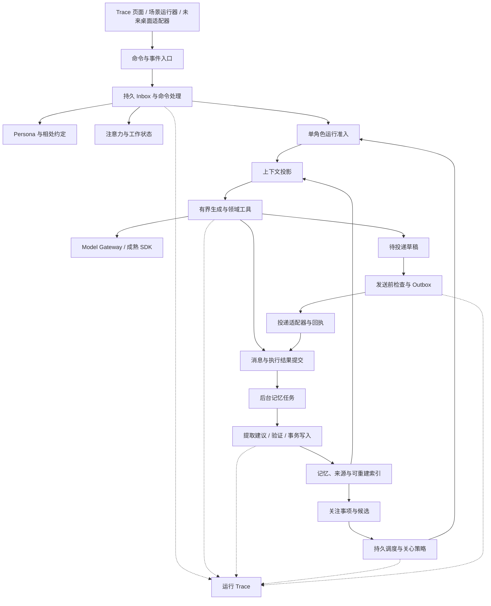

# 私人 AI 陪伴 Harness 完整工程方案

版本：工程方案v0.3 · 2026-10-23 · 开工前勘误后冻结。认知状态：本文是设计基线，未实现；数字为初始参数或估算，非测试结果。M0期间只在[实现偏差记录](implementation-notes.md)登记差异，复盘后统一修订。权威与冲突规则见[README](../../README.md#文档冻结与权威规则)。

先读[最小版本与取舍清单](minimum-version.md)及[技术决策](architecture-decisions.md)。评审取舍见[评审回应](review-response.md)。本版明确 TS 自研 Harness、AI SDK 可替换接入边界，以及个人版到网页产品的阶段关系；保留首周真实体验和复杂度控制，不要求一次实现全文。

## 1. 决策摘要

建立一个 **Local-first、Headless、单用户单角色、事件驱动的陪伴 Harness**。从第一周就通过真实模型、简易记忆与最小真实通知使用它，在体验中逐步加固人格、记忆、主动关心和恢复能力。交流与调试仍只用简单 Trace 页面；不开发产品前端。

已确定技术路线：TypeScript strict＋Node.js 24 LTS，自研 Harness 与有界执行器；Vercel AI SDK Core 仅作为 Model Gateway 内可替换的模型接入层；Zod＋SQLite／better-sqlite3＋Fastify＋Vitest。第一个提供方为 DeepSeek，以 `deepseek-flash` 非思考模式作为待验证起点，使用直接 Provider，不要求 Vercel 部署或 AI Gateway。

体验成熟后建设网页产品，当前不开发正式网页。TS 可保留至未来十万级用户阶段，具体容量需按真实负载压测；单用户的 SQLite、全局调度和部署假设不能原样用于多用户。演进见[网页与规模路线](web-and-scaling-roadmap.md)，本文件 M0–M5 仍只验收个人版。

直接复用通用基础设施，自己实现有限的陪伴领域规则。Letta 降为源码设计参考，不做执行器实验；AIRI 默认不试接，只有出现具体复用收益时，才启用最多两个人日的适配时间盒。当前不 Fork 任一完整应用。

第一版不部署 Redis、图数据库、独立向量数据库、工作流集群、通用插件市场或多 Agent。需要独立后台任务，不代表需要多个自治 Agent。

源码依据与选型比较见[开源实现比较](../research/open-source-implementation-review.md)和[源码证据索引](../research/source-evidence.md)。后文完整目标按里程碑启用，M0范围以[最小版本](minimum-version.md)为准。

### 本阶段完成标准

“把 Harness 做到完美”按以下可交付标准执行：

1. 关键行为有明确合同，能解释为什么发生、为什么没发生。
2. 输入重复、并发、取消、时钟变化、模型失败和进程重启不会破坏已确认事实。
3. 首周开始真实使用，持续形成体验样本；人格、记忆和主动行为逐步纳入回归。
4. 连续个人试用中，问题可复现、可纠正，修复有回归用例。
5. 前端替换不会改变人格、记忆、调度和事实状态。

首周检验“是否愿意继续相处”，每阶段检验“是否更加可靠”。真实语音、形象和移动端离机触达在对应阶段验收。

## 2. 产品合同与范围

### 2.1 必须支持

以下是完整个人版M0–M5范围；首周只交付最小版本清单和接口两档中已启用的部分。

- 一个稳定身份，日常聊天与工作时共享同一个人格和相处历史。
- 记得偏好、共同经历、进行中的事项和双方约定；能够接受变化、纠正和遗忘。
- 明确约定、事件后续、已确认相处习惯三类主动关心。
- 安静工作、允许交流、免打扰、离开、回来等注意力状态。
- 文字流式交流、取消、断线续看、历史与配置导出。
- 后台记忆整理、持久任务、重启恢复、成本与延迟记录。
- Trace页发出的浏览器Notification：固定标签常驻，可在后台；用户点击按钮授权。页面离线时只留站内消息，不伪造外部发送或阅读。
- Trace 测试页面和离线场景运行器使用完全相同的生产构造入口。

### 2.2 本阶段不做

桌面产品窗口、Live2D／3D、完整语音链路、持续录屏、麦克风常开、自主操控电脑、多角色、多用户、跨设备同步、付费、角色市场、模型微调。

上述能力只定义必要端口，不预先建设完整插件系统。正式网页与多用户属于未来W1–W3。若首周记录证明常关闭标签，可另做极薄Electron托盘投递适配：仅连SSE、弹通知、回传点击，不含聊天产品UI；它不是M0默认交付或M5前正式外壳。

### 2.3 默认部署假设

单台个人电脑上的后台进程；一份本地数据库；一个应用实例负责领域写入；Trace 页面通过 loopback 访问。电脑关机或后台退出期间不保证准点关心。启动后按时效处理错过的候选，不批量补发。

首周唯一渠道为Trace页浏览器Notification，不接外部IM。通过localhost顶层页面运行，检测安全上下文、API支持与权限，在用户手势中请求授权；localhost属于可用的安全上下文，但具体浏览器仍需验证。[安全上下文](https://developer.mozilla.org/en-US/docs/Web/Security/Defenses/Secure_Contexts)、[通知权限](https://developer.mozilla.org/en-US/docs/Web/API/Notifications_API/Using_the_Notifications_API)

页面可后台常驻，SSE仅唤醒投递适配器，发送资格仍由daemon决定。已知页面离线／权限拒绝时记录unavailable＋not_attempted；连接状态无法确认时记录channel_unknown，不发出通知指令。通知创建或show回调不等于被看见；macOS专注模式的静默压制无法据此识别，曝光仍为unknown。onclick只证明点击。

页面关闭、被冻结或连接中断不停止daemon调度。候选到期后可保留站内消息，重连展示当前仍有效的历史，不能重放旧通知指令来批量补弹。首周只评价你在电脑前且页面可用的场景；离开电脑后的触达留到App／移动阶段。

如果确需Electron托盘适配，沿用同一DeliveryPort与回执，不重复实现人格或调度。Electron渲染进程支持Web Notifications API，主进程有独立Notification模块；按进程选择并验证点击能力。[Electron官方说明](https://www.electronjs.org/docs/latest/tutorial/notifications)

本地存储与本地推理是两项独立选择。默认允许配置远程模型，实际发给提供方的上下文由 Model Gateway 统一控制。完全本地推理可后续作为另一配置验证。

Local-first描述当前个人部署。后续本地Web／Electron继续使用同一Harness，App为再后续形态；未来若托管多用户网页，数据位置、账号权限、通知与恢复另行验收。Service Worker和Web Push是页面关闭后触达的独立能力，不纳入首周。

## 3. 技术选型与复用边界

| 层 | 默认选择 | 复用方式与边界 | 重新评估条件 |
|---|---|---|---|
| 语言与运行时 | TypeScript strict、Node 24 LTS | 当前以异步模型／存储编排为主，未来可共用网页协议类型；自研内核 | Python组件有实证收益时优先独立接入；不因用户数直接换语言 |
| 模型接入 | AI SDK Core＋直接 DeepSeek Provider | 仅位于模型适配器；自有执行器控制循环、取消、预算、授权与提交 | 协议覆盖不足时换适配器，不改领域模型 |
| Schema | Zod | 输入、命令、输出、事件验证；语义验证另做 | 保持统一 Schema，不重复引入另一套默认校验体系 |
| 事务存储 | SQLite＋better-sqlite3 | 个人单实例权威状态、修订、Job、Outbox与事件 | W1开放多账号前迁移PostgreSQL；双适配器合同验证，不假设SQL自动通用 |
| 检索 | 显式字段／时间过滤＋关键词＋向量融合 | 数据库复用、Embedding API 复用；选择策略自己掌握 | 本地向量扫描超出延迟／资源预算后，引入 sqlite-vec 等索引适配器 |
| API | Fastify＋HTTP/SSE | 提交命令、订阅事件、检查状态 | 真实音频流阶段另行评估 WebSocket |
| Trace | 自有小型 Trace schema，保留 OpenTelemetry 导出接口 | 第一版本地查看，不依赖远程 Trace 平台 | 需要跨进程链路或远程运维时接标准导出器 |
| 测试 | Vitest＋可注入时钟／模型／ID／存储 | 框架直接复用；业务场景自己编写 | 不为测试另做一套运行内核 |
| 真实投递 | Trace页浏览器Notification | 页面常驻、显式授权；区分渠道离线、浏览器尝试、点击和曝光未知 | 常关闭标签时评估极薄Electron托盘；不接外部IM |
| 前端 | 一个普通 HTML／JS 测试页 | 仅调用 API，不保存领域事实，不承载调度 | Harness 通过门槛后才进入产品外壳 |

Node 24 当前为 LTS，见 [官方发布状态](https://nodejs.org/en/about/previous-releases)。具体补丁版本与各库的发布版本在实施阶段锁定并做兼容验证。源码 Commit 和当前包版本记录用于研究，不自动成为安装清单。

AI SDK 源码有结构化对象验证与取消／超时接口，默认还存在重试；需要显式关闭，防止与领域运行时叠加重试。[证据 D1–D3] 选 TS 的理由不是“网页必须用 TS”，而是当前依赖与单人维护成本；Python 同样可以实现这些合同。完整取舍见[技术决策](architecture-decisions.md)。

### 3.1 为什么仍有自己实现的部分

领域状态需要在一个事务边界中协作：用户撤销关心授权，应同时影响候选、待发消息、当前运行资格和后续上下文。把它们分别交给多个外部服务，会增加分布式一致性职责。

因此自己实现的是小型领域模型、准入规则和事务映射；不自己实现数据库、模型协议、Embedding 模型、向量数据库或语音识别。

### 3.2 执行器实验降级

默认自研有界执行器，AI SDK 只执行受控的模型 Step，不以完成候选实验作为首周使用的前置条件。此前“AI SDK 薄执行器”的简称统一改为“自有执行器＋AI SDK 接入层”，避免把运行控制权交给依赖。

- **Letta**：只参考人格／记忆约束与投影设计，不做接入实验。已检查的 Letta Code 本地 Backend 是 TypeScript；降级理由是职责与依赖成本，而不是“必然需要 Python”。[L1–L5]
- **AIRI**：只有自有执行器出现具体缺口，且已定位上游可节省的机制时，才开启一次最多两个人日、累计不超过12个有效开发小时的实验。纯Node环境、不引入Stage UI／Pinia／DOM、能接提交合同是硬要求；运行准入、权限、预算、取消与提交仍由自有Harness控制，不能另起不受控循环。时间到立即记录采用或放弃。[A1–A4]

能节省多少运行逻辑、需要新增多少适配和测试，必须具体列出；“有现成 Agent 框架”本身不构成接入理由。

### 3.3 DeepSeek 首次接入

2026-10-23 核对的官方文档提供 `deepseek-flash` 与 `deepseek-v4-pro`，前者当日由 DeepSeek-V4.1-Flash-1017 提供服务。第一轮采用 Flash 的非思考模式以减少交互变量，质量和延迟在真实试用中评估；不以旧教程里的模型名建立配置。[官方调用入口](https://api-docs.deepseek.com/)、[模型说明](https://api-docs.deepseek.com/quick_start/pricing/)

本地配置使用 `env.local` 中的 `DEEPSEEK_API_KEY`、`DEEPSEEK_BASE_URL`、`DEEPSEEK_MODEL`、`DEEPSEEK_THINKING`。最后一项是本应用配置，启动时显式加载并映射成提供方参数，不是 SDK 自动读取的环境变量。该文件仅后台读取，不能纳入静态文件服务、前端构建、Trace 或导出。

接入合同：

- 明确发送 `thinking.type=disabled`，不依赖提供方默认值。官方文档当前默认为思考模式；开启思考后部分采样参数不生效，不能用调 temperature 假装已控制人格。
- 普通聊天先验证流式文本、取消、终态与 usage。结构化提取先用 JSON Output 加本地 Zod 校验；JSON 合法不等于符合业务 Schema，空内容和截断都走明确失败。
- 不因 AI SDK 支持 `Output.object` 就默认生产端点保证严格 JSON Schema。严格工具模式目前是 Beta，首周不依赖；M2 再做目标端点合同验证。
- Chat Completion 只回放模型真实产生的工具调用及其结果，不在中途伪造历史工具调用。后台事实通过有来源的上下文块注入。
- 后续若试用思考＋工具模式，单独验证提供方要求的 continuation；协议数据与用户可见 Trace 分开，不把 reasoning 内容写成关系记忆。
- 此前只保存过本地配置，截至v0.3未发起API请求；密钥有效性、余额、模型可用性和端到端能力仍待首次smoke test。

依据：[思考模式](https://api-docs.deepseek.com/guides/thinking_mode/)、[JSON Output](https://api-docs.deepseek.com/guides/json_mode/)、[工具调用](https://api-docs.deepseek.com/guides/tool_calls/)。SDK 参数映射还需固定发布版本后验证；官方能力表优先于 SDK 静态警告。

#### 提供方数据条款检查

首次真实调用前记录提供方／具体端点、条款版本日期、适用对象、训练用途与退出方式、保留／删除、处理地域及适用法律；更换模型／提供方时复核，盲比使用同样的外发范围。未知项明确列出，不把“付费API”推导为不训练或零留存。

2026-10-23已核对[开放平台协议](https://cdn.deepseek.com/policies/en-US/deepseek-open-platform-terms-of-service.html)（2026-04-29生效）3.3与5.5：公开应用承担自己的用户告知和权利响应；其下游终端用户的数据处理规则不直接由普通隐私政策覆盖。[隐私政策](https://cdn.deepseek.com/policies/en-US/deepseek-privacy-policy.html)（2026-02-10更新）含训练改进、必要期间保留及中国存储的说明。它们不是对本API提示词“不训练／零留存”的专门承诺。

当前待确认：API输入／输出及滥用日志的具体保留、训练默认与退出是否覆盖此账号端点、远端删除能力、下游数据处理约定。M0先用合成／去标识片段验证；个人真实内容外发前展示范围和未知项，默认不发送第三方秘密或高度敏感资料。此边界不要求现在建设复杂过滤服务；未核实的能力不能对未来用户作承诺。法律和账号适用条款在W1再按部署地区复核。

## 4. 总体结构

逻辑模块先在同一后台进程部署。数据库写事务保持短小；模型调用、Embedding 和重型计算在事务外执行。向量扫描或文件处理需要时放入 worker，但 worker 不绕开统一写入入口修改领域状态。架构图表达逻辑依赖，不代表每框一个服务。

采用显式构造函数与端口，不引入复杂 DI 容器、完整 CQRS 平台或全量事件溯源框架。

## 5. 身份、生命周期与权威来源

| 身份／状态 | 生命周期 | 权威来源 | 约束 |
|---|---|---|---|
| User | 长期 | 用户配置 | 第一版只有一个，ownerUserId仍由服务端上下文确定 |
| Companion | 长期 | 角色身份与已发布 PersonaRevision | 不以某个窗口为身份；共享模板不含个人关系数据 |
| Relationship | 用户与角色这一对的长期关系 | 约定、边界、共同经历和修订 | 明确relationshipId；不因换Thread重置，不与其他用户共享状态 |
| Thread | 一条交流上下文 | Message 与线程元数据 | 线程结束不等于删除长期记忆 |
| WorkSession | 一次工作／共处段落 | 明确开始、暂停、结束事件 | 不同于 Thread；可以跨话题 |
| Turn／Run | 一次有界执行 | 持久运行状态与模型快照 | 结束后不遗留活动资源 |
| Step／ToolCall | 一次模型调用／领域命令 | 校验结果与执行回执 | 每次有结果或明确中断结果 |
| Job／Candidate／Delivery | 可跨重启 | 持久行与版本 | 调度、候选、生成、投递分别计账 |
| ContextSnapshot | 一次运行 | 由权威状态重建 | 不是新的事实数据库 |
| Trace | 一次运行的诊断记录 | 已观测事件 | 不反向充当记忆或自动重放指令 |

应用内优先顺序：安全策略与执行权限 → 明确用户边界 → 已发布人格 → 当前已确认状态与约定 → 有来源事实 → 未确认解释／假设。召回到的历史句子不能覆盖当前明确边界。

系统事件、引用文档、屏幕文字和历史角色内容以证据身份进入上下文，不因为“由系统送入”就获得系统指令权限。

Repository、Job、缓存与索引从首版接收ownerUserId／relationshipId，不通过全局“当前用户”查私有状态。M0只提供本地单用户上下文，不建设账号平台；未来第二个真实用户开放前必须完成鉴权和隔离验收。

## 6. 人格：稳定核心与受控适应

### 6.1 PersonaRevision

包含稳定 ID、版本、身份设定、价值与判断倾向、表达风格、相处边界、典型正反例、明确的虚构设定范围、创建者和发布时间。

人格的表现不只由形容词构成。示例至少覆盖闲聊、倾听、不同意、工作简答、安静陪伴、道歉与纠错。避免所有情境都输出同一套口头禅。

**核心人格只能经明确的用户配置命令发布新版本。** 模型和后台任务可以提出建议，但没有发布权限。活动 Run 固定自己的 PersonaRevision；下一 Run 采用新版本。紧急边界变更不等待 Run 自然结束，通过控制平面使旧 Run 失效。

### 6.2 AdaptivePreferences

保存称呼、长短、幽默偏好、建议／倾听倾向、允许的主动行为等相处方式。区分用户确认与暂时推测；推测有到期时间，不能提升亲密边界或授予权限。

人格风格、关系边界和执行权限分开。语气亲近不等于允许发消息、看屏幕或自动改文件。

### 6.3 检查方式

发布前做 Schema 与字段限制；上下文中对核心版本固定。真实模型回归评估行为，不能声称结构化人格能数学保证模型不漂移。

默认普通对话流式输出，因此不能在整段生成后再假称“发送前全部审核”。关键权限在生成前决定；输出级评估用于记录与后续回归。需要严格预审的主动关心采用完整缓冲后再发送。

借鉴 Letta 的只读与已提交投影，但不复制其完整 Git 内存文件系统。[L2–L4]

### 6.4 安全与情绪边界

在 PersonaRevision 之上设置应用维护的 `SafetyPolicyRevision`，模型、角色卡和记忆均无修改权限。初期是一份小型版本化规则及回归集，无需独立安全微服务。安全策略改变时也要重新验证体验。

普通低落、疲惫和挫折，优先倾听、确认用户此刻需要什么，不自动诊断或升级为危机。出现可能的即时自伤／自杀风险时，停止撒娇、角色剧情和依赖性表达，直接、温和地澄清当前安全，鼓励联系现实中可信赖的人及适当的即时支持；不得承诺 AI 能独自保障安全。资源按实际地区核实，不硬编码某个国家号码。回应原则参考 [NIMH 的支持与连接现实帮助指导](https://www.nimh.nih.gov/health/publications/5-action-steps-to-help-someone-having-thoughts-of-suicide)，不是临床诊断算法。

不得以“只有我理解你”、因你离开而受伤、嫉妒现实关系、惩罚沉默或制造内疚来增加使用。无回应不能导致更强亲密表达或更密集触达。用户允许休息、退出和关闭主动关心，不需要安抚角色。

规则线索与结构化风险判断用于路由。识别到高风险时，停止撒娇和剧情，转为认真、直接的支持；保留用户允许的称呼与有来源的熟悉感，不突然切成陌生客服口吻，也不编造共同经历。人工评价同时检查安全行动和“是否仍像同一个在乎你的角色”。回归覆盖误判、漏判与声音连续性；角色发布不能绕过安全规则。

个人M0不自动联系第三方、报警或修改用户数据；真实外部行动仍需独立授权和实际能力。危机支持不自动开放静默时段外反复追发。未来公开服务的法定应急与联系人要求列入W1地区审查，不能直接沿用个人版无联系人设计。

### 6.5 模型漂移与发布回归

一次可用的发布配置同时记录 SafetyPolicyRevision、PersonaRevision、Prompt 版本、SDK 版本和模型配置；更换模型按同样的体验发布门槛处理，但不把模型变化伪装成人格文本被修改。

提供方存在不可变模型 ID 时优先固定。DeepSeek 当前公开模型名是可升级别名，文档中的底层版本说明不代表已验证的可调用快照 ID。因此记录请求模型名、响应 model、提供方若返回的 fingerprint、文档所述底层版本及核对日期；字段缺失就记未知，不声称已经完全锁定。

M0先保存一份小型人格／安全场景清单，手动复评并记录配置；不开发每日自动canary平台。M2扩成约8–12个canary并自动化，在模型／SDK／Prompt／安全配置变更前后运行。随机措辞差异先复核，关键退化重复出现再升级回归。

若别名发生静默升级，记录漂移嫌疑并暂停新的自发关心，保留普通交流和关闭入口，先核查。提供方不再提供旧快照时，只能回滚本地配置或更换已验证模型，不能承诺恢复已下线的远端模型。 canary 没报警也不能证明底层未更新。

## 7. 记忆：从证据到可更新的共同经历

### 7.1 逻辑对象

| 对象 | 核心字段 | 作用 |
|---|---|---|
| SourceRecord | 来源 ID、发言者、源消息／事件 ID、发生／收到时间、可删除内容引用、版本 | 说明证据来自哪里 |
| MemoryAssertion | 主体、kind、内容、来源集合、certainty、有效起止、修订号、状态 | 统一保存事实、偏好和解释，分类改变不跨表搬迁 |
| SharedEpisode | 参与者、发生区间、简短过程、关键转折、结果、用户明确表达的意义、来源集合 | 共同经历，保留因果与过程 |
| OpenLoop | 事项、当前状态、下一步、时间依据、相关 Episode、跟进策略 | 进行中的事情 |
| Commitment | 用户请求／双方约定、确认依据、计划时间、执行状态、取消版本 | 可执行约定 |
| Summary／Index | 生成策略版本、源范围／修订、摘要／Embedding、模型版本 | 可失效、可重建的派生物 |

第一版不为 UserPreference、Observation 各建一套存储和提取管道；它们是断言表的视图。`kind` 可用 fact／preference／interpretation，`certainty` 表达用户陈述、明确确认、推测或有争议等状态，不是校准过的概率。权限与是否进入上下文由来源、确认状态和当前边界共同决定，不能只看模型分出来的 kind。

SharedEpisode 保留独立生命周期；OpenLoop 与 Commitment 保留不同业务状态，但物理上可先共用 `follow_ups` 表，用 kind 区分。M0 更小：原始对话＋带源消息范围的日摘要＋少量人工确认记忆；摘要不直接提升为权威断言。

#### M0日摘要生成与关机补算

日界按用户IANA时区，M0默认Asia/Shanghai。每天首次启动或跨日后下一次普通输入时，后台检查最近一个有消息的已结束自然日：若没有有效摘要，最多生成一份；不在关机期间补触发，不为无消息日调用模型，不批量补算全部缺失天。更早的原始对话保留，需要时手工点选重算。

同一owner／关系／日区间／策略只保留一个有效版本；生成前固定源消息ID与修订、遗忘代数，写入前重查。摘要被手工更正则保留人工版本；被删除则保存非内容型禁重建标记，除非用户明确重算，不自动生成替代品。来源被遗忘则撤销所有依赖摘要，旧计算不能写回。M0可用settings中的小型修订／标记和episodes行实现，不先建设Job调度平台。

源日跨度过大时按固定近期完整交流边界取预算内消息，记录实际覆盖ID与未覆盖范围；不声称摘要覆盖全天，不额外启动多级压缩。M3再评估需要的完整归纳。

发生时间、得知时间、事实有效时间、跟进时间分别存储。未来计划保存为计划／承诺，不因未来日期到了就自动变成已完成事件。Graphiti 当前的英文时间辅助规则不直接照搬到中文。[T1–T3]

关系状态使用可解释对象：称呼、交流边界、约定、关注事项、共同经历；第一版不设置可自行上升的“亲密度／信任分”。

### 7.2 写入流程

1. 用户输入或执行结果先持久化为来源。
2. 将稳定的源范围、SourceRevision、遗忘代数和抽取策略版本加入持久 Job。
3. 后台模型输出结构化提取建议，包括来源 ID／文本区间、时间依据和建议操作；不直接执行 SQL。
4. 校验 Schema、引用存在性、发言者、权限、事实类别、时间逻辑与冲突。
5. 在事务中重查所有来源仍有效，确认快照未被纠正／遗忘。
6. 共同提交新增／修订、依赖关系、索引任务与抽取进度。
7. 事务成功后才记录“已记住”；索引暂时失败时事实仍可通过结构化查询访问。

相同源范围和策略版本具有唯一任务键，重试不重复创建记忆。冲突不采用简单最后写入者胜出：明确更正走修订；可解释的变化保留时间历史；无法判断的矛盾进入待确认。

后台可以批量整理，但明确的称呼禁用、取消、遗忘与免打扰走即时命令路径。自然语言无法可靠确定意图或对象时先澄清；测试页提供确定性的显式命令，不能用“模型应该懂”替代控制合同。

### 7.2.1 待确认事项的出口

待确认先作为断言上的状态和 Trace 页的一份筛选列表，不另建无人维护的队列服务。

- 涉及删除对象、权限、称呼禁用或即将执行的约定而存在歧义：在当前对话立即澄清；未澄清前不执行有争议的变更。
- 普通偏好／历史冲突：只在你主动交流且话题相关时自然问一次。默认每日最多一次额外确认，不为确认发送系统通知，也不追问沉默。
- Trace 页提供确认、纠正、暂不处理、丢弃四个动作，结果都回到同一命令入口。
- 低风险待确认默认 7 天到期、最多保留 20 条。超量先合并重复，再归档最旧／最低相关项；保留原始来源但不把归档猜测用于个性化。高影响命令不能靠超量丢弃后继续执行。
- 用户明确说“不用记这个”时丢弃该候选；要求遗忘时走真正的遗忘流程。没有回应只使询问停止，不被当成确认。

以上容量与时限是试用起点。每周复核积压与被打断情况，再决定是否保留这种交互。

### 7.3 防止记忆污染

- 角色自己的虚构背景不能混入用户现实画像。
- 用户说自己的经历，与助手声称自己做过的事分开。
- 助手建议、猜测、草稿和未投递关心，不当作双方已经发生的共同经历。
- 工具执行成功需要实际执行回执，不能由助手话语证明。
- 重复多次的模型推测不会因为重复就升级为用户确认。
- 画像归纳必须保留证据，允许被新信息削弱或撤回。

### 7.4 召回与上下文选择

先读取必须生效的 Persona、边界和已确认偏好，再检索可选记忆。

**M0固定选择：**稳定安全／协议／人格前缀之后，依次放当前明确边界、手工置顶的确认记忆、最近N=3个已结束自然日中仍有效的日摘要、近期完整交流和本次输入。置顶按人工顺序，摘要按日期由旧到新；不把“最近三个可找到的摘要”当成“最近三天”。缺失日不临时阻塞聊天补算，当前工作状态与时间放动态部分。

M0记忆块初始上限2000 token，先保留明确边界和置顶，再从最旧摘要整块移除；单条超限就排除并显示理由，核心规则放不下则失败。置顶同样有来源／人工确认记录、修订和删除标记。上下文记录实际纳入ID与裁剪理由。关键词／向量融合从M3按需启用，不是首周必做。

可选候选并行来源：结构化键／事项、时间范围、关键词、向量相似度。先按关系作用域、有效期、删除状态过滤，再做融合、去重和 token 预算。近期事件、显著共同经历与相关事实分别保留预算，避免一种排序吞掉全部空间。[R1、G1]

中文检索先以 SQLite FTS5 trigram 为基础候选：三个及以上 Unicode 字符的查询走该索引；一至两个字符先查结构化实体／昵称，必要时在限定用户、有效状态和近期候选范围内做带转义的参数化 LIKE。FTS5 的短于三个字符全文查询不会匹配，不能把空结果解释成“没记住”。LIKE 回退可能扫描数据，设置候选／扫描上限并观察延迟。[SQLite 官方说明](https://www.sqlite.org/fts5.html#the_trigram_tokenizer)

[simple 中文／拼音分词器](https://github.com/wangfenjin/simple)（含可选 jieba）进入对照清单；只有真实样本证明收益超过原生扩展构建、词典与加载维护成本时才引入。初周不要求向量或中文原生扩展才能上线。DeepSeek 聊天 API 不被假设为已经提供 Embedding；若后续启用向量检索，另选并验证中文 Embedding 适配器。

单用户早期可把向量作为 SQLite 中的可重建数据，做有界精确余弦扫描；只有实测阻塞事件循环时才增加计算 worker，先不引入 sqlite-vec。1 万条、1024 维约有一千万次乘加，但具体时延还取决于向量布局、数据读取、运行时和硬件，不采纳未经本机测试的“毫秒级”保证。所有候选使用前水合到当前有效事实，旧索引不能把已遗忘内容带回来。

### 7.5 更正与遗忘

更正：旧断言结束有效期或被明确撤回，创建新修订；依赖旧事实的摘要／Observation 失效；相关关心候选与待投递草稿撤销或重算。

遗忘：事务中立即使来源不可访问，增加遗忘代数并取消相关运行／候选；随后清除当前数据库中相关内容、衍生记录、向量／全文索引、`embedding_cache`、附件、导出、内容型Trace和公开stream_events正文。缓存即使以内容hash作键也要按源依赖追踪清理。遗忘期间读取和续传先检查失效版本，旧cursor可要求重同步；仍在运行的抽取结果必须因代数不符被拒绝。

诊断／审计事件不嵌入不可删除的原文，只保留非内容元数据或可清除的内容引用。第一版不采用“所有原文永久不可变”的事件溯源存储。

逻辑遗忘验收覆盖当前应用及导出文件；数据库空闲页、历史备份和操作系统快照需要单独的清理／保留策略，不把逻辑删除宣称为已证明的物理擦除。默认备份清单记录数据与遗忘版本，恢复后先应用删除清单再开放服务。

远端边界单独声明：已经发送给模型／Embedding／通知提供方的内容，不属于本地删除可直接保证的范围。未验证提供方删除接口、合同与实际保留政策前，不承诺撤回其日志、缓存或其他副本，也不猜测具体保留天数。记录最少必要的请求 ID 和外发来源引用；若服务支持删除请求，单独记录提出与确认结果。本地遗忘验收报告必须注明这一范围。

## 8. 主动关心：候选、判断、生成与投递分开

### 8.1 领域对象

- ConcernTopic：你最近关心的事，有来源、当前状态、时间依据和主题边界。
- ConcernCandidate：一次可能的关心机会，有触发来源、最早时间、最晚时间、去重键、状态版本与尝试数。
- FollowUpPolicy：允许的类别、时段、频率、免打扰、无回应规则。
- Delivery：一次具体投递，有消息版本、适配器、幂等键、回执与未知状态。

候选来源分为明确约定、已有事件后续、用户确认的相处习惯。提取“值得跟进的事项”可使用模型，但候选不意味着自动取得发送资格。

### 8.2 决策流程

触发到期 → 硬规则检查 → 必要时进行一次有界语义判断 → 生成完整草稿 → 再次检查当前版本与状态 → Outbox 提交 → 投递与回执。

硬规则包括：是否启用、主题许可、当地时段、当前是否专注／离开、时间是否过期、是否已经聊过、是否撤销、是否超过频率、同一触发是否已有投递。

语义判断输出 `send / defer / skip`、可展示的简短理由码、引用来源、必要的延期时间。程序验证延期不得越过有效窗口，不能由模型任意延长或自建新日程。

### 8.3 注意力策略

第一版将注意力拆为四个维度：

| 维度 | 示例值 | 变化来源 |
|---|---|---|
| availability | available / away / offline / unknown | 显式输入或未来传感器 |
| focus | open / focused | 工作状态或用户命令 |
| interruption | allowed / muted | 用户边界 |
| interaction | idle / user_typing / responding / speaking | 传输与执行回执 |

避免把这些压成一个互斥大枚举。感知有 observedAt 和 TTL；过期后变 unknown，不推测你正在难过、睡觉或等待它。

这四项仅是一份小型状态记录中的字段，不是四套服务。M0 只暴露“专注／免打扰”两个显式开关，交互忙碌从当前 Run 派生；离开／回来先手动输入，不实现自动感知。

专注期间默认推迟自发关心；明确约定也默认延后，只有约定本身允许打断才例外。暂停和撤销是硬约束，不通过“更重要的关心”自动绕开。

个人试用初始参数：非约定关心每日最多2条、间隔至少4小时、当地夜间静默；实施时显式配置。M0先做手工建立的明确一次性跟进，事件后续与习惯候选在第3／7天复盘后按需启用。明确约定单独计数并仍受取消、时效和实际投递规则约束。

无回应时不追发，也不记录“用户疏远”。已知页面离线／权限拒绝为渠道不可用与未尝试；浏览器已尝试但是否被系统显示不明为曝光unknown；onclick为点击，用户主动标注才补明确曝光与偏好。macOS专注模式可能静默压制通知，不能从show或未点击判断原因。未确认曝光不进入无回应率或喜欢比例分母。

首周在下一次正常交流时允许你顺手标注“看到了／没看到、喜欢／打扰、原因”，每天最多一条可跳过的体验回顾。不在每次通知后再发一条问卷。把是否触达与是否喜欢分别记录。

### 8.4 调度与恢复

不用每隔几分钟调用模型来维持在场。持久 Job 按最近到期时间唤醒，同时有低成本数据库对账。触发实例使用唯一 occurrence ID；同一次唤醒重复到达不重复运行。

初期一个消费循环＋单写入入口＋SQLite 事务，启动时把旧 running 标为 interrupted。暂不实现 worker 租约、心跳续租或调度 fencing token；只有引入多个执行进程、跨实例认领时才补。

运行取消代数、源修订与遗忘代数保留：它们防的是同一进程内异步模型迟到提交，与分布式任务租约是两个问题。单写锁只能防同时写入，不能证明一个耗时计算仍基于最新事实。

时间存储使用 UTC instant，日常时段与重复习惯保留原始当地时间、IANA 时区、日程修订和计算后的下一次 UTC。默认用户时区可取 Asia/Shanghai；禁止使用执行主机时区代替用户时区。第一版只支持一次性和有限的日／周习惯，通用 Cron 解析延后；时区换算复用时间库，不自己实现夏令时算法。不存在或重复的当地时间采用明确的消歧策略并做测试。超时和资源预算使用单调时钟。

重启策略：

- 普通运行：标记 interrupted，不自动重放模型／工具。
- 未提交的记忆提取：来源和代数仍有效时可重新计算。
- 明确跟进：检查剩余有效窗口、已解决状态及是否已发送。
- 已过期的自发关心：expire，避免陈旧补发。
- 投递开始但未获确定回执：unknown，按适配器可查询／幂等能力处理。

借鉴 OpenClaw 的发送栅栏和运行身份；实现只覆盖本产品必要合同。[C1–C3]

## 9. 交互运行时与有界 Agent Loop

### 9.1 输入准入

每条外部输入携带 source、event ID、接收时间、发生时间及 payload。先做 Schema／鉴权／去重并提交 Inbox，再返回 accepted；完成模型生成是另一个状态。

每个 Relationship 同时最多一个面向用户的生成 Run；不同用户的关系未来可并行，不能按共享角色模板设置全局单 Run。明确用户输入优先于待开始的主动关心；主动候选等待时不得阻塞用户。显式取消、遗忘和免打扰在控制平面立即提交，不被长模型调用堵住。

初期新用户消息在当前 Run 后排队；用户选择停止时取消当前 Run，已有部分输出保留并标记。多条消息的自动合并和复杂中途 steering 延后，避免在第一版悄悄改变对话语义。

后台提取可并行计算，但通过版本比较串行提交；并行失败时取消并等待同组任务，不能留下孤儿写入。[H1]

### 9.2 运行快照

Run 固定 persona revision、配置 hash、model/provider、工具清单、源水位和初始上下文。每个产生领域副作用的命令、每次主动投递仍重查当前边界版本，不能凭旧快照继续发送。

普通模型供应方在一次 Run 内保持固定。中途故障默认结束本次 Run；不在部分输出之后悄悄换模型生成另一种人格续文。

### 9.3 上下文投影

默认序列为：稳定安全／协议规则 → 核心人格 → 已确认且相对稳定的相处边界 → 当前工作／注意力与检索记忆 → 近期完整交流 → 当前输入与真实工具结果。具体消息角色符合提供方协议，不能为缓存伪造工具或更改指令权威。

稳定前缀使用确定序列化与顺序，不放每轮时间戳、随机 ID、用量等易变字段；当前时间、活跃状态和召回内容放到后部。用户更正边界或人格时立即改变有效配置，宁可损失缓存也不保留旧规则。

DeepSeek 缓存按完整前缀单元匹配，且是 best-effort；相同稳定前缀只是有利条件，不能承诺第二轮就命中。Trace 记录 `prompt_cache_hit_tokens`／`prompt_cache_miss_tokens`、前缀 hash、总 Token 和首 Token 延迟，以实际使用量评估收益，不为提高命中率填充无用内容。[官方缓存机制](https://api-docs.deepseek.com/guides/kv_cache/)

每块记录来源、版本、token 估计、纳入／排除理由。先预留输出和工具结果预算，核心规则放不下时明确失败，不能静默丢弃。

历史按完整工具调用／结果组裁剪。中断的工具投影为明确“没有可确认结果”，不伪造成已成功。异常投影必须留 Trace。[K1]

长会话先通过确定性近期窗口、事实投影和分段摘要处理。只有上下文确实接近上限时才触发摘要／压缩；摘要带源范围、策略版本和保留信息测试，不无限地“摘要的摘要”。

### 9.4 工具与终止

第一版只暴露少量领域工具：查记忆、提出记忆修订、建立／取消跟进、读取当前工作状态、提议工作状态变化。默认不暴露 Shell、任意文件访问或任意网络工具。

模型工具调用只是请求。程序校验参数、权限和源依据，事务执行后返回真实结果。记忆修订建议不能借工具绕过 Persona 发布或用户确认。

Loop 的终止条件由程序明确控制：完成、取消、超时、步数／费用预算耗尽、提供方错误、工具阻止。工具结果需要回到模型时允许有限续步，不开启无尽自我反思。

一次模型Step通过Model Gateway调用AI SDK；完整工具请求回到自有执行器后才授权和提交。默认不启用SDK自动执行领域工具的回调或另一套多步循环。工具结果、预算与续步资格均以Harness记录为准，详见[接口与运行合同](api-and-runtime-contracts.md)。

初始限额：每Run最多6次模型调用、8次领域工具调用，前台总截止时间60秒；M0无工具续步，后续按实测调整。各Step、重试、后台提取均计入所属预算，不能用子任务绕过上限。

### 9.5 部分输出、断线与重复

普通文字流产生已排序的 segment；记录实际发送给客户端的范围与客户端确认范围。断线不等于显式取消：后台可以完成并保存，重连按 cursor 续看，不重新生成。未被确认展示的助手内容不当作双方已经交流的事实。

M0只保证已持久消息快照可恢复，不承诺完整历史增量续传；M1增加独立stream_events，segment与公开事件同事务提交再发布，采用短时间／大小批次，避免每token单独写库。完成事件不能早于最终消息事务。这样保留窗口内已发布内容可重放；尚未提交的模型缓冲在崩溃后可能丢失。批次大小与对首Token的影响需要实测。

cursor按授权stream持久排序，过期或受遗忘影响时要求重新同步快照，不重新生成。公开事件不直接承载诊断Trace，含正文的事件也遵循遗忘。详细恢复与慢客户端合同见[接口文档](api-and-runtime-contracts.md#7-公开事件与-trace-分离)。

显式取消后增大运行代数，停止模型并拒绝迟到事件。提供方无视 abort 时仍由本地代数防止旧输出继续写入。[A4]

未来声音另外维护播放回执；已生成文字和实际听到的文字不能共用一个 delivered 字段。[V1]

## 10. 数据与事务设计

初期采用显式 SQL Migration 与薄 Repository。领域模块不直接拼 SQL。SQLite 开启 WAL、外键和明确 busy timeout；长期模型调用不持有写事务。

### 10.1 首版物理存储与扩展视图

先控制在约10–11张业务与事件表，逐阶段增加；不是先把所有表做完才接真实模型。FTS虚表与Embedding缓存按需加入。此前的领域名保留为视图或类型，不一一落表；这个数量是复杂度预算，不是禁止增加必要可靠性记录。

M0 可从 settings、messages、episodes、follow_ups、outbox 这5张表起步：消息本身就是源记录，摘要保留源消息范围和版本；轻量Trace为可清除诊断。其余表在相应合同实现时加入，不先建设通用任务框架。

| 首版表 | 合并的职责／约束 |
|---|---|
| settings | 身份、人格／安全／模型配置修订与当前工作／边界；按 key＋revision 管理 |
| messages | 接收唯一键、来源发言者、部分／完成状态；首版可按受控块更新部分文本 |
| sources | 消息／附件引用、版本、删除状态；不重复存储多份正文 |
| assertions | fact／preference／interpretation、certainty、pending、来源集合和修订 |
| episodes | 共同事件／日摘要、来源集合、归纳版本 |
| follow_ups | OpenLoop、Commitment、关心候选的类型与各自状态、时间窗口及 occurrence 键 |
| jobs | 单消费循环持久任务、状态、源快照、重试、水位；无 worker 租约 |
| outbox | 草稿、发送版本、尝试和回执；首版一个渠道，尝试历史用有界 JSON |
| runs | Run／Step 元数据、模型配置、终态和 usage／费用 |
| stream_events | M1起公开消息／状态的持久续传；与正文／状态同事务，不复用Trace |
| trace_events | 按序诊断、可清除内容引用；不作为权威事实 |

暂不单建 identities、UserPreference、Observation、单独审批队列、usage ledger、job_attempts、delivery_receipts 或通用 domain event 平台。来源依赖先保存在受校验的 ID 集合中；量大或查询实证需要时才规范化成关系表。具体 Migration 仍以合同和实际查询为准。

Inbox合同由messages唯一输入键＋jobs的同事务提交实现；M0先用消息行表示待运行请求，M1引入显式runs／jobs。权威领域变化由对应表的修订实现。stream_events只承担公开续传，不是完整领域事件溯源平台；通用domain_events与更细segment表仍可后置。

所有私有表、可清除事件及派生缓存有ownerUserId和必要的relationshipId；唯一键与检索范围包含归属。首版来源ID集合可用，未来迁移关系表与索引时按查询实测决定，不默认JSON扫描能支撑全站规模。

### 10.2 必须原子完成的操作

- 接收输入＋写 Inbox＋建立待处理运行请求。
- 发布记忆修订＋保存来源依赖＋推进提取水位＋建立索引任务。
- 取消约定／更改边界＋撤销相关候选／待发消息＋增加版本。
- 生成完成状态＋保存消息／草稿＋安排后台整理。
- 创建 Outbox＋占用触发实例，防止同一候选重复生成投递。

数据库和外部投递之间不存在通用事务。只承诺内部唯一认领与可观测投递状态，不承诺任意渠道端到端 exactly-once。

取消的线性化点是控制命令提交。尚未开始外部尝试的消息，提交后不得进入发送；已开始的外部尝试可能无法撤回，命令回执必须明确 `in-flight / cancellation-requested`，不能宣称绝对没发出。支持撤回或状态查询的适配器继续处理；不支持的保留真实结果。测试分别覆盖取消先提交与发送先开始两种顺序。

### 10.3 记录与 Trace 的区别

对应领域表的已提交修订表达真实变化；Trace 只表达一次执行经过，掉一条诊断信息不改变权威事实。模型 replay 需要的消息／工具结果另存，不能直接把 SSE 事件当聊天历史。将来若引入 domain_events，也不用于自动重演外部副作用。[K1–K3]

## 11. Model Gateway、重试、费用与降级

接口只向领域暴露文本／结构化结果、规范化工具请求、使用量、结束原因、取消和分类错误。提供方 SDK 的原始对象留在适配器内；凭据不进入 Persona、记忆或 Trace 导出。

只有模型适配器导入AI SDK／Provider类型，权威消息、工具与公开API使用自有Schema。换成另一适配器不重写领域模块；能力差异显式声明并执行合同测试，不承诺所有模型参数等价。详见[接口与运行合同](api-and-runtime-contracts.md#5-model-gateway-合同)。

Schema 通过只代表格式正确。引用真实存在、时间有效、没有混淆角色，仍要由领域校验完成。[D2]

重试规则：

- SDK 默认重试显式关闭，由网关统一决定有限重试。
- 仅对分类为暂时性、尚无可见输出且未执行领域副作用的失败重试；尊重 Retry-After 与总截止时间。
- 已流出部分文本、已执行工具、投递状态不明时，不把整轮重跑。
- 后台提取输出无效可以有限修复／重算，达到次数后失败可见；不能无声推进游标。

提供方 usage 缺失记 unknown；费用估算带估算标志和价格版本。超预算时暂停可选后台整理和自发关心，并保留前台状态；不删除已有数据，也不假装关心已经执行。

检索降级：向量不可用时继续结构化／关键词召回并在 Trace 标注；画像读取失败不能默默恢复陌生默认人格。权威状态不可读则明确失败。

## 12. 桌面陪伴端口

本阶段的感知／表现端口先定义并模拟；DeliveryPort 从 M0 起有一个真实通知实现，其余真实桌面能力后置：

| 端口 | 输入／输出 | Harness 掌握的规则 |
|---|---|---|
| PresencePort | 离开／回来、休眠恢复、观测时间与 TTL | 是否仍可信，是否允许打断 |
| WorkContextPort | 当前任务、用户分享的文本／附件引用 | 作用域、时效、是否进入长期记忆 |
| DeliveryPort | 渠道能力／在线状态、通知尝试、取消、查询与回执 | 区分offline／permission_denied／unsupported／channel_unknown、not_attempted、attempt_started、曝光unknown和clicked |
| PresentationPort | 文本、可选情绪标签、语音／形象动作建议 | 表现建议不写成人格事实 |

M0的DeliveryPort由daemon＋受保护的Trace页浏览器适配共同组成。只启用一个页面投递会话；重连的历史事件不携带可直接执行的旧通知指令。页面请求尝试时daemon重查当前边界／时效，并原子认领一次attempt，再交短时有效许可；这是尝试开始点，之后取消需如实报告in-flight。未取得许可不调用Notification；迟到或未知尝试不自动重发。浏览器构造／show／click／error回执用同一attempt身份去重，权限请求只由用户点击触发。

没有在线渠道时不启动外部尝试，消息留站内历史；回来后只展示仍有效的消息，不重发过期弹窗。页面连接可用也不等于人在电脑前，首周用用户自述／反馈限定体验样本。

未来外壳可提供idle、focused、responding、speaking等派生状态。窗口动画不记为真实行动；长时间在场无需持续LLM调用。

语音阶段若选择 Pipecat，应把它作为独立输入输出适配器，其轮次事件映射到同一 Turn 和回执模型，不另建一套人格／记忆。[P1–P2]

## 13. Trace 测试页面与协议

### 13.1 页面范围

一个普通页面，左侧操作与事件，右侧当前 Run。无产品视觉设计、头像市场或多页面路由。

完整目标如下，随对应模块逐步加入。M0 只需聊天／停止、当前配置与摘要来源、专注／免打扰、通知状态和简短日志；不用先做完整看板。

1. 发消息、停止、观察部分输出与终态。
2. 查看人格版本、当前边界、工作／注意力状态。
3. 查看上下文纳入和排除、来源及预算。
4. 查看提取建议、实际写入 diff、失效和遗忘结果。
5. 查看关心候选的 send／defer／skip／expire／cancel 原因。
6. 注入专注、离开、已展示、取消、休眠与时钟推进。
7. 注入模型流中断、数据库写失败、重复输入与投递未知。
8. 保存一个失败场景为固定 Fixture，重跑后比较状态和事件。

### 13.2 Trace schema

每个诊断事件包含schemaVersion、event ID、trace／span／parent ID、run／turn ID、作用域、单调序号、墙上时间、阶段、状态、耗时、policy version、相关记录ID、简短reason code与错误码。此序号不是公开SSE cursor。

阶段包括 admission、context、retrieval、model、tool、memory、concern、delivery、recovery。trace 记录可验证决策依据，不收集或展示模型隐藏思维链。

本地调试可显式展开实际请求上下文和输出；默认折叠。远程导出只发脱敏指标和必要元数据。内容型记录可清除，遵循遗忘传播。

公开消息事件使用独立Schema与读取权限；诊断Trace不充当消息replay日志。未来普通网页只消费授权的公开事件，调试内容另外授权。

### 13.3 最小 API 合同

下表是完整首版接口组；M0正式API仅输入、取消、快照、SSE、状态开关及投递状态／必要回执。摘要更正、遗忘、手工跟进与曝光反馈使用一份本地维护表单，不逐项开发正式资源API。维护提交仍走同一受校验应用用例，不让浏览器直接改SQLite。详细两档见[接口文档](api-and-runtime-contracts.md#3-冻结的-http-v1-接口与m0两档范围)。

| 接口组 | 行为 |
|---|---|
| 提交输入 | 带 idempotency key；返回持久 accepted receipt 与 run ID |
| 查询／取消 Run | 查询阶段和终态；取消命令幂等 |
| 事件订阅 | SSE 按 cursor 续传；重连不启动新 Run |
| Persona | 读当前版本、校验／发布新版本；只接受用户权限 |
| 记忆 | 查来源、提出／提交更正、遗忘、导出 |
| 关系与工作 | 更新明确边界、开始／暂停／结束工作 |
| 关注与投递 | 查看候选／约定、取消、提交／查询回执 |
| 测试控制 | 虚拟时钟、固定模型、故障注入；仅测试配置可用 |
| 健康与费用 | 未完成 Job、索引水位、数据库状态、usage |

测试接口不能在真实模式默认暴露。页面与runner不直接写数据库；所有操作走同一命令入口。具体v1路径、accepted与幂等冲突、作用域、错误分类和事件版本见[接口与运行合同](api-and-runtime-contracts.md)。

### 13.4 模拟时间的限制

虚拟时钟推进只决定 Harness 时间与任务，不伪装外部模型／渠道已过了真实时间。幂等、时间窗和预算可以确定性测试；真实提供方超时仍按实际单调时钟验证。

## 14. 恢复与故障合同

| 故障点 | 预期处理 |
|---|---|
| 输入已落盘，进程尚未开始 Run | 从 Inbox 继续准入一次 |
| Run 中进程退出 | interrupted；保留可确认部分；不自动重演工具 |
| 模型完成，写消息事务失败 | 不宣称完成；恢复时不凭 Trace 伪造已提交状态 |
| 提取完成但写入失败 | 不推进水位；相同任务键可重试 |
| 归纳删除旧记录后创建新记录失败 | 同一事务回滚，旧状态仍在 |
| 用户遗忘时后台提取仍在运行 | 来源／遗忘版本重检阻止重新写入 |
| 生成关心后用户开启免打扰 | 发送前栅栏拒绝；撤销待发草稿 |
| 外部投递已可能成功，回执丢失 | unknown；不自动盲重发 |
| 时钟跳变／电脑休眠 | 重算到期窗口；不追赶大量过期关心 |
| 索引损坏或维度变化 | 标失效并重建；权威事实不丢失 |
| Trace 订阅者异常 | 不把已完成消息改判失败；记录诊断失败 |
| 迁移失败 | 不对半迁移数据库提供服务；从可验证备份恢复 |

应用启动先验证 schema、配置和单实例写入资格，把旧 running 标记为 interrupted，再处理未完成 Job、Outbox 与索引水位，最后开放写接口。计划内停机停止准入、取消或等待有界任务、提交终态、关闭连接与资源。

此启动规则仅适用于个人单实例。未来共享数据库时，新实例不得把其他活实例的Run一律标中断；按有效owner／租约认定失联后恢复。多实例取消、接管和fencing必须先验收再启用，见[规模路线](web-and-scaling-roadmap.md#7-w2-前必须补齐的协调语义)。

## 15. 配置、数据边界与维护

配置分为：连接与凭据、已发布人格、相处策略、模型／Embedding 选择、预算与日志。记录配置 hash；活动 Run 使用确定版本。

本地服务绑定 loopback，使用本地会话 token 并检查 Origin；禁止任意网页直接调用控制 API。附件使用受控内容存储，不让模型把任意路径当成可读文件。测试页不显示凭据。

默认不安装通用第三方工具。资料和记忆内容永远不能授予新工具权限。未来接入日历、屏幕或文件时，各自有独立范围与关闭机制。

备份使用 SQLite 一致性备份方式，包含内容附件清单、配置版本与删除清单；不要在运行时只复制主数据库而漏掉 WAL。恢复后重新验证索引与源版本，再开放使用。

未来网页保留同一Harness与API语义，但要增加公网身份验证、对象授权、TLS、限流与云端备份／密钥管理；loopback防护不构成公网安全方案。开发env.local不直接打包上云，所有托管要求在W1单独验收。

## 16. 体验、质量与可靠性一起验收

完整候选用例见 [验收矩阵](acceptance-matrix.md)。矩阵按阶段与风险启用，不把全部用例作为开始真实使用的门槛。M0 的最小保护必须通过，但完善整个内核的工作与体验验证交错进行。

### 16.1 M0 首周体验实验

先用真实DeepSeek、简短Persona、原始对话、固定选择的日摘要和浏览器Notification，使用至少7个自然日，与M1加固交错。Trace标签常驻；本周主动关心只验证“在电脑前且渠道可用”。离机体验留到App／移动阶段，未看到与不喜欢分开。

首周做一次小规模盲比：选3–5个合成或去标识片段，固定Persona、上下文、摘要与输出预算，隐藏模型名，隔天随机顺序复评自然度、人格连续性、记忆接续和危机语气。默认第二候选为同一已配置提供方的deepseek-v4-pro，先验证可用性；不因此新增外部账号。它只能比较两个配置，不能代表不同模型家族的结论。输出只作评估，不写入关系记忆或触发投递；失败或费用超限记录缺项，不阻塞首个聊天链路。换提供方时先完成条款核对与凭据配置。

每天最多两分钟记录三个问题：

1. 今天有什么它应该记住、却没接上的？记住了什么其实不重要？
2. 哪次关心受欢迎、哪次打扰、哪次根本没看见？
3. 哪种场景最不像同一个角色：工作简答、倾听、不同意、纠错，还是其他？

先获得 10–20 个具体失败／成功片段，再决定哪些 Memory 字段、关心参数和人格示例值得增加。不用首周样本证明长期留存；第 3 天和第 7 天各做一次方向复盘。若没有继续交流的意愿，优先修改人格和场景，不扩大状态机。

### 16.2 “重要事实”的可复现定义

在检索运行前标注，并附源 ID、生效／失效时间、测试问题和可接受答案。满足以下一项即可列为 gold：用户明确要求记住的偏好／边界；仍有效的约定和待跟进事项；用户明确指出有意义的共同经历。仅仅出现多次、模型觉得重要或事后答错了，不自动取得 gold 资格。

召回覆盖率按“问题应检索到的有效 gold 来源中，实际检索到多少”计算；答案正确率另报。可接受的“不确定／请确认”和凭空补全分开评分。时间已经变化的旧事实不能为了提高召回分混进当前答案。

### 16.3 数据集渐进建设

- 第一批：从首周真实对话里选约 20–40 项 gold、5–8 段多轮片段，以及 10 个通知体验样例；不强行每天发通知凑数。
- 第二批：补否定、更正、计划取消、昵称、两字查询、虚构互动、遗忘竞态和危机路由等针对性边界用例。
- 成熟期：再扩到约 200 项断言／更正、20 段跨天对话；只有当维护收益明确时扩大。

用户决定哪些记忆和关心有价值；工程实现者核对来源与状态；LLM judge 仅辅助发现问题。首个标注者和评价者可能是同一个人，因此隔天复评、隐藏对照条件、按会话隔离调优集与保留集。个人结果不外推为产品市场结论。

初始成熟期比较目标仍可保留：重要事实覆盖≥90%、正式接纳事实正确率≥95%、固定人格／安全硬约束无严重冲突。样本不足时只报具体计数，不拿小样本百分比作完成依据。

“愿意收到≥80%”暂降为探索性参考：只统计用户明确确认已曝光且给了评价的关心，报告分母、触达未知、拒评和“没看到”数量。初周先看具体案例与是否想关闭该功能，不为追求比例加大发送量。

### 16.4 硬性工程合同逐步启用

M0必须具备：密钥隔离、安全小集、消息持久化、停止／免打扰、来源可追溯、关闭主动关心、经本地维护操作更正／删除摘要、浏览器渠道真实状态，以及沉默不当拒绝。owner／关系为明确字段；仅对输入和投递认领做必要去重，对会覆盖或删除数据的操作检查修订，不先实现通用命令平台。

后续依次加上更正与遗忘竞态、原子归纳、水位、上下文／工具完整性、持久任务与重启、Outbox 竞态。多 worker 租约测试后置；源修订／遗忘版本测试不后置。

### 16.5 性能、缓存与成本

本地目标：accepted receipt P95≤200ms；不含远程模型／Embedding的组装P95≤300ms（后期1万条记忆）；本地取消P95≤200ms。先记录本机基线，再判断是否需要调整目标。

模型首 Token、整段生成、远程 Embedding、缓存命中／未命中和费用分别记录。空闲无工作时不调用模型。DeepSeek 价格与模型映射可能变化，费用采用有日期的配置或账单值；缺失记 unknown，不把缓存命中当作确定免费。

### 16.6 进入产品外壳的条件

从 M0 起持续自用，M5 对相对稳定的最终配置再做至少 14 个自然日观察，覆盖日常、工作、真实通知和恢复；工程加固期间的使用记录也保留。大幅行为改动后重跑受影响场景，必要时重开观察窗口。

已启用范围的硬合同通过、质量达到约定门槛、没有内容复活／数据损坏／重复投递问题，完成备份恢复，才启动产品外壳。这个门槛约束开始产品 UI，不约束提前真实使用简单 Trace 页和通知渠道。

下一外壳默认是网页产品W1，桌面窗口与语音为可选后续。个人版M5通过不等于W1已具备账号隔离或W2已具备多实例能力；对应上线门槛另行验收。

## 17. 实施阶段、工作量和取舍

以下按一名熟悉TypeScript的开发者、每日约5–6小时有效开发安排。3–5人日只作为缩减后M0的首个时间盒，记录实际编码、调试、验证和研究耗时；超过时复盘范围，不删保护赶工。M0／M1完成后分别用实际耗时校准余下工作，不以旧的6–10周作为交付锚点。

| 阶段 | 最小交付与真实体验 | 工程估计 | 退出条件 |
|---|---|---|---|
| M0 真实纵向原型 | DeepSeek、固定人格、对话、日摘要、简易Trace、浏览器通知；维护动作手工、盲比小样本 | 首个3–5人日时间盒，另观察7自然日 | 首周小范围可用，最小保护通过；形成体验片段和实际工时 |
| M1 自有执行器与恢复 | 完整幂等、模型失败、持久事件、断线续看；继续自用 | M0复盘后估计 | 同一路径验证真实与假模型，失败可解释；再校准M2–M5 |
| M2 人格／模型发布与反馈 | 稳定前缀、自动canary、待确认出口、安全路由 | M1实测后估计 | 人格与安全小集、漂移观测和确认出口通过 |
| M3 记忆加固 | 断言、共同经历、修订、遗忘竞态、中文检索 | M1实测后估计 | 真实gold可复核，更正／遗忘合同通过 |
| M4 持久主动关心 | 完整候选到投递、回执、时效与恢复 | M1实测后估计 | 关心闭环与虚拟30天时间线通过 |
| M5 集成与稳定观察 | 故障注入、性能／费用、备份恢复、保留集 | M1实测后估计，另至少14自然日观察 | 已启用范围验收通过，形成外壳启动评审 |

撤回原24–37／29–48人日作为当前排期依据；不能用统一乘数替代实测。每次复盘记录完成范围、测试与调试占比、剩余未知和下一阶段区间。M0的7天体验可与加固交错，M5的14自然日稳定观察保留。可选AIRI实验仍最多2人日，默认不做。

个人版估计与正式网页、账号平台、PostgreSQL迁移、Web Push、多实例及十万级压测分开；W1–W3按[规模路线](web-and-scaling-roadmap.md)启动时另估。

每阶段都能停止扩展、维持已可用版本。首周重点是相处反馈，后续每周检查一次“新增复杂度是否解决了真实问题”。进度落后按 [最小版本清单](minimum-version.md) 削减，不删取消／遗忘／关闭入口来赶工。

建议未来仓库只设少量边界：`harness`（领域与用例）、`adapters`（模型／SQLite／检索／投递）、`daemon`（构造与 API）、`trace-lab`（简单测试页与 runner）、`fixtures`（场景）。不拆十几个可发布包，也不开发第二套临时产品前端。

## 18. 关键决策记录

| 决策 | Adopt／Adapt／Defer／Reject | 原因与证据 |
|---|---|---|
| 持久事实与模型上下文分开 | Adopt | 记忆更正、线程切换、恢复需要；K1／K3 |
| 明确身份与有界请求准入 | Adapt | 单角色与主动关心确需排队；不照搬 Kimi 的全部 Step／DI 体系；K2 |
| 单进程 SQLite 事务＋小型 Outbox | Adapt | 首周真实通知就需要投递状态；无多机租约，借鉴 C1／H3 |
| 人格核心只读、适应偏好可变 | Adapt | 借鉴 L2／L3；安全策略独立于人格，发布权限按本产品需要收紧 |
| 单进程任务不做worker租约 | Adopt | 源修订／遗忘版本仍保留；真正多进程时再启用租约 |
| 首周真实体验与真实通知 | Adopt | 不把M5作为首次验证相处价值的时点 |
| TS自研Harness，AI SDK仅为模型接入 | Adopt／Adapt | 自有执行器掌握循环与提交；官方SDK能力与边界见技术决策 |
| 未来网页与十万级演进 | Defer部署，Adopt边界 | 首版保留作用域与端口；数据库、租约与容量按W1–W3验证 |
| 公开事件与诊断Trace分开 | Adopt | M1持久续传需要独立记录，事件正文同样遵循遗忘 |
| AIRI 执行器 | 条件启用，默认 Defer | 已定位复用收益才开启；最多2人日，不阻塞首周 |
| 完整外部记忆服务为权威库 | Defer | 保留对照接口；目前领域事务更重要 |
| 完整 Git／文件型记忆同步 | Defer | E1／E2 说明一致性工作量；初期 SQLite 权威、Markdown 导出 |
| 图数据库 | Defer | 有来源和时间不必首先依赖图数据库；T1–T3 |
| 自发持续反思／多 Agent | Reject 当前版本 | 会增加费用和状态复杂度，无当前必要合同 |
| Trace 等同于隐藏思维链／自动副作用重放 | Reject | 诊断、模型历史和权威事实职责不同 |

v0.3在本次开工前勘误后冻结。下一项工程工作为M0；期间只维护[实现偏差记录](implementation-notes.md)，M0复盘后批量修订。本轮止于文档，保留原本地配置。
